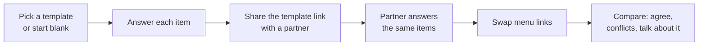
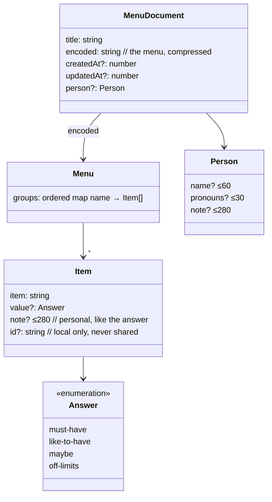
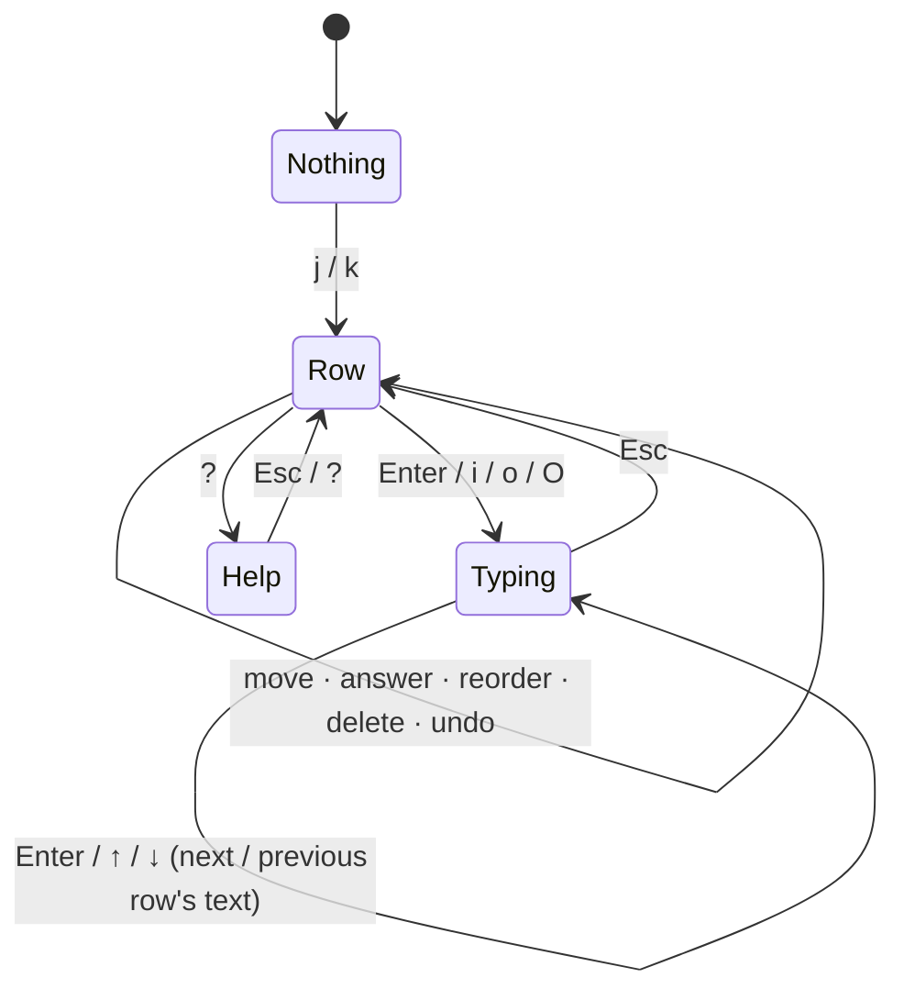
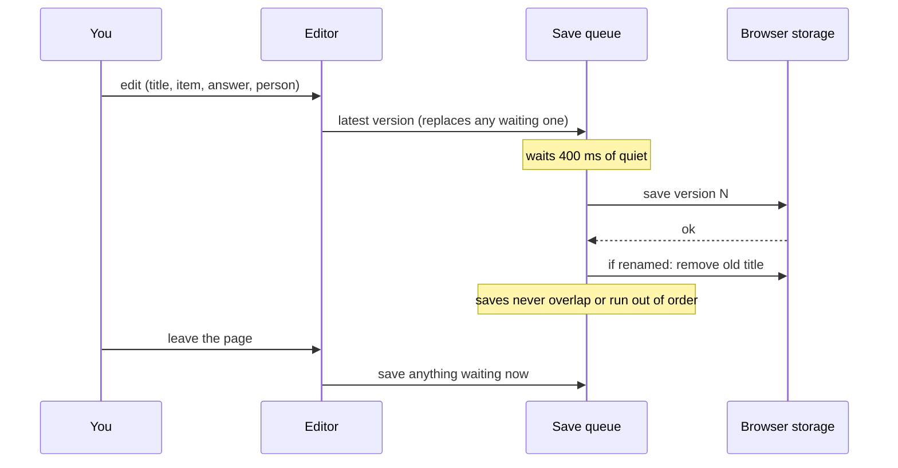
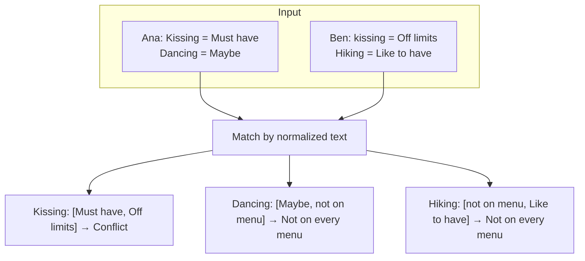
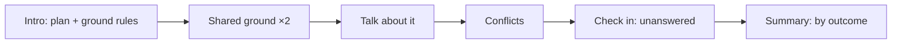
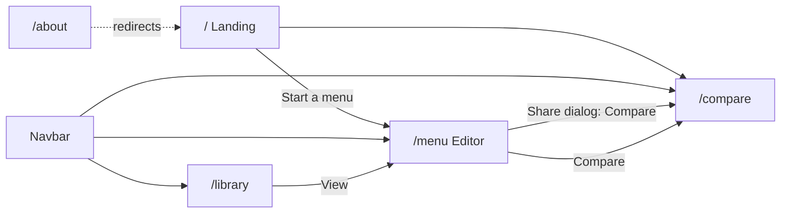
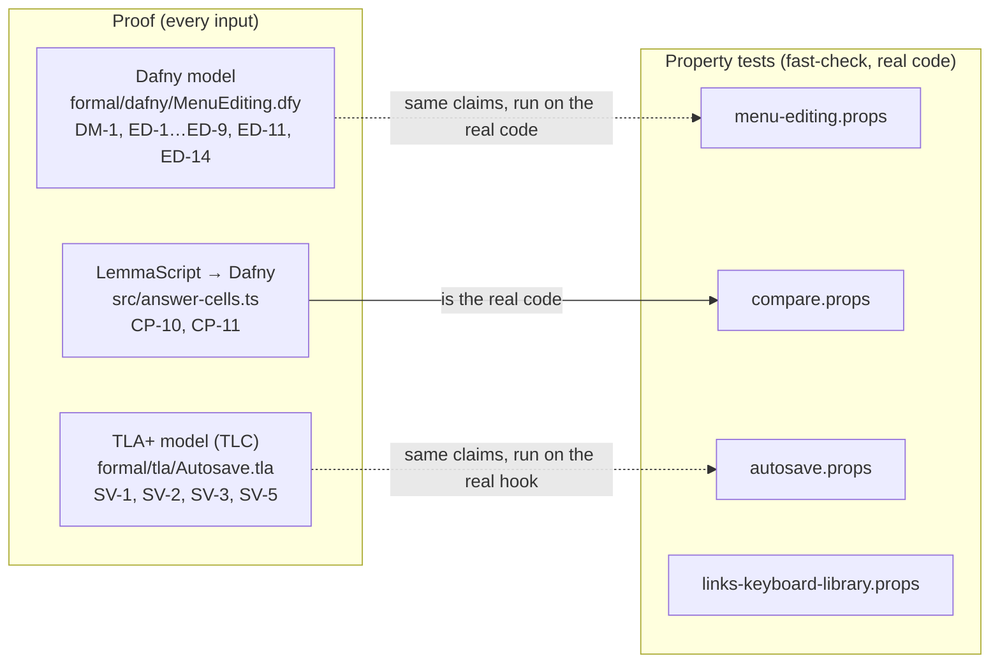

# Relationship Menu — Specification

This is the reference for how Relationship Menu behaves. It is written to be read top to bottom by a person, and every rule has a short ID (like `ED-2`) so that tests and formal proofs can point back to it.

- **Read this first:** [1. The idea in one page](#1-the-idea-in-one-page)
- **Looking for a rule?** Each section starts with a one-paragraph summary, then a table of rules.
- **How is it checked?** The last column of every table links to what checks the rule. [Section 11](#11-verification-map) lists every rule and how strongly it is checked, including the gaps.

| Check | Meaning |
| --- | --- |
| **Proof** | Proved for every input: either the TypeScript itself (LemmaScript → Dafny), or a model of it (Dafny, or TLA+ for timing) that a property test ties back to the real code. All of it runs in CI. |
| **Property** | A randomized property test (fast-check) runs the real TypeScript on hundreds of generated inputs in CI. |
| **Test** | Example-based unit or end-to-end tests. |
| **Review** | Checked by reading the code; no automated check yet. |

---

## 1. The idea in one page

A **relationship menu** lists things a relationship *could* include. Each person answers every **item** with one of four **answers**, privately. Then they **compare**.



There is no server and no account. A menu lives in the browser that made it, and a **link** carries a whole menu inside its address.

### Glossary

| Term | Meaning |
| --- | --- |
| Menu | A title plus an ordered list of **groups**, each an ordered list of **items**. |
| Group | A named section, like "Commitment". Names are unique within a menu. |
| Item | A short piece of text, like "Moving in together", plus an optional answer. |
| Answer | One of **Must have**, **Like to have**, **Maybe**, **Off limits**, or none yet. |
| Person | Optional name, pronouns and note saying whose menu it is. |
| Menu link | A web address containing a menu *with* answers and person info. |
| Template link | A web address containing a menu's items *without* answers or person info. |
| Slug | The data part of a link, without the web address. |
| Library | The menus saved in this browser. |

---

## 2. Data model

**In short:** a menu is an ordered map from group names to item lists. Everything else (links, the library, comparisons) is derived from it.



| ID | Rule | Checked by |
| --- | --- | --- |
| DM-1 | Group names in a menu are unique (exact text). Order of groups and of items is meaningful and kept everywhere. | ED-* rules below |
| DM-2 | An item's answer is one of the four answers or absent. Anything else read from outside (a link, storage) is treated as absent. | LK-3 |
| DM-3 | Item `id`s exist only inside the editor (for focus and undo). They are stripped before saving or sharing, and never used to match items between menus. | Review |
| DM-4 | Any text can be a group name or title, including `__proto__` or `constructor`; such names behave like any other. | ED-12 |
| DM-5 | The library holds at most one menu per title. | SV-6 |
| DM-6 | An item may have a short note ("only on weekends"). Notes are personal, like answers: they travel in menu links but never in template links, and they never affect matching. | LK-9, CP-14, PR-3 |

---

## 3. Editing a menu

**In short:** every change to a menu goes through one pure function, `applyMenuChange` (`src/menu-editing.ts`). It never changes its input, never loses data except when asked to delete, and returns the *same* menu when an edit does nothing (which is how undo knows nothing happened).

| ID | Rule | Checked by |
| --- | --- | --- |
| ED-1 | **Add group:** appended at the end. Ignored if the name is empty or already used. | [Proof](formal/dafny/MenuEditing.dfy) |
| ED-2 | **Rename group:** keeps its position and items. Ignored if another group already has the new name (a warning is shown instead). Renaming to empty text is allowed and keeps the group. | [Proof](formal/dafny/MenuEditing.dfy) |
| ED-3 | **Delete group:** only by the explicit delete action. Clearing a name never deletes. | [Proof](formal/dafny/MenuEditing.dfy) |
| ED-4 | **Add item:** appended to the group, with a fresh `id` unless it already has one. | [Proof](formal/dafny/MenuEditing.dfy) |
| ED-5 | **Change item:** only the given fields change. | [Proof](formal/dafny/MenuEditing.dfy) |
| ED-6 | **Delete item:** removes exactly that item. | [Proof](formal/dafny/MenuEditing.dfy) |
| ED-7 | **Move item / group:** swaps with its neighbour; at either end nothing happens. Moving never adds or removes anything. (Groups named only with digits can't be reordered; see KL-1.) | [Proof](formal/dafny/MenuEditing.dfy) |
| ED-8 | **Add a ready-made group:** creates the group, or, if it exists, appends only the items it doesn't already have (matched ignoring case and surrounding spaces; repeats within the added list count once). A blank group name is ignored. Existing items and answers are never touched. | [Proof](formal/dafny/MenuEditing.dfy) |
| ED-9 | **Start from a template:** replaces the whole menu (one undo step). | [Proof](formal/dafny/MenuEditing.dfy) |
| ED-10 | **Purity:** the input menu is never modified. An edit with no effect returns the identical menu object. | [Property](../../src/__props__/menu-editing.props.test.ts) |
| ED-11 | **No silent loss:** apart from delete and replace, every edit keeps every existing item's text and answer. | [Proof](formal/dafny/MenuEditing.dfy) |
| ED-12 | Names that collide with JavaScript object internals (`__proto__`, `constructor`) behave like ordinary names. | [Property](../../src/__props__/menu-editing.props.test.ts) |
| ED-14 | **Make into group:** turns an item into a new group named after its text (trimmed), placed right after its own group. The item (text, answer, note) becomes the new group's first entry, so nothing is lost; it's one undo step. Ignored if the text is blank or a group with that name exists (the button explains why). | [Proof](formal/dafny/MenuEditing.dfy), [Property](../../src/__props__/menu-editing.props.test.ts) |
| ED-15 | **Notes:** adding, changing or clearing a note changes only that item's note; an empty note is stored as no note. | Test |
| ED-13 | **Undo/redo:** undo restores the previous menu exactly; redo re-applies it. A run of typing in one text field is one undo step. At most 100 steps are kept. | Test |

### Editing the text

| ID | Rule | Checked by |
| --- | --- | --- |
| ED-20 | Typing into the "new group" or "new item" box turns that box into the new entry; focus stays where you are typing, however fast you type. | Test (unit + e2e) |
| ED-21 | A group name already used by another group shows "A group with this name already exists" and is not applied until it's unique. | Test |
| ED-22 | Choosing "---" in an answer picker clears the answer. | Test |

---

## 4. Keyboard

**In short:** the editor has two modes. In **row mode** a whole row is highlighted and single keys are commands. In **typing mode** keys type text, except Esc, Enter and ↑/↓.



| ID | Rule | Checked by |
| --- | --- | --- |
| KB-1 | In typing mode, letters, digits and `?` type text; only Esc, Enter, ↑ and ↓ are intercepted. | [Property](../../src/__props__/links-keyboard-library.props.test.ts) |
| KB-2 | Keys with Alt are never intercepted; Ctrl/⌘ only for Z and Y (so Ctrl+R still reloads). | [Property](../../src/__props__/links-keyboard-library.props.test.ts) |
| KB-3 | `gg` and `dd` need both keys within 800 ms; any other key in between cancels the sequence. | [Property](../../src/__props__/links-keyboard-library.props.test.ts) |
| KB-4 | The help overlay lists exactly the bindings the editor uses (it is generated from the same table). | Review (single source) |
| KB-5 | Arrow keys and vim keys do the same thing: ↓/j, ↑/k, ←/h, →/l. `n` opens an item's note, `m` makes it into a group. | [Property](../../src/__props__/links-keyboard-library.props.test.ts) |
| KB-6 | After a move, delete or undo, the highlight lands on a row that still exists. | Test |
| KB-7 | Dialogs keep keyboard focus inside them, close on Esc and give focus back. | Test |

---

## 5. Saving and the library

**In short:** the editor saves automatically, shortly after you stop typing, one save at a time. A menu is stored under its title; renaming moves it. Nothing ever overwrites a *different* menu.



| ID | Rule | Checked by |
| --- | --- | --- |
| SV-1 | Any change (title, groups, items, answers, person) is saved within about 400 ms of the last edit, and again immediately when you leave the page. | [Proof](formal/tla/Autosave.tla) |
| SV-2 | Saves run one at a time, in order. The version that ends up stored is always the latest one you made. | [Proof](formal/tla/Autosave.tla) |
| SV-3 | Undoing back to the saved version before the wait ends saves nothing (the intermediate version is never stored). | [Proof](formal/tla/Autosave.tla) |
| SV-4 | An empty, untitled menu is not saved. | Test |
| SV-5 | **Rename:** the menu is saved under the new title first; the old title is removed only after that save succeeded. A failed save leaves the old entry in place and shows "Couldn't save". | [Proof](formal/tla/Autosave.tla) |
| SV-6 | Storage keeps one entry per title. When older duplicates exist, the most recently saved wins. | [Property](../../src/__props__/links-keyboard-library.props.test.ts) |
| SV-7 | A menu is never saved under a title that belongs to a different saved menu; the editor says "Another menu already has this title" until it's renamed. | Test |
| SV-8 | `createdAt` is set on the first save and never changes; `updatedAt` is set on every save. | Test |
| SV-9 | Menus saved by older versions (raw `menu:<title>` entries, and IPFS-era `menu:<CID>` / `menu:pending:<title>` copies) are listed like any other; the next save of that menu tidies the old copies away. Menus the IPFS version kept only in its IndexedDB block store (saved July 2024 – March 2026, with just a date in browser storage) are read back from that store before the Library first loads, and are never shown as unreadable entries; the old store itself is left untouched ([SY-91, SY-92](sync.md#11-moving-off-ipfs)). | Test (unit + e2e) |
| SV-10 | Saving writes to browser storage synchronously, so leaving or closing the page right after a save can't lose it. | Test |
| LB-1 | The library shows each menu's title (or "Untitled menu"), person, item and group counts, answered progress, and edited/created dates when known. | Test |
| LB-2 | Search matches title, person or item text, ignoring case. Sort by recently edited, newest, or title. Menus without dates sort last. | [Property](../../src/__props__/links-keyboard-library.props.test.ts) |
| LB-3 | Deleting from the library asks for confirmation. | Test |

---

## 6. Links

**In short:** a link is `…/menu?encoded=<slug>`. A slug is two or three compressed JSON parts separated by `:`. Reading a link never trusts its contents and never overwrites anything you already have.

```
slug        = title ":" menu [ ":" person ]
each part   = base64( zlib-deflate( UTF-8 JSON ) )     base64 never contains ":"
menu        = { "Group": [ { "item": "text", "value"?: answer } ] }
person      = { "name"?, "pronouns"?, "note"? }
```

| ID | Rule | Checked by |
| --- | --- | --- |
| LK-1 | Encoding then decoding gives back the same title, menu and person (after LK-3 cleaning). | [Property](../../src/__props__/links-keyboard-library.props.test.ts) |
| LK-2 | A slug without the person part (older links, templates) still opens. | [Property](../../src/__props__/links-keyboard-library.props.test.ts) |
| LK-3 | **Untrusted input:** decoding never throws. Items without text are dropped, unknown answers become "no answer", person fields are trimmed and capped (60 / 30 / 280 characters), and anything malformed gives "not a valid link". | [Property](../../src/__props__/links-keyboard-library.props.test.ts) |
| LK-4 | Accepted input: a bare slug, a full link, a compare link holding several menus (each becomes its own entry), a slug whose `+` became a space, and links with `#fragment`s. | [Property](../../src/__props__/links-keyboard-library.props.test.ts) |
| LK-5 | A template link contains no answers and no person part. | [Property](../../src/__props__/links-keyboard-library.props.test.ts) |
| LK-6 | Opening a link whose title matches a *different* saved menu opens it as a copy named "Title (2)", "Title (3)" … with a notice. Opening your own unchanged menu's link opens that menu. | Test (e2e) |
| LK-7 | A link that can't be read shows a notice instead of an empty editor. | Test |
| LK-9 | Item notes survive encoding and decoding. Read from a link, they're trimmed, capped at 280 characters, and dropped if blank or not text. | [Property](../../src/__props__/links-keyboard-library.props.test.ts) |
| LK-8 | The editor keeps the address bar in sync by *replacing* the history entry, so Back always leaves the editor. | Test (e2e) |

---

## 7. Comparing menus

**In short:** items are matched across menus by their text, ignoring case and extra spaces. Each item gets one value per menu: an answer, *no answer*, or *not on this menu*. Filters then pick out agreements, conflicts and so on.



| ID | Rule | Checked by |
| --- | --- | --- |
| CP-1 | Two items match when their text is equal after trimming, collapsing spaces and lowercasing. Groups match the same way. | [Property](../../src/__props__/compare.props.test.ts) |
| CP-2 | Each compared item has exactly one value per menu, in menu order: the answer, `undefined` (on the menu, no answer), or `null` (not on that menu). | [Property](../../src/__props__/compare.props.test.ts) |
| CP-3 | Display text and order come from the first menu that has the group/item. | [Property](../../src/__props__/compare.props.test.ts) |
| CP-4 | Blank items are ignored. If one menu lists the same item twice, its first answer counts. | [Property](../../src/__props__/compare.props.test.ts) |
| CP-5 | Every item from every menu appears in the comparison exactly once. | [Property](../../src/__props__/compare.props.test.ts) |

### Filters

| Filter | An item matches when… |
| --- | --- |
| All | always |
| Agree | everyone answered, all the same |
| All want | everyone answered Must have or Like to have |
| Conflicts | someone wants it (Must/Like) and someone marked it Off limits |
| Talk about it | everyone answered, answers differ, and it's not a conflict |
| Unanswered | someone has it but didn't answer |
| Not on every menu | some menu doesn't include it |

| ID | Rule | Checked by |
| --- | --- | --- |
| CP-10 | When everyone answered an item, it is in **exactly one** of Agree, Talk about it, Conflicts. | [Proof](../../src/answer-cells.ts), [Property](../../src/__props__/compare.props.test.ts) |
| CP-11 | All want implies everyone answered; Agree and Conflicts never overlap. | [Proof](../../src/answer-cells.ts), [Property](../../src/__props__/compare.props.test.ts) |
| CP-12 | A filter shows exactly the matching items, keeps their order, and hides groups left empty. The count on each filter equals what it shows. | [Property](../../src/__props__/compare.props.test.ts) |
| CP-14 | Each person's note on an item is shown under it, labelled with their name. Notes never change matching, answers, filters or counts; if a menu has the item twice, its first note counts. | [Property](../../src/__props__/compare.props.test.ts), Test |
| CP-13 | The comparison appears after pressing Compare; a shared compare link with two or more valid menus opens straight to it. Columns are labelled with the person's name when known, else the menu title. | Test (e2e) |

### At a glance

An overview above the items (`src/compare-insights.ts`, `CompareOverview`):
- the headline: the share of items everyone answered that they agree on, how many conflicts there are, and how many items aren't answered by everyone;
- tiles for shared wants, agree, talk about it and conflicts, which also apply that filter;
- alignment per group;
- the biggest differences;
- each person's must-haves, off-limits and open items;
- a way into the guided discussion.

| ID | Rule | Checked by |
| --- | --- | --- |
| CP-20 | The overview's counts are the filters' counts; group totals and each person's answers add up to the number of items. | [Property](../../src/__props__/insights-discussion.props.test.ts), Test |
| CP-21 | Alignment is the agreed share of items everyone answered (0–100%), shown per group too; with nothing fully answered it says so instead of showing a number. | [Property](../../src/__props__/insights-discussion.props.test.ts), Test |
| CP-22 | "Biggest differences first" orders items by how far apart the answers are (Must have … Off limits), conflicts above everything, ties in menu order; items with fewer than two answers go last. Nothing is added or dropped. | [Property](../../src/__props__/insights-discussion.props.test.ts), Test |
| CP-23 | The overview lists at most five biggest differences, and only real ones (answers not all the same). | [Property](../../src/__props__/insights-discussion.props.test.ts), Test |
| CP-24 | Search matches item text, group names and notes (ignoring case); it combines with the filter and a group choice, and "Show everything" clears all three. | Test (unit + e2e) |
| CP-25 | Sorting by difference shows one list, with each item's group as a caption. | Test (unit + e2e) |

---

## 7b. Talking it through

**In short:** from the comparison, "Talk it through" (`/discuss`, same link format) turns the differences into a guided conversation. It starts with ground rules, then goes through one topic at a time: everyone's answers, a few prompts, a place for notes, an outcome and a next step. At the end there's a summary to keep. Notes stay in this browser.



| ID | Rule | Checked by |
| --- | --- | --- |
| DS-1 | The intro shows who's talking, how many topics of each kind, a rough time, and the ground rules. Nothing is decided by the app. | Test |
| DS-2 | The agenda has every conflict, difference and not-fully-answered item exactly once, in this order: up to two shared wants (Must have first), differences, conflicts (largest gap first within each, ties in menu order), then check-ins. Agreed items that aren't shared wants are left out. | [Property](../../src/__props__/insights-discussion.props.test.ts), Test |
| DS-3 | Each topic has prompts suited to its kind, chosen the same way every time. | [Property](../../src/__props__/insights-discussion.props.test.ts), Test |
| DS-4 | Each topic shows everyone's answers and notes from their menus, with a notes field, one of five outcomes (Agreed, Compromise, Revisit later, Agree to disagree, Boundary) and an optional next step. Topics can be skipped, revisited from the progress dots, and finished in any order. | Test (unit + e2e) |
| DS-5 | Notes are saved in this browser as they're typed, under a key made from the people's names and menu titles (so they survive changed answers). They never leave the browser and never reach analytics. | Test (unit + e2e) |
| DS-6 | Coming back offers "Continue", which goes to the first topic not yet covered. | Test (unit + e2e) |
| DS-7 | The summary groups covered topics by outcome, with answers, notes and next steps. It can be copied or downloaded as Markdown, or printed. | Test (unit + e2e) |
| DS-8 | "Prepare with AI" isn't built: it says so and records interest only. Nothing about the menus is sent. | Test |

---

## 8. Pages and navigation



| ID | Rule | Checked by |
| --- | --- | --- |
| NV-1 | Every page works when opened directly by its address (the host falls back to the app for unknown paths). | Production check |
| NV-2 | Opening `/menu` from a link, the navbar or Back/Forward starts a fresh editor for that address. | Test |
| NV-3 | An empty editor offers the six templates and a blank menu. | Test (e2e) |
| NV-4 | **Support page** (`/support`): everything in the app stays free; supporting is optional and never gates a feature. It's linked from the navbar, quietly after a link is shared, under comparison results, and on the landing page. Until checkout exists, choosing an amount says plainly that nothing was charged. | Test (unit + e2e) |

---

## 9. Privacy

| ID | Rule | Checked by |
| --- | --- | --- |
| PR-1 | No menu content leaves the browser except inside links the user copies. There is no server-side storage. | Review |
| PR-2 | Analytics receive the page path (never the `?encoded=` query) and a fixed set of usage events ([`src/analytics.ts`](../../src/analytics.ts), listed in [`docs/analytics.md`](../analytics.md)). Event parameters are only template ids, link kinds, filter ids, counts and true/false: never titles, item or group text, notes, names, search queries or link contents. The types enforce this, and an e2e test drives the app with marker text and checks that none of it reaches analytics. | Test (e2e) + types |
| PR-3 | The menu link includes answers, notes and person info and says so in the share dialog; the template link includes none of them. | [Property](../../src/__props__/links-keyboard-library.props.test.ts), Test |

---

## 10. Accessibility and presentation

| ID | Rule | Checked by |
| --- | --- | --- |
| AX-1 | Everything can be done with the keyboard alone. | Test (e2e) |
| AX-2 | Each page has one `<h1>`; inputs, pickers and icon buttons have names. | Test |
| AX-3 | Text and focus indicators meet WCAG AA contrast (answer colors keep their meaning: blue, green, yellow, red). | Review |
| AX-4 | No page scrolls sideways at any width from 320 px (small phone) up, including tablets in both orientations. | Test (e2e) |
| AX-5 | Animations stop when the system asks for reduced motion. | Review |
| AX-6 | On phones (≤ 520 px), each item's text gets the full row width, with its answer picker and buttons underneath at least 44 px tall. Long item text wraps onto more lines instead of being cut off, at any width. Navigation links and the share dialog's "Advanced" toggle are also 44 px tall. | Test (e2e) for the editor rows; Review for the rest |

---

## 11. Verification map

**In short:** the rules where a mistake would lose or misreport someone's answers have proofs: editing, comparing and saving. The link format and keyboard bindings have property tests. Things you can only see in a browser have example tests. Everything runs in CI.



### How each area is checked

| Area | Rules | Strongest check | Where |
| --- | --- | --- | --- |
| Data model | DM-1…DM-5 | Proof (DM-1), Property (DM-2, DM-4, DM-5) | via ED/LK/SV rules |
| Editing | ED-1…ED-9, ED-11, ED-14 | **Proof** + Property | [`MenuEditing.dfy`](formal/dafny/MenuEditing.dfy), [`menu-editing.props`](../../src/__props__/menu-editing.props.test.ts) |
| Editing | ED-10, ED-12 | Property | same props file |
| Editing | ED-13, ED-15, ED-20…ED-22 | Test | `Menu.test.tsx`, e2e |
| Keyboard | KB-1, KB-2, KB-3, KB-5 | Property | [`links-keyboard-library.props`](../../src/__props__/links-keyboard-library.props.test.ts) |
| Keyboard | KB-4 | Review (one table drives both) | `keyboard.ts` |
| Keyboard | KB-6, KB-7 | Test | `Menu.test.tsx`, `ShareDialog.test.tsx`, e2e |
| Saving | SV-1, SV-2, SV-3, SV-5 | **Proof** (TLC, all interleavings up to the bounds) + Property | [`Autosave.tla`](formal/tla/Autosave.tla), [`autosave.props`](../../src/__props__/autosave.props.test.ts) |
| Saving | SV-6 | Property | links-keyboard-library props |
| Saving | SV-4, SV-7, SV-8, SV-9, SV-10 | Test | `storage.test.ts`, `ipfs-recovery.test.ts`, `App.test.tsx`, e2e (`ipfs-recovery.spec.ts`) |
| Library | LB-2 | Property | links-keyboard-library props |
| Library | LB-1, LB-3 | Test | `Library.test.tsx`, e2e |
| Links | LK-1…LK-5, LK-9 | Property (incl. arbitrary junk input) | links-keyboard-library props |
| Links | LK-6…LK-8 | Test (e2e) | `e2e/` |
| Comparing | CP-10, CP-11 | **Proof** of the code itself + Property | [`answer-cells.ts`](../../src/answer-cells.ts), [`compare.props`](../../src/__props__/compare.props.test.ts) |
| Comparing | CP-1…CP-5, CP-12, CP-14 | Property (against a naive reference) | compare props |
| Comparing | CP-20…CP-25 | Property + Test | [`insights-discussion.props`](../../src/__props__/insights-discussion.props.test.ts), `Compare.test.tsx`, `e2e/discuss.spec.ts` |
| Discussing | DS-1…DS-8 | Property (DS-2, DS-3) + Test | `discussion.test.ts`, `Discuss.test.tsx`, `e2e/discuss.spec.ts` |
| Comparing | CP-13 | Test (e2e) | `e2e/` |
| Pages, privacy, accessibility | NV, PR, AX | Test / Review | see each table |

### Bugs these checks found (all fixed)

| Found by | Bug | Fix |
| --- | --- | --- |
| Review (sync plan, Nov 2026) | After IPFS was removed, menus that the IPFS version had kept only in IndexedDB (browser storage held just a date under `menu:<CID>`) showed up in the Library as unreadable entries titled with a CID; their content was no longer read. | Read them back from the old block store with plain IndexedDB, checking each block's hash, and hide pointers that can't be resolved (SV-9, SY-91). |
| e2e (analytics test) | An edit saved while the IPFS node was busy was lost if the page was closed or left during the save: the browser-storage copy was only written after the IPFS write finished. | Write the browser-storage copy first; later IPFS was removed altogether, so saves are now synchronous (SV-10). |
| Property CP-1 | A group named `__proto__` vanished from Compare, from opened links and from the library's in-memory list. | Prototype-free objects in `data-comparer.ts`, `compare-slug.ts`, `providers/Storage.tsx`. |
| Property LK-4 | A pasted link whose slug ended in `+` didn't open (the `+` arrived as a space and was trimmed off). | Restore `+` before trimming (`compare-slug.ts`). |
| Property LB-2 | Library search matched the stored JSON, so "item", "value" or "must" matched every menu. | Search only group and item text (`library-info.ts`). |
| Property ED-12 | Editing an item in a missing group named `constructor` crashed. | Own-property check (`menu-editing.ts`). |
| Property ED-10 | Edits that changed nothing still created an undo step (same values, nothing to add, a group move that can't happen). | Return the same menu (`menu-editing.ts`). |
| Property ED-8 | "Add ready-made group" added repeats from its own list and accepted a blank group name. | Skip repeats, ignore blank names; Dafny model updated and re-proved. |
| TLC (SV-1) | If removing the old title failed during a rename, autosave believed an older version was stored. Undoing back to it showed "Saved" but didn't save. | Forget the last-saved version after any failed save (`autosave.ts`). |
| TLC (status) | "Saved" could show while a newer edit was still waiting. | Only show "Saved" when nothing is pending. |

### Known limitations

| ID | Limitation | Why it stays |
| --- | --- | --- |
| KL-1 | Groups whose name is only digits (`"2024"`, `"0"`) are always listed first and can't be moved. JavaScript objects order integer-like keys first. | Needs groups stored as an ordered list, which changes the link format. See [architecture notes](architecture.md). The checks exclude these names from ordering claims and verify that such a move is a no-op. |

### Gaps: what isn't formally covered, and what would be next

- **App-level storage logic** (copy-on-conflict naming LK-6, title conflicts SV-7, legacy entries SV-9) lives inside `App.tsx` and `providers/Storage.tsx`, so it only has example tests. Next step: move it into a pure module and give it a property test or Dafny model like the editing core.
- **Browser storage itself** isn't modelled: the TLA+ model treats a save as one atomic write plus an optional delete, which matches `localStorage`.
- **Real time** isn't modelled. TLC checks the order of events, not the 400 ms timer. The property tests use fake timers.
- **The Dafny editing model is a hand-written mirror** of `menu-editing.ts`. The property tests check the same claims on the real code, which catches drift, but they don't prove it. `answer-cells.ts` is verified directly with LemmaScript. Moving more of `menu-editing.ts` to LemmaScript is possible once LemmaScript handles object-keyed maps.
- **UI behaviour** (focus, dialogs, layout, contrast) is checked by tests and review only. That's the right tool for it.

### Tools

| Tool | Used for | Why |
| --- | --- | --- |
| [LemmaScript](https://github.com/midspiral/LemmaScript) | Verifies TypeScript functions directly (via Dafny) | The proof is about the code that ships, not a copy. Works for pure functions over arrays and unions. |
| [Dafny](https://dafny.org) 4.11 | Model of every menu edit | Close to TypeScript, strong automation, so no manual proof scripts were needed. |
| [TLA+ / TLC](https://lamport.azurewebsites.net/tla/tla.html) | The autosave queue, rename and page-leave | Explores every interleaving of edits, timers and slow saves. |
| [fast-check](https://fast-check.dev) | Property tests on the real code | Ties each model to the code, and covers JS-only details (prototypes, key order, object identity). |

Run everything locally: `yarn test --watchAll=false` (includes the property tests), `yarn verify` (Dafny on your PATH), and TLC as in [`formal/tla/README.md`](formal/tla/README.md).

---

## 12. Architecture notes

**In short:** React stays (it was about 3% of the download). The app moved from Create React App to Vite + Vitest and dropped the in-browser IPFS node (about 70% of the download), which also removed every known vulnerable dependency. Details and measurements are in [`architecture.md`](architecture.md).
