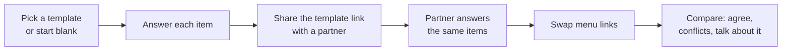
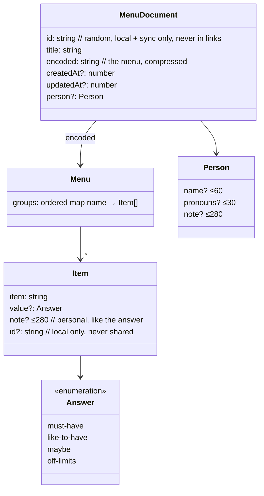
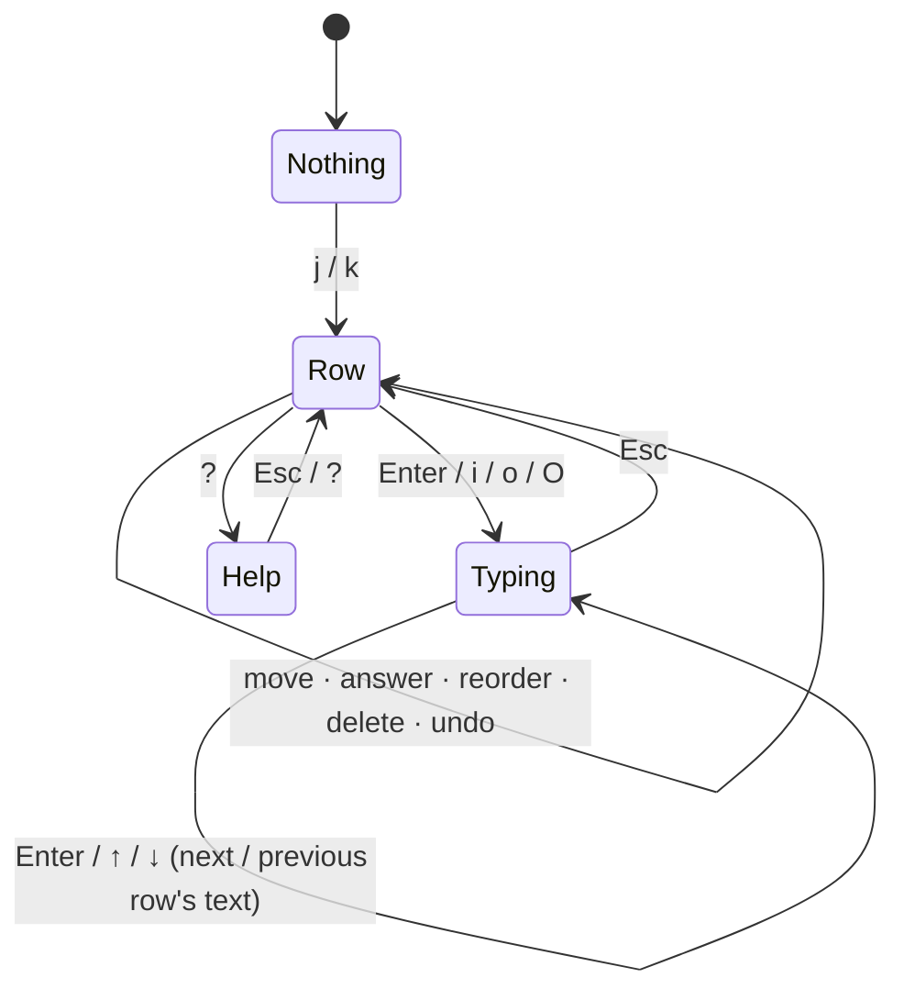
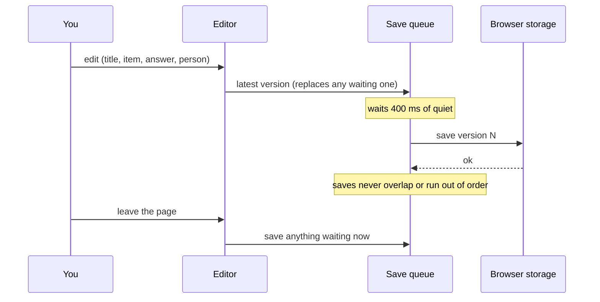
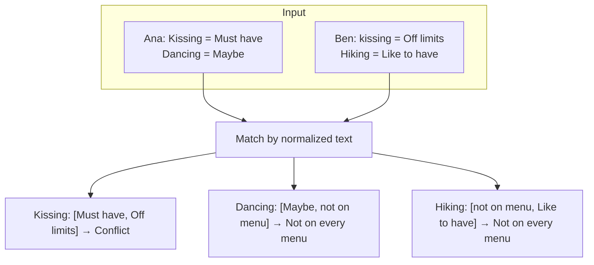
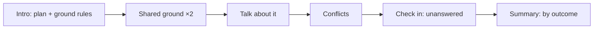
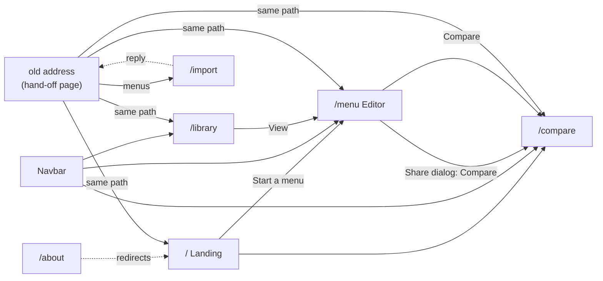
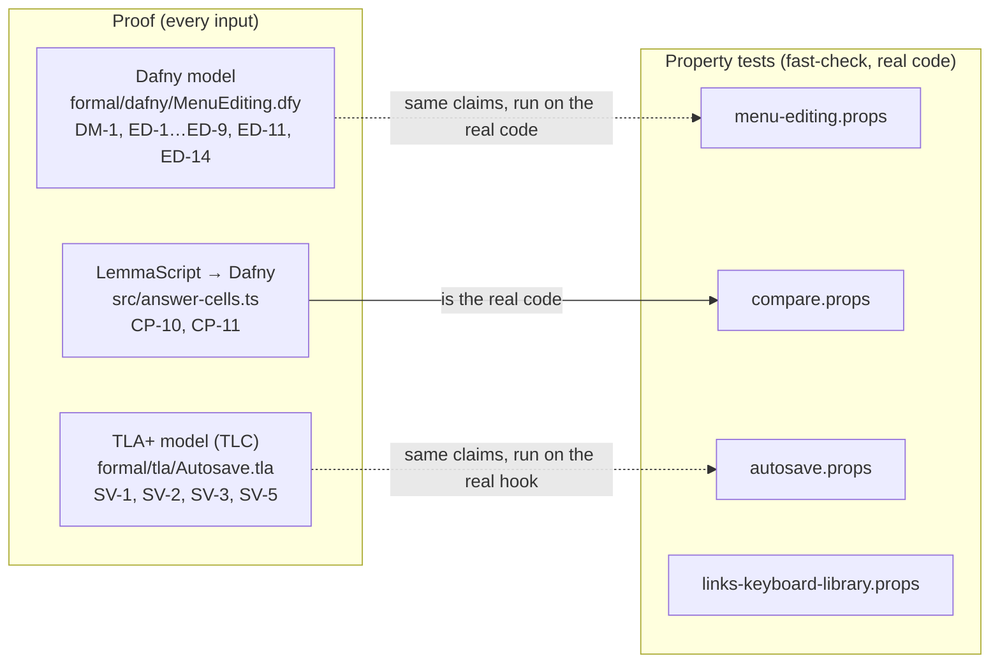

# Wants & Won'ts — Specification

This is the reference for how Wants & Won'ts (formerly Relationship Menu) behaves. It is written to be read top to bottom by a person, and every rule has a short ID (like `ED-2`) so that tests and formal proofs can point back to it.

- **Read this first:** [1. The idea in one page](#1-the-idea-in-one-page)
- **Looking for a rule?** Each section starts with a one-paragraph summary, then a table of rules.
- **How is it checked?** The last column of every table links to what checks the rule. [Section 11](#11-verification-map) lists every rule and how strongly it is checked, including the gaps.

| Check | Meaning |
| --- | --- |
| **Proof** | Proved for every input: either the TypeScript itself (LemmaScript → Dafny), or a model of it (Dafny, or TLA+ for timing) that a property test ties back to the real code. All of it runs in CI. |
| **Property** | A randomized property test (fast-check) runs the real TypeScript on hundreds of generated inputs in CI. |
| **Test** | Example-based unit or end-to-end tests. |
| **Review** | Checked by reading the code; no automated check yet. |

---

## 1. The idea in one page

A **relationship menu** lists things a relationship *could* include. Each person answers every **item** with one of four **answers**, privately. Then they **compare**.



There is no server and no account. A menu lives in the browser that made it, and a **link** carries a whole menu inside its address.

### Glossary

| Term | Meaning |
| --- | --- |
| Menu | A title plus an ordered list of **groups**, each an ordered list of **items**. |
| Group | A named section, like "Commitment". Names are unique within a menu. |
| Item | A short piece of text, like "Moving in together", plus an optional answer. |
| Answer | One of **Must have**, **Like to have**, **Maybe**, **Off limits**, or none yet. |
| Person | Optional name, pronouns and note saying whose menu it is. |
| Menu link | A web address containing a menu *with* answers and person info. |
| Template link | A web address containing a menu's items *without* answers or person info. |
| Slug | The data part of a link, without the web address. |
| Library | The menus saved in this browser. |

---

## 2. Data model

**In short:** a menu is an ordered map from group names to item lists. Everything else (links, the library, comparisons) is derived from it.



| ID | Rule | Checked by |
| --- | --- | --- |
| DM-1 | Group names in a menu are unique (exact text). Order of groups and of items is meaningful and kept everywhere. | ED-* rules below |
| DM-2 | An item's answer is one of the five answers (Must have, Like to have, Maybe, Soft no, Off limits) or absent. Anything else read from outside (a link, storage) is treated as absent. | LK-3 |
| DM-3 | Item `id`s exist only inside the editor (for focus and undo). They are stripped before saving or sharing, and never used to match items between menus. Menu ids (DM-5) likewise never appear in links. | Review, [Property](../../src/__props__/links-keyboard-library.props.test.ts) |
| DM-4 | Any text can be a group name or title, including `__proto__` or `constructor`; such names behave like any other. | ED-12 |
| DM-5 | Every saved menu has a random 128-bit id ([SY-20](sync.md#5-menu-ids-and-stored-data)). Saving never overwrites a different menu, whatever its title. Titles stay unique when you name a menu (SV-7). | SV-6, SV-7 |
| DM-6 | An item may have a short note ("only on weekends"). Notes are personal, like answers: they travel in menu links but never in template links, and they never affect matching. | LK-9, CP-14, PR-3 |

---

## 3. Editing a menu

**In short:** every change to a menu goes through one pure function, `applyMenuChange` (`src/menu-editing.ts`). It never changes its input, never loses data except when asked to delete, and returns the *same* menu when an edit does nothing (which is how undo knows nothing happened).

| ID | Rule | Checked by |
| --- | --- | --- |
| ED-1 | **Add group:** appended at the end. Ignored if the name is empty or already used. | [Proof](formal/dafny/MenuEditing.dfy) |
| ED-2 | **Rename group:** keeps its position and items. Ignored if another group already has the new name (a warning is shown instead). Renaming to empty text is allowed and keeps the group. | [Proof](formal/dafny/MenuEditing.dfy) |
| ED-3 | **Delete group:** only by the explicit delete action. Clearing a name never deletes. | [Proof](formal/dafny/MenuEditing.dfy) |
| ED-4 | **Add item:** appended to the group, with a fresh `id` unless it already has one. | [Proof](formal/dafny/MenuEditing.dfy) |
| ED-5 | **Change item:** only the given fields change. | [Proof](formal/dafny/MenuEditing.dfy) |
| ED-6 | **Delete item:** removes exactly that item. | [Proof](formal/dafny/MenuEditing.dfy) |
| ED-7 | **Move item / group:** swaps with its neighbour; at either end nothing happens. Moving never adds or removes anything. (Groups named only with digits can't be reordered; see KL-1.) | [Proof](formal/dafny/MenuEditing.dfy) |
| ED-8 | **Add a ready-made group:** creates the group, or, if it exists, appends only the items it doesn't already have (matched ignoring case and surrounding spaces; repeats within the added list count once). A blank group name is ignored. Existing items and answers are never touched. | [Proof](formal/dafny/MenuEditing.dfy) |
| ED-9 | **Start from a template:** replaces the whole menu (one undo step). | [Proof](formal/dafny/MenuEditing.dfy) |
| ED-10 | **Purity:** the input menu is never modified. An edit with no effect returns the identical menu object. | [Property](../../src/__props__/menu-editing.props.test.ts) |
| ED-11 | **No silent loss:** apart from delete and replace, every edit keeps every existing item's text and answer. | [Proof](formal/dafny/MenuEditing.dfy) |
| ED-12 | Names that collide with JavaScript object internals (`__proto__`, `constructor`) behave like ordinary names. | [Property](../../src/__props__/menu-editing.props.test.ts) |
| ED-14 | **Make into group:** turns an item into a new group named after its text (trimmed), placed right after its own group. The item (text, answer, note) becomes the new group's first entry, so nothing is lost; it's one undo step. Ignored if the text is blank or a group with that name exists (the button explains why). | [Proof](formal/dafny/MenuEditing.dfy), [Property](../../src/__props__/menu-editing.props.test.ts) |
| ED-15 | **Notes:** adding, changing or clearing a note changes only that item's note; an empty note is stored as no note. | Test |
| ED-13 | **Undo/redo:** undo restores the previous menu exactly; redo re-applies it. A run of typing in one text field is one undo step. At most 100 steps are kept. | Test |

### Editing the text

| ID | Rule | Checked by |
| --- | --- | --- |
| ED-20 | Typing into the "new group" or "new item" box turns that box into the new entry; focus stays where you are typing, however fast you type. | Test (unit + e2e) |
| ED-21 | A group name already used by another group shows "A group with this name already exists" and is not applied until it's unique. | Test |
| ED-22 | Choosing "---" in an answer picker clears the answer. | Test |
| ED-23 | **Reorder mode:** "↕ Reorder" shows ▲▼ on every item and group, in place of their other buttons and the empty "new" rows. They make exactly the moves of ED-7 (one undo step each; Shift+J / Shift+K do the same from the keyboard). At either end a button is shown disabled. After a move, focus stays on the same button of the moved row, or the other one at an end, so it can be pressed again. Works with touch on a 320px phone. | Test (unit + e2e) |

---

## 4. Keyboard

**In short:** the editor has two modes. In **row mode** a whole row is highlighted and single keys are commands. In **typing mode** keys type text, except Esc, Enter and ↑/↓.



| ID | Rule | Checked by |
| --- | --- | --- |
| KB-1 | In typing mode, letters, digits and `?` type text; only Esc, Enter, ↑ and ↓ are intercepted. | [Property](../../src/__props__/links-keyboard-library.props.test.ts) |
| KB-2 | Keys with Alt are never intercepted; Ctrl/⌘ only for Z and Y (so Ctrl+R still reloads). | [Property](../../src/__props__/links-keyboard-library.props.test.ts) |
| KB-3 | `gg` and `dd` need both keys within 800 ms; any other key in between cancels the sequence. | [Property](../../src/__props__/links-keyboard-library.props.test.ts) |
| KB-4 | The help overlay lists exactly the bindings the editor uses (it is generated from the same table). | Review (single source) |
| KB-5 | Arrow keys and vim keys do the same thing: ↓/j, ↑/k, ←/h, →/l. `n` opens an item's note, `m` makes it into a group. | [Property](../../src/__props__/links-keyboard-library.props.test.ts) |
| KB-6 | After a move, delete or undo, the highlight lands on a row that still exists. | Test |
| KB-7 | Dialogs keep keyboard focus inside them, close on Esc and give focus back. | Test |

---

## 5. Saving and the library

**In short:** the editor saves automatically, shortly after you stop typing, one save at a time. A menu is stored under a random id, so renaming it is just another save. Nothing ever overwrites a *different* menu.



| ID | Rule | Checked by |
| --- | --- | --- |
| SV-1 | Any change (title, groups, items, answers, person) is saved within about 400 ms of the last edit, and again immediately when you leave the page. | [Proof](formal/tla/Autosave.tla) |
| SV-2 | Saves run one at a time, in order. The version that ends up stored is always the latest one you made. | [Proof](formal/tla/Autosave.tla) |
| SV-3 | Undoing back to the saved version before the wait ends saves nothing (the intermediate version is never stored). | [Proof](formal/tla/Autosave.tla) |
| SV-4 | An empty, untitled menu is not saved. | Test |
| SV-5 | **Rename:** a menu keeps its id when renamed, so a rename is an ordinary save of its one entry and nothing is removed ([SY-21](sync.md#5-menu-ids-and-stored-data)). A failed save leaves the stored entry as it was and shows "Couldn't save". | [Proof](formal/tla/Autosave.tla) |
| SV-6 | Storage keeps one entry per menu id. Menus saved before ids existed are read one per title (when older duplicates exist, the most recently saved wins) and get an id the first time this version loads them; the id-keyed entry is written before the old ones are removed, so stopping at any point loses nothing ([SY-90](sync.md#11-moving-off-ipfs)). | [Property](../../src/__props__/menu-store.props.test.ts), [Property](../../src/__props__/links-keyboard-library.props.test.ts) |
| SV-7 | A menu is never saved under a title that belongs to a different saved menu; the editor says "Another menu already has this title" until it's renamed. | Test |
| SV-8 | `createdAt` is set on the first save and never changes; `updatedAt` is set on every save. | Test |
| SV-9 | Menus saved by older versions (raw `menu:<title>` entries, and IPFS-era `menu:<CID>` / `menu:pending:<title>` copies) are listed like any other; the next save of that menu tidies the old copies away. Menus the IPFS version kept only in its IndexedDB block store (saved July 2024 – March 2026, with just a date in browser storage) are read back from that store before the Library first loads, and are never shown as unreadable entries; the old store itself is left untouched ([SY-91, SY-92](sync.md#11-moving-off-ipfs)). | Test (unit + e2e) |
| SV-10 | Saving writes to browser storage synchronously, so leaving or closing the page right after a save can't lose it. | Test |
| LB-1 | The library shows each menu's title (or "Untitled menu"), person, item and group counts, answered progress, and edited/created dates when known. | Test |
| LB-2 | Search matches title, person or item text, ignoring case. Sort by recently edited, newest, or title. Menus without dates sort last. | [Property](../../src/__props__/links-keyboard-library.props.test.ts) |
| LB-3 | Deleting from the library asks for confirmation. | Test |
| SV-11 | **Keeping storage:** after the first successful save in a browser, the app asks the browser to keep this site's storage (`navigator.storage.persist()`), once per browser. The request never blocks, delays or fails a save, and whatever the browser answers changes nothing else. | Test |
| SV-12 | **Home Screen tip:** Safari on iPhone and iPad may delete a site's storage after a week of use without opening that site; Home Screen apps are exempt but keep storage of their own. So in Safari on iPhone and iPad (not other browsers, not a Home Screen app), a quiet tip says "Safari may delete menus from sites you haven't opened in a week" and how to add the site to the Home Screen. It shows on the landing page, in an empty Library, and once per browser in the editor after a save. Dismissing it hides it for good in this browser. | Test (unit + e2e) |
| SV-13 | **Export all menus:** the Library makes one text file with every saved menu's title and menu link (answers, notes and person info included), whatever the search shows. It's built in the browser and never uploaded: downloaded, or on iPhone and iPad offered to the share sheet ("Save to Files"). Opening a link from it brings that menu back (LK-6 applies). | Test (unit + e2e) |
| SV-14 | **Import menus:** the Library, empty or not, takes pasted text or a chosen file (such as the one Export all menus makes) and adds every menu it finds a link to: menu links from any address, each menu of a compare link, and bare menu slugs. Other text is ignored. It never overwrites: a menu identical to one already here (same items, answers, notes and person, under the same title or a numbered copy of it) is skipped, and one whose title belongs to a different menu is added as "Title (2)" (HO-5's rules, LK-6's naming). Each added menu is new, dated now, and read like an opened link, so a link that can't be read is counted and left out. The file is read in the browser and nothing is sent anywhere. A plain summary says what happened ("Added 3 menus, 1 was already here."). This is how menus get from Safari into a Home Screen app on iPhone and iPad, which has storage of its own and no address bar. | [Property](../../src/__props__/import-text.props.test.ts) (reading links from text, naming, never overwrites) + Test (unit + e2e) |
| SV-16 | **Import menus from other formats:** side-by-side section sheets (the widely shared non-escalator relationship menu) are read too: an answer in one column, its item in the next, repeated across the page, with stretched section titles ("C O M M I T M E N T") in that answer column and emoji answers (🔴 Must have, ⭕ Like to have, ❓/❓❓/❓❌❓ Maybe, ❌ Off limits, ⬜ unanswered); Excel workbooks (`.xlsx`/`.xlsm`, as Google Sheets' "Download → Microsoft Excel" and the popular web menu's own export produce, read lazily with the ZIP reader over the app's existing pako); and sheets that mark one answer per row under its own column (`Item | Must have | Like to have | Maybe | Off limits`, marked with X, a tick, or the answer itself). Besides links and this app's backup, Import menus reads, on the device and without uploading: a relationshipmenu.org menu file (`.json`, `.rmenu`, `.relationshipmenu`, any schema version it has shipped, one menu per person on it) and its PDF exports (the menu JSON they embed, read by a parser loaded only when a PDF is chosen); spreadsheets (`.csv`, `.tsv`, including Google Sheets, Excel and Airtable exports) with `Item`/`Group`/`Answer`/`Note`-style columns in any order and any of the usual names; a Google Form's response sheet (a row per respondent, one menu each, named after them); and a pasted list (Markdown, Notion or plain lines, with answers written at the end of a line or as tick boxes). When answers sit side by side, one column per person, each column becomes that person's menu. Anything it can't read is counted and left out rather than guessed. Imported menus follow SV-14's rules exactly (nothing overwritten, duplicates skipped, "Title (2)", dated now). A `noescalator.com` (or `relationshipmenu.com`) share link is explained rather than attempted: those menus live on that site's server and can't be read by another site. | Test (`src/import-formats.test.ts`, `src/pages/Library.test.tsx`, `src/import-menus.test.ts`) |
| SV-17 | **Say what it means:** a bare, category-sized item ("Trust", "Quality time", "Communication") means different things to different people, so comparing them can show agreement that isn't there. Writing one shows a hint with an example of a specific version, and Talk it through asks each person what it means (CV-19). Nothing is blocked and no item is rewritten. Built-in templates must not ship bare vague items: a test fails if any template item is exactly one of the generic words. | Test (`src/menu-specificity.test.ts`, `src/templates.test.ts`, `src/components/MenuItem.test.tsx`) |
| SV-18 | **Soft no:** a fifth answer between Maybe and Off limits, for "not something I want, but not a line I'd draw". It appears in the editor's picker (between Maybe and Off Limits), the landing legend, the number-key shortcuts (4, with Off limits moving to 5) and the comparison's labels and symbols; it travels in links, templates keep four answers unless they use it, and importing recognises "soft no", "rather not" and "prefer not". | Test (`src/components/MenuItem.test.tsx`, `src/keyboard.test.ts`, `src/import-formats.test.ts`, `src/compare-focus` tests) |
| SV-19 | **Choosing menus to compare:** the compare page stacks one box per menu, full width, with a "+ Add a menu" button that opens the menus saved in this browser (minus the ones already in the comparison) and adds the chosen one. Pasting a link still works, up to 8 menus (the same ceiling as a conversation); at the ceiling there is no empty box and no add button. | Test (`src/components/CompareSection.test.tsx`, `src/pages/Compare.test.tsx`) |

---

## 6. Links

**In short:** a link is `…/menu?encoded=<slug>`. A slug is two or three compressed JSON parts separated by `:`. Reading a link never trusts its contents and never overwrites anything you already have.

```
slug        = title ":" menu [ ":" person ]
each part   = base64( zlib-deflate( UTF-8 JSON ) )     base64 never contains ":"
menu        = { "Group": [ { "item": "text", "value"?: answer } ] }
person      = { "name"?, "pronouns"?, "note"? }
```

| ID | Rule | Checked by |
| --- | --- | --- |
| LK-1 | Encoding then decoding gives back the same title, menu and person (after LK-3 cleaning). | [Property](../../src/__props__/links-keyboard-library.props.test.ts) |
| LK-2 | A slug without the person part (older links, templates) still opens. | [Property](../../src/__props__/links-keyboard-library.props.test.ts) |
| LK-3 | **Untrusted input:** decoding never throws. Items without text are dropped, unknown answers become "no answer", person fields are trimmed and capped (60 / 30 / 280 characters), and anything malformed gives "not a valid link". | [Property](../../src/__props__/links-keyboard-library.props.test.ts) |
| LK-4 | Accepted input: a bare slug, a full link, a compare link holding several menus (each becomes its own entry), a slug whose `+` became a space, and links with `#fragment`s. | [Property](../../src/__props__/links-keyboard-library.props.test.ts) |
| LK-5 | A template link contains no answers and no person part. | [Property](../../src/__props__/links-keyboard-library.props.test.ts) |
| LK-6 | Opening a link whose title matches a *different* saved menu opens it as a copy named "Title (2)", "Title (3)" … with a notice. Opening your own unchanged menu's link opens that menu. | Test (e2e) + [Property](../../src/__props__/import.props.test.ts) (naming, `menu-titles.ts`) |
| LK-7 | A link that can't be read shows a notice instead of an empty editor. | Test |
| LK-9 | Item notes survive encoding and decoding. Read from a link, they're trimmed, capped at 280 characters, and dropped if blank or not text. | [Property](../../src/__props__/links-keyboard-library.props.test.ts) |
| LK-8 | The editor keeps the address bar in sync by *replacing* the history entry, so Back always leaves the editor. | Test (e2e) |

---

## 7. Comparing menus

**In short:** items are matched across menus by their text, ignoring case and extra spaces. Each item gets one value per menu: an answer, *no answer*, or *not on this menu*. Filters then pick out agreements, conflicts and so on.



| ID | Rule | Checked by |
| --- | --- | --- |
| CP-1 | Two items match when their text is equal after trimming, collapsing spaces and lowercasing. Groups match the same way. | [Property](../../src/__props__/compare.props.test.ts) |
| CP-2 | Each compared item has exactly one value per menu, in menu order: the answer, `undefined` (on the menu, no answer), or `null` (not on that menu). | [Property](../../src/__props__/compare.props.test.ts) |
| CP-3 | Display text and order come from the first menu that has the group/item. | [Property](../../src/__props__/compare.props.test.ts) |
| CP-4 | Blank items are ignored. If one menu lists the same item twice, its first answer counts. | [Property](../../src/__props__/compare.props.test.ts) |
| CP-5 | Every item from every menu appears in the comparison exactly once. | [Property](../../src/__props__/compare.props.test.ts) |

### Where people stand on an item

Every item is put in exactly **one** bucket (`src/compare-focus.ts`), built only on the verified predicates in `src/answer-cells.ts`. The buckets answer the question two people actually have: where do we need to talk, what only needs a quick check, and where are we already aligned. Must have against Like to have is *not* a disagreement: you both want it.

| Zone (filter) | Bucket | An item is here when… |
| --- | --- | --- |
| Conflicts | Conflict | someone wants it (Must/Like) and someone marked it Off limits, whether or not everyone answered |
| Talk about it | Talk about it | everyone answered, answers differ, it's not a conflict, and not everyone wants it (e.g. Must have vs Maybe, Maybe vs Off limits) |
| Not answered | Not answered yet | not a conflict, and someone didn't answer or doesn't have it on their menu |
| Quick checks | Want it, different amounts | everyone wants it, some more (Must have and Like to have) |
| Quick checks | Everyone's unsure | everyone answered Maybe |
| Same page | Everyone wants it | everyone gave the same yes |
| Same page | Shared limit | everyone marked it Off limits |

The filters are **All**, the five zones, and **With notes** (someone wrote a note on it). The older filters (Agree, All want, Unanswered, Not on every menu) remain as the verified predicates the buckets are built from.

| ID | Rule | Checked by |
| --- | --- | --- |
| CP-10 | When everyone answered an item, it is in **exactly one** of Agree, Talk about it, Conflicts. | [Proof](../../src/answer-cells.ts), [Property](../../src/__props__/compare.props.test.ts) |
| CP-11 | All want implies everyone answered; Agree and Conflicts never overlap. | [Proof](../../src/answer-cells.ts), [Property](../../src/__props__/compare.props.test.ts) |
| CP-12 | A filter shows exactly the matching items, keeps their order, and hides groups left empty. The count on each filter equals what it shows. | [Property](../../src/__props__/compare.props.test.ts), [Property](../../src/__props__/insights-discussion.props.test.ts) (CP-30) |
| CP-14 | Each person's note on an item is shown under it, labelled with their name. Notes never change matching, answers, filters or counts; if a menu has the item twice, its first note counts. | [Property](../../src/__props__/compare.props.test.ts), Test |
| CP-13 | The comparison appears after pressing Compare; a shared compare link with two or more valid menus opens straight to it. Columns are headed with the person's name when known, else the menu title, written across above each column (cut short with its full text as a tooltip). Each answer square carries a symbol as well as its color (★ Must have, ✓ Like to have, ? Maybe, ✕ Off limits, – no answer), and the item's text sits beside the squares. Rows that need a talk carry a tag (Conflict, Talk about it, Not answered yet) and a colored edge; quick checks only the edge. | Test (unit + e2e) |

### Where you stand

An overview above the items (`src/compare-insights.ts`, `CompareOverview`), written for two people deciding where to spend their conversation:
- **the headline:** how many items you're on the same page on, how many are worth a real conversation (and how many of those are conflicts), how many only need a quick check, and how many aren't answered by everyone;
- **one bar** split into the five zones, with a button per zone that shows those items below;
- **talk about these first:** conflicts, then differences, then unanswered items, each naming who answered what and showing their notes;
- **what matters most to each of you:** each person's must-haves that aren't a yes for the others, and their Off limits that someone else wants, with how the others answered;
- **where you're aligned:** what you all want, and your shared limits;
- **by group:** a bar per group split the same way, with its conflicts and differences; the group's name shows its items;
- a way into talking it through (a conversation, §7c), and saving the comparison as one.

| ID | Rule | Checked by |
| --- | --- | --- |
| CP-30 | Every item is in exactly one bucket and one zone, so the zone counts, the bar and the filters all add up to the number of items, per group too; each person's answers add up to the number of items. | [Property](../../src/__props__/insights-discussion.props.test.ts), Test |
| CP-31 | The buckets agree with the verified filters: Conflict exactly when CP-11's conflict holds; Same page and Everyone's unsure only when everyone gave the same answer; Want it, different amounts only when everyone wants it; Talk about it only when answers differ and not everyone wants it. | [Property](../../src/__props__/insights-discussion.props.test.ts), Test |
| CP-32 | "Talk about these first" is exactly the conflicts, differences and unanswered items: conflicts first, then differences, then unanswered; within each the largest gap first, then items with notes, then menu order. The overview shows the first six and can show them all below, most important first. | [Property](../../src/__props__/insights-discussion.props.test.ts), Test (unit + e2e) |
| CP-35 | **Soft no** sits between Maybe and Off limits: it is not a want, and not a boundary. An item is a Conflict only when someone wants it (Must have or Like to have) and someone marked it Off limits, so Soft no, however others answer, is "Talk about it" (or the shared bucket when everyone answered it). Everyone answering Soft no is its own aligned bucket, "Everyone would rather not". Gaps count Soft no as one step from Maybe and one from Off limits. | [Unit](../../src/compare-focus.ts), [Property](../../src/__props__/insights-discussion.props.test.ts), Test |
| CP-33 | For each person, "must-haves that aren't a yes" is exactly their Must haves where someone else answered Maybe or Off limits, didn't answer, or doesn't have it; "Off limits that someone wants" is exactly their Off limits where someone else answered Must or Like. | [Property](../../src/__props__/insights-discussion.props.test.ts), Test |
| CP-34 | Outside the grid an answer is always shown with whose it is ("Ana: Must Have"), never as an unlabelled color. | Test (unit + e2e) |
| CP-22 | "Biggest differences first" orders items by how far apart the answers are (Must have … Off limits), conflicts above everything, ties in menu order; items with fewer than two answers go last. Nothing is added or dropped. | [Property](../../src/__props__/insights-discussion.props.test.ts), Test |
| CP-24 | Search matches item text, group names and notes (ignoring case); it combines with the filter and a group choice, and "Show everything" clears all three. | Test (unit + e2e) |
| CP-25 | Sorting by difference drops the groups: items are split into bands by how far apart the answers are (Conflicts, Far apart, One step apart, Same answer, Can't compare yet), in rank order, each band a grid of tiles that fills the width. Each item shows its group as a caption, and a line names whose square is whose. Empty bands are left out. | Test (unit + e2e) |

---

## 7b. Talking it through

**In short:** from the comparison, "Talk it through" (`/discuss`, same link format) turns the differences into a guided conversation. It starts with ground rules, then goes through one topic at a time: everyone's answers, a few prompts, a place for notes, an outcome and a next step. At the end there's a summary to keep. Notes stay in this browser.



| ID | Rule | Checked by |
| --- | --- | --- |
| DS-1 | The intro shows who's talking, how many topics of each kind, a rough time, and the ground rules. Nothing is decided by the app. | Test |
| DS-2 | The agenda has every conflict, difference and not-fully-answered item exactly once, in this order: up to two shared wants (Must have first), differences, conflicts (largest gap first within each, ties in menu order), then check-ins. Agreed items that aren't shared wants are left out. | [Property](../../src/__props__/insights-discussion.props.test.ts), Test |
| DS-3 | Each topic has prompts suited to its kind, chosen the same way every time. | [Property](../../src/__props__/insights-discussion.props.test.ts), Test |
| DS-4 | Each topic shows everyone's answers and notes from their menus, with a notes field, one of five outcomes (Agreed, Compromise, Revisit later, Agree to disagree, Boundary) and an optional next step. Topics can be skipped, revisited from the progress dots, and finished in any order. | Test (unit + e2e) |
| DS-5 | Notes are saved in this browser as they're typed, in the conversation for these menus ([§7c](#7c-conversations)). They leave the browser only in a conversation link someone chooses to send (CV-6), and never reach analytics. | Test (unit + e2e) |
| DS-6 | Coming back offers "Continue", which goes to the first topic not yet covered. | Test (unit + e2e) |
| DS-7 | The summary groups covered topics by outcome, with answers, notes and next steps. It can be copied or downloaded as Markdown (with everything in CV-12), or printed. | Test (unit + e2e) |
| DS-8 | "Prepare with AI": for supporters, the AI coach ([coach.md](coach.md), CO-1…CO-12) after everyone agrees to exactly what's sent; for everyone else, "Prepare this conversation with AI (for supporters)", which says what the coach does, that it's a thank-you for supporters, and links to the Support page (on the website). It records interest only and sends nothing. | Test |

---

## 7c. Conversations

**In short:** a comparison can be saved as a **conversation**: a living document people come back to over several sittings. It keeps the menus, the agenda split into **parts**, notes on each **area** (a group of the menu) from each person, notes and outcomes on each topic, **comments** left for later, and research-based **tips**. It's saved in this browser and listed in the Library. To work on it without being in the same room, people send it to each other as a link; opening a link merges it into your copy. No server is involved.

```mermaid
sequenceDiagram
  participant A as Ana's browser
  participant B as Ben's browser
  A->>A: Save comparison → conversation (id, menus, parts)
  A->>A: Area notes, comments
  A-->>B: Link /talk#c=… (sent by message, email…)
  B->>B: Saved (new) or merged into Ben's copy
  B->>B: "1 new comment"; Ben replies
  B-->>A: Link back
  A->>A: Merged: Ana's notes kept, Ben's reply added
```

| ID | Rule | Checked by |
| --- | --- | --- |
| CV-1 | "Save this comparison" on the Compare page saves a conversation for those menus; the Library lists conversations with progress, parts done and new comments, and can delete them. | Test |
| CV-2 | "Talk it through" opens the saved conversation for the same people and menu titles if there is one, else a new one that's saved as soon as anything is written in it. Either way the address becomes `/talk?id=…`. | Test |
| CV-3 | The agenda is suggested in parts of at most six topics, keeping each area together where it fits, easiest areas first. Parts can be renamed, dated, marked done and have their own notes; topics can move between parts. Finishing a part's last topic marks it done. Topics added by changed menus go to "Not planned yet". | Test, Property (merge) |
| CV-4 | Each area shows plain insights computed from the answers (agreements, shared wants, conflicts, differences, open items, who has the most Must haves) and the AI coach's area insight if there is one (CO-10). Insights never judge compatibility or suggest changing an Off limits answer. | Test |
| CV-5 | Each area has notes per person in three prompts: what matters most to me, what I'm unsure or worried about, what would help me. | Test (unit + e2e) |
| CV-6 | A conversation travels as a link `/talk#c=<compressed conversation>`. The payload is in the #hash, which browsers never send to a server, so it isn't in our logs or analytics. Opening it saves or merges it, then the address becomes `/talk?id=…`. The page says the link holds every note and comment. | Test (unit + e2e) |
| CV-7 | If a newer version of one compared menu is saved in this browser (same title and person) or arrives in a compare link, the conversation offers to use it; it's never replaced silently. | Test |
| CV-8 | Merging two copies keeps, for each menu, part, topic and person's area notes, the most recently changed version, and every comment from both (a deletion wins). Merging is commutative, associative and idempotent. Two people editing the same shared topic note at once: the later one wins, which is why comments exist for async replies. | [Property](../../src/__props__/conversation.props.test.ts) |
| CV-9 | Anything read from storage or a link is cleaned: unknown fields dropped, text capped (notes 4,000, comments 1,000 characters, 300 comments per topic), ids checked, maps without prototypes. A damaged link says so. | [Property](../../src/__props__/conversation.props.test.ts), Test |
| CV-10 | Notes saved by the earlier discussion page (`discussion:<hash>`) move into the conversation for the same menus; the old entry is removed only after the conversation is saved. | Test |
| CV-11 | Who's using this device ("I'm …") is remembered per conversation in this browser only and never sent. Comments are signed with it; you can delete your own. Comments by others since this device last looked are marked new. ("New" compares each device's clock; a badly wrong clock can hide the mark.) | Test (unit + e2e) |
| CV-12 | The summary (copy, download) has outcomes first, then each part and area with everyone's area notes, topic notes, next steps and comments. | Test |
| CV-13 | Tips for hard conversations by stage (before, opening, listening, when heated, Off limits and boundaries, closing, between conversations), each with its sources, adapted from the Gottman Institute, PREP, Imago Dialogue, NVC, EFT, DBT skills and consent education ([evidence notes](conversation-tips.md)). Each topic shows one tip fitting its kind. No statistics, no therapy claims, nothing that nudges anyone off an Off limits answer. | Test |
| CV-14 | Every text box is a plain field, so the device's own dictation works in it; each view says how to dictate on this device (keyboard microphone, Fn twice on a Mac, Windows + H, Search + D on a Chromebook). Nothing is recorded or transcribed by the app. | Test |
| CV-15 | **Shape the agenda:** include or leave out each kind of item, with how many there are: Conflict, Talk about it, Not answered yet, Want it in different amounts, and what you agree on (Everyone wants it, Everyone's unsure, Shared limit); with "Everyone wants it" left out, choose how many to warm up with (0–3). Agreed items get their own label and prompts ("Both unsure", "Shared limit"). The defaults give exactly the agenda conversations had before settings existed. | [Unit](../../src/discussion.test.ts), Test |
| CV-16 | **Notes from each person's menu** on a topic can be shown under each answer, highlighted (set apart on the topic, and marked ✎ in the plan), or hidden until someone presses "Show what … wrote". | Test |
| CV-17 | **Order and prompts:** easiest areas first (shared ground first) or hardest first (conflicts first, ending on what you share), for both the agenda and the suggested parts; suggested questions can be turned off (the AI coach's suggestions still show if you asked for them). | [Unit](../../src/conversation.test.ts), Test |
| CV-19 | **What it means to each person:** each topic asks "What do you each mean by this?" with a field per person, saved per person (capped at 400 characters) and kept when a link merges. Both answers appear in the summary and in its Markdown ("What it means: Ana: … · Ben: …"), and a topic with only a definition appears there under "Notes, no outcome yet". Definitions are never sent to the AI coach. | [Unit](../../src/conversation.test.ts), Test |
| CV-18 | The settings belong to the conversation: they travel in its link and merge like the rest (the newer change wins, CV-8), so everyone sees the same agenda. Once the parts have been changed by hand, topics a setting adds go to "Not planned yet" and topics it removes leave their parts. Anything malformed is reset to the default (CV-9). | [Property](../../src/__props__/conversation.props.test.ts), Unit |

Live sharing through the server, with push notifications for comments, is proposed in [notifications.md](notifications.md) (NT-1…NT-62).

---

## 7d. Just for fun

**In short:** under the editor, a "Just for fun" panel turns the answers into an animal, an RPG character sheet, a loot item and badges. It's worked out in this browser from words written ahead of time, so it costs nothing and sends nothing. Rules IN-1…IN-13 are in [insights.md](insights.md).

---

## 8. Pages and navigation



| ID | Rule | Checked by |
| --- | --- | --- |
| NV-1 | Every page works when opened directly by its address (the Worker serves the app for unknown paths, HO-1). | Test (`server/test-node/routing.test.ts`) |
| NV-2 | Opening `/menu` from a link, the navbar or Back/Forward starts a fresh editor for that address. | Test |
| NV-3 | An empty editor offers the eight templates and a blank menu. | Test (e2e) |
| NV-4 | **Support page** (`/support`): everything in the app stays free; supporting is optional and never gates a feature. It's linked from the navbar, quietly after a link is shared, under comparison results, and on the landing page. Until checkout exists, choosing an amount says plainly that nothing was charged. | Test (unit + e2e) |

The old address (relationship-menu.vercel.app) serves only a hand-off page, and `/import` receives the menus it brings: see [sync.md §12](sync.md#12-hosting-domain-and-name), rules HO-1…HO-10.

---

## 9. Privacy

| ID | Rule | Checked by |
| --- | --- | --- |
| PR-1 | No menu content leaves the browser except inside links the user copies and the backup file they export (SV-13), both of which go only where the user puts them. There is no server-side storage. | Review |
| PR-2 | Analytics receive the page path (never the `?encoded=` query) and a fixed set of usage events ([`src/analytics.ts`](../../src/analytics.ts), listed in [`docs/analytics.md`](../analytics.md)). Event parameters are only template ids, link kinds, filter ids, counts and true/false: never titles, item or group text, notes, names, search queries or link contents. The types enforce this, and an e2e test drives the app with marker text and checks that none of it reaches analytics. | Test (e2e) + types |
| PR-3 | The menu link includes answers, notes and person info and says so in the share dialog; the template link includes none of them. | [Property](../../src/__props__/links-keyboard-library.props.test.ts), Test |

---

## 10. Accessibility and presentation

| ID | Rule | Checked by |
| --- | --- | --- |
| AX-1 | Everything can be done with the keyboard alone. | Test (e2e) |
| AX-2 | Each page has one `<h1>`; inputs, pickers and icon buttons have names. | Test |
| AX-3 | Text and focus indicators meet WCAG AA contrast (answer colors keep their meaning: blue, green, yellow, red). | Review |
| AX-4 | No page scrolls sideways at any width from 320 px (small phone) up, including tablets in both orientations. | Test (e2e) |
| AX-5 | Animations stop when the system asks for reduced motion. | Review |
| AX-6 | On phones (≤ 520 px), each item's text gets the full row width, with its answer picker and buttons underneath at least 44 px tall. Long item text wraps onto more lines instead of being cut off, at any width. Navigation links and the share dialog's "Advanced" toggle are also 44 px tall. | Test (e2e) for the editor rows; Review for the rest |
| AX-7 | Anything clickable looks clickable. Every expandable section shows a triangle that turns when it opens, and underlines on hover. A shortened list ends in a "Show N more" button (and "Show fewer" once open), never in plain "+N more" text. Text-style buttons are underlined or outlined in their text colour. | Test (`Compare.test.tsx`), Review |

---

## 11. Verification map

**In short:** the rules where a mistake would lose or misreport someone's answers have proofs: editing, comparing and saving. The link format and keyboard bindings have property tests. Things you can only see in a browser have example tests. Everything runs in CI.



### How each area is checked

| Area | Rules | Strongest check | Where |
| --- | --- | --- | --- |
| Data model | DM-1…DM-5 | Proof (DM-1), Property (DM-2, DM-4, DM-5) | via ED/LK/SV rules |
| Editing | ED-1…ED-9, ED-11, ED-14 | **Proof** + Property | [`MenuEditing.dfy`](formal/dafny/MenuEditing.dfy), [`menu-editing.props`](../../src/__props__/menu-editing.props.test.ts) |
| Editing | ED-10, ED-12 | Property | same props file |
| Editing | ED-13, ED-15, ED-20…ED-22 | Test | `Menu.test.tsx`, e2e |
| Keyboard | KB-1, KB-2, KB-3, KB-5 | Property | [`links-keyboard-library.props`](../../src/__props__/links-keyboard-library.props.test.ts) |
| Keyboard | KB-4 | Review (one table drives both) | `keyboard.ts` |
| Keyboard | KB-6, KB-7 | Test | `Menu.test.tsx`, `ShareDialog.test.tsx`, e2e |
| Saving | SV-1, SV-2, SV-3, SV-5 | **Proof** (TLC, all interleavings up to the bounds) + Property | [`Autosave.tla`](formal/tla/Autosave.tla), [`autosave.props`](../../src/__props__/autosave.props.test.ts) |
| Saving | SV-6 | Property (incl. a crash after every write) | menu-store props, links-keyboard-library props |
| Saving | SV-4, SV-7, SV-8, SV-9, SV-10 | Test | `storage.test.ts`, `ipfs-recovery.test.ts`, `App.test.tsx`, e2e (`ipfs-recovery.spec.ts`) |
| Library | LB-2 | Property | links-keyboard-library props |
| Library | LB-1, LB-3 | Test | `Library.test.tsx`, e2e |
| Keeping menus | SV-11, SV-12, SV-13 | Test | `persistence.test.tsx`, `HomeScreenHint.test.tsx`, `export-menus.test.ts`, `Library.test.tsx`, `e2e/keeping-menus.spec.ts` |
| Keeping menus | SV-14 | Property (backup round trip, pasted prose, cut-off links, junk) + Test | [`import-text.props`](../../src/__props__/import-text.props.test.ts), `import-menus.test.ts`, `Library.test.tsx`, `e2e/keeping-menus.spec.ts` |
| Importing other formats | SV-16, SV-17 | Test (files, spreadsheets, workbooks, forms, outlines, PDFs, answer-column sheets; the specificity hint and the template floor) | `import-formats.test.ts`, `import-xlsx.test.ts`, `menu-specificity.test.ts`, `templates.test.ts`, `Library.test.tsx` |
| Soft no and choosing menus | SV-18, SV-19, CP-35 | Test + Property | `MenuItem.test.tsx`, `keyboard.test.ts`, `compare-focus` tests, [`insights-discussion.props`](../../src/__props__/insights-discussion.props.test.ts), `CompareSection.test.tsx` |
| What an item means | CV-19 | [Unit](../../src/conversation.test.ts), Test | `conversation.test.ts`, `Discuss.test.tsx` |
| Links | LK-1…LK-5, LK-9 | Property (incl. arbitrary junk input) | links-keyboard-library props |
| Links | LK-6…LK-8 | Test (e2e) | `e2e/` |
| Comparing | CP-10, CP-11 | **Proof** of the code itself + Property | [`answer-cells.ts`](../../src/answer-cells.ts), [`compare.props`](../../src/__props__/compare.props.test.ts) |
| Comparing | CP-1…CP-5, CP-12, CP-14 | Property (against a naive reference) | compare props |
| Comparing | CP-22, CP-24, CP-25, CP-30…CP-34 | Property + Test | [`insights-discussion.props`](../../src/__props__/insights-discussion.props.test.ts), `compare-insights.test.ts`, `Compare.test.tsx`, `e2e/discuss.spec.ts` |
| Discussing | DS-1…DS-8 | Property (DS-2, DS-3) + Test | `discussion.test.ts`, `Discuss.test.tsx`, `e2e/discuss.spec.ts` |
| Conversations | CV-1…CV-18 | Property (CV-8, CV-9) + Test | `__props__/conversation.props.test.ts`, `conversation.test.ts`, `Talk.test.tsx`, `Discuss.test.tsx`, `ConversationList.test.tsx`, `e2e/conversation.spec.ts` |
| Just for fun | IN-1…IN-13 | Property (IN-2, IN-3, IN-4, IN-6, IN-7, IN-10…IN-13) + Test; Review (IN-1, IN-8) | [`menu-insights.props`](../../src/__props__/menu-insights.props.test.ts), [`menu-loot.props`](../../src/__props__/menu-loot.props.test.ts), `menu-insights.test.ts`, `menu-loot.test.ts`, `MenuInsights.test.tsx` |
| Comparing | CP-13 | Test (e2e) | `e2e/` |
| Pages, privacy, accessibility | NV, PR, AX | Test / Review | see each table |
| Hosting and the move from the old address | HO-1…HO-10 | Property (import never overwrites; malformed input) + Test (two origins, Worker routing) | [sync.md §12](sync.md#12-hosting-domain-and-name) |

### Bugs these checks found (all fixed)

| Found by | Bug | Fix |
| --- | --- | --- |
| Test (`push.test.tsx`, flaky in CI) | Turning on notifications while a pull of a live conversation was in flight: the pull finished afterwards and wrote back the entry it started with, without the push subscription, in the page and in storage. The panel went back to "Notify me" while the device stayed subscribed on the server. Renewing an invite or stopping sharing had the same race. | Turning push on or off, renewing and stopping now wait in the same queue as pulls, and each step reads the newest entry, updated the moment it changes (`useLive.ts`). A test holds a pull open across the tap. |
| Property HO-5 (import) | Reading a link trimmed a note and then cut it at 280 characters, which could leave spaces at the end that the next read trimmed. The same menu read differently the second time, so a repeated hand-off would have added a copy of an unchanged menu. | Trim again after cutting (`compare-slug.ts`, and `person.ts` for person fields); a new LK-1/LK-3 property checks that reading is stable. |
| Review (sync plan, Nov 2026) | After IPFS was removed, menus that the IPFS version had kept only in IndexedDB (browser storage held just a date under `menu:<CID>`) showed up in the Library as unreadable entries titled with a CID; their content was no longer read. | Read them back from the old block store with plain IndexedDB, checking each block's hash, and hide pointers that can't be resolved (SV-9, SY-91). |
| e2e (analytics test) | An edit saved while the IPFS node was busy was lost if the page was closed or left during the save: the browser-storage copy was only written after the IPFS write finished. | Write the browser-storage copy first; later IPFS was removed altogether, so saves are now synchronous (SV-10). |
| Property CP-1 | A group named `__proto__` vanished from Compare, from opened links and from the library's in-memory list. | Prototype-free objects in `data-comparer.ts`, `compare-slug.ts`, `providers/Storage.tsx`. |
| Property LK-4 | A pasted link whose slug ended in `+` didn't open (the `+` arrived as a space and was trimmed off). | Restore `+` before trimming (`compare-slug.ts`). |
| Property LK-4 (Nov 2026) | A pasted slug whose last two characters were `+`, turned into spaces, still didn't open: only one trimmed `+` was put back. | Pad each part back to a multiple of 4 with `+` (`compare-slug.ts`), with an example test. |
| Property LB-2 | Library search matched the stored JSON, so "item", "value" or "must" matched every menu. | Search only group and item text (`library-info.ts`). |
| Property ED-12 | Editing an item in a missing group named `constructor` crashed. | Own-property check (`menu-editing.ts`). |
| Property ED-10 | Edits that changed nothing still created an undo step (same values, nothing to add, a group move that can't happen). | Return the same menu (`menu-editing.ts`). |
| Property ED-8 | "Add ready-made group" added repeats from its own list and accepted a blank group name. | Skip repeats, ignore blank names; Dafny model updated and re-proved. |
| TLC (SV-1) | If removing the old title failed during a rename, autosave believed an older version was stored. Undoing back to it showed "Saved" but didn't save. | Forget the last-saved version after any failed save (`autosave.ts`). |
| TLC (status) | "Saved" could show while a newer edit was still waiting. | Only show "Saved" when nothing is pending. |

### Known limitations

| ID | Limitation | Why it stays |
| --- | --- | --- |
| KL-1 | Groups whose name is only digits (`"2024"`, `"0"`) are always listed first and can't be moved. JavaScript objects order integer-like keys first. | Needs groups stored as an ordered list, which changes the link format. See [architecture notes](architecture.md). The checks exclude these names from ordering claims and verify that such a move is a no-op. |

### Gaps: what isn't formally covered, and what would be next

- **App-level storage logic:** migrating older entries (SV-6, SY-90) and importing from the old address (HO-5) and from pasted links or a backup file (SV-14) live in pure modules (`menu-store.ts`, `import-menus.ts`) with property tests, and so does naming copies (`menu-titles.ts`, LK-6). Deciding when a link opens as a copy (LK-6) and title conflicts (SV-7) are still inside `App.tsx`, so they only have example tests. Next step: move them into a pure module too.
- **Browser storage itself** isn't modelled: the TLA+ model treats a save as one atomic write plus an optional delete, which matches `localStorage`.
- **Real time** isn't modelled. TLC checks the order of events, not the 400 ms timer. The property tests use fake timers.
- **The Dafny editing model is a hand-written mirror** of `menu-editing.ts`. The property tests check the same claims on the real code, which catches drift, but they don't prove it. `answer-cells.ts` is verified directly with LemmaScript. Moving more of `menu-editing.ts` to LemmaScript is possible once LemmaScript handles object-keyed maps.
- **UI behaviour** (focus, dialogs, layout, contrast) is checked by tests and review only. That's the right tool for it.

### Tools

| Tool | Used for | Why |
| --- | --- | --- |
| [LemmaScript](https://github.com/midspiral/LemmaScript) | Verifies TypeScript functions directly (via Dafny) | The proof is about the code that ships, not a copy. Works for pure functions over arrays and unions. |
| [Dafny](https://dafny.org) 4.11 | Model of every menu edit | Close to TypeScript, strong automation, so no manual proof scripts were needed. |
| [TLA+ / TLC](https://lamport.azurewebsites.net/tla/tla.html) | The autosave queue, rename and page-leave | Explores every interleaving of edits, timers and slow saves. |
| [fast-check](https://fast-check.dev) | Property tests on the real code | Ties each model to the code, and covers JS-only details (prototypes, key order, object identity). |

Run everything locally: `yarn test --run` (includes the property tests), `yarn verify` (Dafny on your PATH), and TLC as in [`formal/tla/README.md`](formal/tla/README.md).

---

## 12. Architecture notes

**In short:** React stays (it was about 3% of the download). The app moved from Create React App to Vite + Vitest and dropped the in-browser IPFS node (about 70% of the download), which also removed every known vulnerable dependency. Details and measurements are in [`architecture.md`](architecture.md).

**Embedding.** `src/platform.ts` lets a host that embeds this app (for example an app-store shell) change a few things before calling `startApp` (`src/start.tsx`): the web address put in shared links, how text is copied and shared and files are saved, and whether the Support page, the AI teaser and the Home Screen tip are shown. The website uses the browser's defaults for all of them (`src/platform.test.tsx`).
