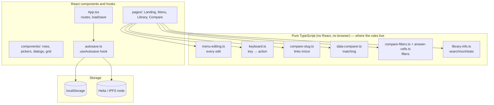

# Architecture notes

How the app is put together, what each part costs, and what we'd change. The short version: **keep React, replace Create React App with Vite, and make IPFS optional (or drop it).**

## Shape of the app

Nearly every rule in the [spec](README.md) lives in the pure modules on the left, which is why they can be tested with property tests and modelled in Dafny without rendering anything. React is the thin layer that shows state and turns DOM events into calls to those functions. `useAutosave` is the one piece of real concurrency, and it has its own TLA+ model.

## Is React making this easier?

We measured the production bundle (`main.js`, 1.87 MB minified) using its source map:

| Part | Share of bundled source |
| --- | --- |
| IPFS / libp2p and their crypto (`@noble/*`, `multiformats`, `asn1js`, `@libp2p/*`, `cborg`, …) | **~69%** |
| react-router | ~7% |
| pako (compression for links) | ~4% |
| The app's own code | ~3% |
| react + react-dom | **~3%** |

So React isn't what makes the app heavy, and it's doing real work. The editor has a lot of interacting state: focus that must survive fast typing (ED-20), undo/redo, a keyboard mode machine, dialogs with focus traps, and autosave. Rewriting that with plain DOM code or a smaller library (Preact, Svelte, Lit) would save about 50 KB and lose the existing component tests, Storybook stories and the team's familiarity. **Verdict: keep React.** If size matters later, `preact/compat` is a drop-in swap that needs no code changes.

What *is* making things harder:

1. **Create React App is deprecated** (no releases since 2022). It pins Jest 27, which can't load ESM-only packages (we had to stay on fast-check 3 for this reason). It forces `moduleResolution: node`, which broke Storybook 10's types, and it's slow. **Recommendation: move to Vite + Vitest.** The code needs almost no changes. The config, the `%PUBLIC_URL%` placeholders in `index.html` and the `react-scripts` commands are what change.
2. **IPFS doesn't earn its weight.** The in-browser Helia node is about 70% of the download and takes seconds to start. But menus travel inside links, and nothing pins them to a public gateway, so other people never actually fetch a menu over IPFS. localStorage already does the saving. **Recommendation:** load Helia lazily (dynamic `import()`) behind a setting. Or remove it, keep the `Storage` interface, and leave localStorage as the default. Either change cuts the initial download by about two thirds.
3. **Groups are stored in a plain object** keyed by name. That's why group names need special care (`__proto__`, ED-12), and why groups named only with digits always sort first (KL-1 in the [verification map](README.md#11-verification-map)). An ordered array, `[{ name, items }]`, would remove both problems. It changes the link format, so it needs a version marker and a reader for old links. It's worth doing together with any future change to items (such as sub-items).

## What we'd keep exactly as it is

- The **pure-function core** with property tests and formal models next to it.
- **Links that carry the whole menu.** There's no server, no accounts, nothing to leak.
- **One table drives both the keyboard handler and the help overlay** (`keyboard.ts` → `SHORTCUTS`), so the help can't drift from the behaviour (KB-4).
