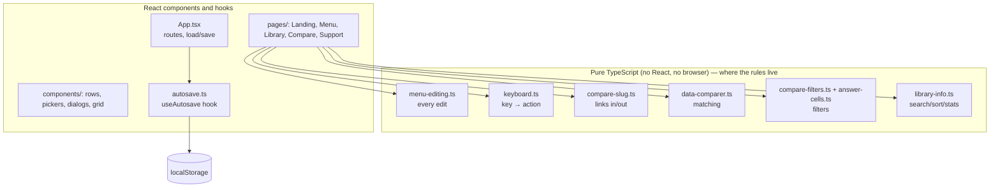

# Architecture notes

How the app is put together, and why it's this small.

## Shape of the app

Nearly every rule in the [spec](README.md) lives in the pure modules on the left, which is why they can be tested with property tests and modelled in Dafny without rendering anything. React is the thin layer that shows state and turns DOM events into calls to those functions. `useAutosave` is the one piece of real concurrency, and it has its own TLA+ model.

There is no server. A menu is saved in the browser's `localStorage`, and a share link carries the whole menu (compressed JSON) in its query string.

## Toolchain

| | |
| --- | --- |
| Build and dev server | Vite (`vite.config.mts`), output in `build/`, served by the Worker (the old address's hand-off page builds to `build-handoff/`) |
| Unit, component and property tests | Vitest + React Testing Library + fast-check |
| End-to-end | Playwright |
| Proofs | LemmaScript and Dafny (`yarn verify`), TLA+/TLC (in CI) |
| Runtime dependencies | React, React DOM, React Router, pako, web-vitals, two pixel fonts, an avatar generator |

## History: what was removed, and why (2026-11)

The app used to run on Create React App, with an in-browser IPFS node (Helia/libp2p) as a second storage layer, and Storybook + Chromatic for component review. Measured before removal:

| | Before | After |
| --- | --- | --- |
| Known vulnerable packages (`yarn npm audit`) | 106 advisories (1 critical, 36 high) | **0** |
| Installed packages | ~1,600 | **164** |
| App JavaScript | 1.87 MB (525 KB gzipped) | **420 KB (123 KB gzipped)** |

- **IPFS didn't earn its weight.** It was about 70% of the download and took seconds to start, but menus travel inside links and nothing pinned them to a public gateway, so nobody ever fetched a menu over IPFS. `localStorage` already did the saving. Old IPFS-era copies in `localStorage` are still read (SV-9).
- **Create React App is unmaintained** and brought ~1,100 packages, including nearly all the vulnerable ones. Vite + Vitest needed almost no code changes.
- **Storybook and Chromatic** added ~260 packages, and the visual review wasn't being used. Component behaviour is covered by unit and e2e tests.

React itself was always about 3% of the download and does real work (focus that survives fast typing, undo/redo, the keyboard mode machine, dialogs, autosave), so it stays.

## Known limitation worth fixing next

**Groups are stored in a plain object** keyed by name. That's why group names need care (`__proto__`, ED-12), and why groups named only with digits always sort first (KL-1 in the [verification map](README.md#11-verification-map)). An ordered array, `[{ name, items }]`, would remove both. It changes the link format, so it needs a version marker and a reader for old links. Best done together with the planned sync work, which gives menus stable ids anyway.
