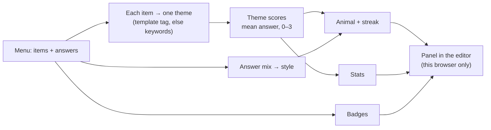

# Just for fun: menu insights

**In short:** the editor turns a menu's answers into a playful portrait: an **animal** (with a style and a "streak" of a second animal), an RPG **character sheet** (class, level and stats), a **loot** item whose stat lines quote the menu's own items, and **badges**. Later phases add a share card and a "party" view when comparing. Everything is worked out in the browser from the menu alone, using words written once and kept in the code. No AI runs while anyone uses it, so it costs nothing per use and nothing leaves the browser.

**Status:** phases 1 and 2 are built. `src/menu-insights.ts` does the scoring, `src/menu-loot.ts` the character sheet and loot, `src/insights-content.ts` holds the words, and `src/components/MenuInsights.tsx` shows them. Phases 3 to 5 are planned (see [Phases](#phases)).



## Why no AI at runtime

| | Words written once, picked in the browser | AI writes each result |
| --- | --- | --- |
| Cost per use | $0 | About $0.0003 a call on Claude Haiku 5.5, plus quotas to keep it bounded |
| Privacy | Nothing leaves the browser (PR-1) | Menu content leaves the device: needs the coach's consent screen, a supporter account and quotas ([coach.md](coach.md)) |
| Tone | Every line read by a person before it ships | A model improvises jokes about people's sex lives and boundaries |
| Works offline, in links, for everyone | Yes | No |

The words are written once: drafted with AI in a development session, read and edited by a person, and committed as `src/insights-content.ts`. The results come in a few hundred combinations at most (8 themes × 7 second themes × 5 styles), so even richer text can be written ahead of time instead of at runtime.

## Themes

Each item counts towards at most one theme. Template items are tagged by hand in `src/insights-content.ts`. Other items are matched by keywords on their text, then on their group's name.

| Theme | Animal | Comes from items like |
| --- | --- | --- |
| Closeness | 🦦 Otter | Cuddling, Kissing, Romantic dates, Pet names |
| Talk | 🦜 Parrot | Daily check-in messages, Giving honest feedback, Disclosure |
| Space | 🐈 Cat | Time alone respected, Separate bedrooms, No veto power |
| Roots | 🐧 Penguin | Living together, Long-term plans, Exclusivity, Co-parenting |
| Spotlight | 🦚 Peacock | Meeting friends, Public affection, Using a relationship label |
| Hearth | 🦫 Beaver | Chores, Finances, Pets & plants, Shared calendar |
| Care | 🐘 Elephant | Emotional support, Caring when sick, Emergency contact |
| Adventure | 🐬 Dolphin | Traveling together, Shared hobbies, Regular date nights |

The Chameleon 🦎 stands in when no theme has a score yet, and the Egg 🥚 when too few items are answered.

## Rules

| ID | Rule | Checked by |
| --- | --- | --- |
| IN-1 | Worked out in this browser from the menu alone. Results are never sent, stored, put in links or reported to analytics (PR-1, PR-2). | Review (no network or storage calls in `menu-insights.ts`) |
| IN-2 | An item's theme is, in order: its template tag (exact text, ignoring case, spacing and curly quotes), else the first keyword match on its text, else its group's template tag, else the first keyword match on the group's name, else none. Every template item has exactly one tag. | Test, [Property](../../src/__props__/menu-insights.props.test.ts) |
| IN-3 | A theme's score is the mean of its answered items' ranks (Off limits 0, Maybe 1, Like to have 2, Must have 3). It's shown only once at least 2 of its items are answered. Blank and unanswered items don't count. Group order, item order, notes and person info never change a score. | [Property](../../src/__props__/menu-insights.props.test.ts), Test |
| IN-4 | **Animal:** with fewer than 5 answered items, "Still hatching" says how many more are needed. Otherwise it's the top theme's animal (highest score, then more answered items, then the theme order above), or the Chameleon if no theme has a score. A second theme scoring 2 or more adds "with a streak of …". | [Property](../../src/__props__/menu-insights.props.test.ts), Test |
| IN-5 | **Style:** the first that applies to the answered items: Curious (40% or more Maybe), Wholehearted (50% or more Must have), Discerning (30% or more Off limits), Decisive (no Maybe), else Easygoing. | Test |
| IN-6 | The same answers always give the same result. "Another one" changes only the wording, going through a fixed list. | [Property](../../src/__props__/menu-insights.props.test.ts), Test |
| IN-7 | **Badges never ask for an answer.** Effort badges (answering, notes, own items) may show as not yet earned, with a hint. Badges that depend on *which* answers were given only appear once earned, never as a goal. | [Property](../../src/__props__/menu-insights.props.test.ts), Test |
| IN-8 | **Tone:** no wording treats an answer as better or worse. Off limits is a valid answer, never a flaw or a punchline (as in CO-6). It's labelled "just for fun": not a personality test, and never a compatibility verdict. | Review (`insights-content.ts`) |
| IN-9 | Emoji are decorative (hidden from screen readers) and always have a name in text; each stat has its value in text. No sideways scrolling from 320 px (AX-4). | Test, Review |
| IN-10 | **Character sheet:** once hatched, the class comes from the animal's theme (the Chameleon is a Shapeshifter), with a multiclass from its streak. The level is 1, plus 1 for every 5 answered items, up to 20. | Test, [Property](../../src/__props__/menu-loot.props.test.ts) |
| IN-11 | **Loot:** once hatched, an item named *style prefix + theme base + "of" + a quoted Must have* (else the phrase of the streak's theme, or of the animal's). Its lines: the top two themes' scores, up to two Must haves (+3), one Like to have (+1), one Maybe ("Unidentified"), and up to two Off limits ("Immune to", a boundary as armour, never a flaw). "Roll again" changes the words and which items are quoted, nothing else. | Test, [Property](../../src/__props__/menu-loot.props.test.ts) |
| IN-12 | **Quoting:** only item text is ever quoted, never notes, titles or names, cut to 40 characters. Any item can be quoted as something wanted: a Must have (+3, or the loot's "of …") or a Like to have (+1). Sex, kids, health and the rest are part of many good relationships, and the panel says so. **Tender topics are never the punchline:** an item flagged in `SENSITIVE_ITEMS` (sex and sexual health, kids, other partners and veto, marriage, past relationships and hurts, health and mental health, coming out, politics), or an own item matching `SENSITIVE_KEYWORDS`, never appears as "Immune to" (Off limits) or "Unidentified" (Maybe), where it could read as a dig at someone's boundary or history. The panel is only ever shown in this browser; phase 3's share card previews every quote first. | Test, [Property](../../src/__props__/menu-loot.props.test.ts) |
| IN-13 | Level and rarity depend only on *how many* items are answered, never on which answers. Rarity: Common, Uncommon from 40% of items answered, Rare from 70%, Epic from 90%, Legendary when every item of a menu of 10 or more is answered. | [Property](../../src/__props__/menu-loot.props.test.ts), Test |
| IN-14 | **The card:** the animal, character sheet and loot are one collectible card, in an original trading-card layout (not any existing game's): a name bar with the level, an art window with the animal (and the streak's animal in a corner), a type line with the class and a rarity gem, a text box with the blurb, stats and loot, and the class's flavor text. The frame takes the animal's theme colour; Rare and up shine, and Legendary's shine moves unless reduced motion is asked for. Colours are decorative: the level, class, rarity and every value are written out. While hatching, the card is face down. Badges sit beside it on wide screens and below it on narrow ones. | Test |

### Badges

| Badge | Kind | Earned when |
| --- | --- | --- |
| 🐣 Hatched | Effort | 5 items answered |
| 🗺️ Cartographer | Effort | Every item answered, with 10 or more items |
| 🧭 Well-Rounded | Effort | Every theme has a score (2+ answered items in each) |
| 📜 Fine Print | Effort | Notes on 5 items |
| 🧪 Homebrewer | Effort | 3 items that aren't from any template |
| 🛡️ Boundary Keeper | Answers | At least one Off limits |
| 🌈 Full Spectrum | Answers | All four answers used at least once |

Badges that would reward one answer over another ("No Maybes", "All in") are left out on purpose: they'd nudge people away from honest answers.

### Classes and loot

| Theme | Class | Loot bases | "of …" when nothing can be quoted |
| --- | --- | --- | --- |
| Closeness | Enchanter | Weighted Blanket, Cuddle Gauntlets, Locket | Snuggles |
| Talk | Bard | Speaking Stone, Carrier Pigeon, Scroll | Long Talks |
| Space | Ranger | Cloak, Tower Key, Do-Not-Disturb Sign | Alone Time |
| Roots | Paladin | Ring, Anchor, Pebble | Forever |
| Spotlight | Herald | Banner, Megaphone, Party Hat | Grand Entrances |
| Hearth | Artificer | Chore Wheel, Ladle, Ledger | the Hearth |
| Care | Cleric | Healing Potion, Hot Water Bottle, Soup Flask | Soup and Sympathy |
| Adventure | Swashbuckler | Compass, Boots, Picnic Basket | Side Quests |
| *(none)* | Shapeshifter | Mimic Chest, Mystery Box | the Unknown |

An example, for a Wholehearted Otter with a streak of Beaver, 18 of 20 items answered:

```
Unwavering Weighted Blanket of Holding hands        ★ Epic
  +3.0 Closeness · +2.0 Hearth
  +3 Cuddling
  +3 Shared cooking
  +1 Regular date nights
  Unidentified: Meeting family
  Immune to: Posting about us online
  Nearly complete. It hums faintly.
```

## Phases

| Phase | What | Notes |
| --- | --- | --- |
| 1 | Scoring, animal, stats, badges in the editor | Emoji stand in for art. Since IN-14, shown as one collectible card. |
| 2 | **RPG sheet and loot** (built): class, level and stats, and a generated item whose lines quote the menu's own items (IN-10…IN-13). | Tender topics are quoted only as things wanted, never on the Off limits or Maybe lines (IN-12). |
| 3 | **Share card:** drawn in the browser (SVG to PNG), shared with the system share sheet or downloaded. Shows the animal, class and stats, never answers; loot lines that quote items only after a preview with each quote removable, where quotes of flagged items start unticked. | Analytics may count that a card was shared (no parameters), never which animal (PR-2). |
| 4 | **Compare "party":** each person's animal side by side, with a party description ("a tank and a rogue"). Pair badges (Shared Must-Haves, Talked It Through, Full Party) are only ever awarded, never shown as missing. | No compatibility score or verdict (CO-6). |
| 5 | **Pixel sprites** in the Sweetie 16 palette replace the emoji: CC0 packs (check each licence) or a dozen drawn 16×16. Layering an animal with a held item and a hat multiplies the variety. | Keep the bundle small: sprites as one sheet or inline SVG. |

**Optional, not planned:** a supporter-only "the bard writes your ballad" extra through the coach's consent and quota pipeline, sending only the result (animal, style, stats), never the menu. With so few combinations, writing every ballad ahead of time with the Batch API (under a dollar) is simpler and keeps IN-1.

## Changing the words

- Add or rename a template item → tag it in `ITEM_THEMES`. A test fails until every template item has exactly one tag.
- New wording goes in `insights-content.ts`, and a person reads it against IN-8 before it ships.
