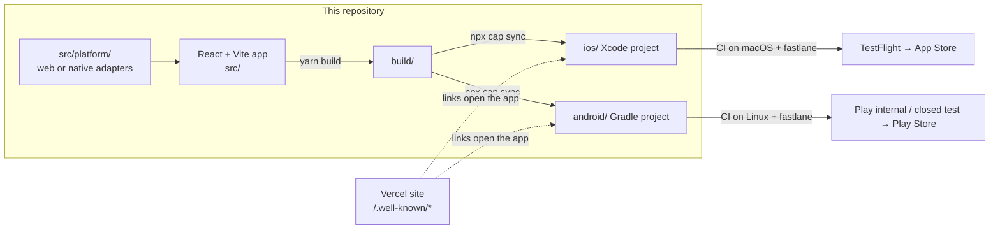

# iOS and Android apps

**In short:** ship the existing web app inside a thin native shell with [Capacitor](https://capacitorjs.com/) (version 8), from this same repository and the same React code. The app bundles its files, so it works offline with no account, and adds what a store app should have: the native share sheet, links that open in the app, saving that the OS won't clear, and proper safe areas and back-button handling. Version 1 has **no payments, no sync and no AI coach**, which keeps store review and privacy forms simple. Paid features come later, through Apple's and Google's in-app purchase.

**Status:** proposal. Nothing here is built yet. Rule IDs use the prefix `NA`.

## 1. Why Capacitor

| Option | Verdict |
| --- | --- |
| **Capacitor 8** (wrap the Vite build in a native WebView) | **Recommended.** One codebase, and the existing unit, property, e2e and formal checks keep covering the app. Native APIs come from small official plugins. About a week or two of work. |
| PWA only | Android can install it, but the App Store doesn't list PWAs, and the Play Store needs a wrapper (TWA) anyway. |
| React Native / Expo rewrite | Native UI, but every screen would be rewritten and the spec and formal checks would have to be redone. Not worth it for a form-and-list app. |
| Flutter / native Swift + Kotlin | Two or three codebases for one small app. |

## 2. Scope of version 1

**In:** everything the website does with no account. That covers templates, editing, answers, notes, the Library, compare, the guided discussion (with built-in prompts), export, and share links. It also works offline.

**Out until later:**

- **Support page and payments.** In-app purchase is required for paid digital features (see §7). Linking out to a web payment page is restricted outside the US.
- **Sync.**
- **AI coach.** It needs a supporter account.
- **The "coming soon" fake doors.**

The app build hides all of these.

**Devices:** iPhone and Android phones, with iPad and Android tablets in the same binaries. The layout already handles tablets. Supporting iPad means also supplying iPad screenshots.

## 3. Rules

| ID | Rule | Checked by |
| --- | --- | --- |
| NA-1 | The app runs the bundled build, never a remote URL (no `server.url` in `capacitor.config.ts` for release builds). It works fully offline. | Release config review; airplane-mode smoke test |
| NA-2 | Every link the app makes (share, export, copy, compare) uses the public site origin `https://relationship-menu.vercel.app` (one constant, `PUBLIC_ORIGIN`), never `window.location.origin`. In the app, that would be `capacitor://localhost` or `https://localhost`. | Unit test of `src/platform` + grep check in CI |
| NA-3 | Menu, compare and discussion links (`/menu?encoded=…`, `/compare?…`, `/discuss?…`) open in the app when it's installed (iOS Universal Links, Android App Links) and on the website otherwise. The app routes them with React Router. | Device test; `.well-known` files served with `application/json` |
| NA-4 | Menus and discussion notes are saved through native storage (`@capacitor/preferences`), behind the existing `Storage` interface (`src/storage.ts`). The OS doesn't clear it under storage pressure the way it can clear WebView `localStorage`. On first launch, anything already in WebView storage is copied over, and the copy is kept until the native write succeeds (same "never lose a menu" rule as SV-6). | Unit tests with a fake Preferences; property test reuse |
| NA-5 | Share and export use the native share sheet (`@capacitor/share`) and clipboard (`@capacitor/clipboard`). Export writes a file with `@capacitor/filesystem`, then shares it. The web build keeps `navigator.share` and download. | Unit tests per adapter; device test |
| NA-6 | Android's back button goes back in the app's history, and exits only from the home screen. External links (crisis numbers, legal pages, GitHub) open in the system browser or dialer, never inside the app's WebView. | Device test |
| NA-7 | Content respects safe areas (`viewport-fit=cover` and `env(safe-area-inset-*)`), with status-bar and splash colors from the theme (`#1a1c2c`). There's no white flash on launch. | Screenshot review on notch / punch-hole devices |
| NA-8 | The app build hides Support, the AI teaser, sync and any price or payment wording (`isNativeApp()` check). Nothing in the app points to a way to pay outside the store. | Unit test of the flag; e2e run with the flag on |
| NA-9 | Analytics are **off in the app by default**. GA already sends only from `relationship-menu.vercel.app`, so in the app events just queue locally. If turned on later, it sends the same privacy-safe events plus `platform: ios/android`, with Google signals and ad personalization off. The store privacy forms are then updated *before* that release. | Existing e2e privacy test, plus a native-flag variant |
| NA-10 | The app asks for no permissions: no tracking (so no App Tracking Transparency prompt), no location, no contacts, no notifications in version 1. | Manifest / Info.plist review |
| NA-11 | Every store build passes the web checks first (Build, Test, TLA+, Dafny + LemmaScript, CodeQL), and is built from a tagged commit on `main`. | CI workflow |

## 4. Code changes in the web app (one PR, testable on the web)

Most of the work is a small platform layer, so the rest of the app doesn't change.

- **`src/platform/index.ts`:**
  - `isNativeApp()` uses `Capacitor.isNativePlatform()`, and is false on the web.
  - `PUBLIC_ORIGIN` is the site origin on the web and the production origin in the app.
  - `shareLink`, `copyText` and `saveAndShareFile` use the web or native version.
- **Replace `window.location.origin`** in `src/export-menus.ts:71`, `src/pages/Menu.tsx:478-480` and `src/App.tsx:691` with `PUBLIC_ORIGIN` (NA-2).
- **`createNativeStorage()`** implements `Storage` over Preferences, plus the one-time move from WebView `localStorage` (NA-4). `discussion.ts` load/save goes through the same adapter.
- **`ShareDialog` / `SharePane` / Discuss "Copy summary"** call the platform helpers (NA-5).
- **CSS safe-area padding** goes on the header, bottom bars and dialogs, and `index.html` gets `viewport-fit=cover` (NA-7).
- **Routes and entry points** for Support, the AI teaser and sync are hidden when `isNativeApp()` (NA-8).
- **A public `/privacy` page** (and `/terms`), made from `docs/legal/`, for the store listings (§6).

## 5. The native projects (second PR)

- Add `@capacitor/core`, `@capacitor/cli`, `@capacitor/ios` and `@capacitor/android`, plus the plugins `app`, `share`, `clipboard`, `filesystem`, `preferences`, `status-bar`, `splash-screen`, `browser` and `keyboard`. All are official and small.
- **`capacitor.config.ts`:**
  - `appId` is a reverse-domain id you own, e.g. `app.relationshipmenu`. It **can't change** after the first upload.
  - `appName` is "Relationship Menu" and `webDir` is "build".
  - Android scheme: `https`.
- **`npx cap add ios` and `npx cap add android`** create `ios/` and `android/`, which get committed. Capacitor 8 uses Swift Package Manager on iOS, so there's no CocoaPods.
- **Icons and splash screens** are generated with `@capacitor/assets` from `public/logo512.png` / `logo-maskable-512.png`. The iOS 1024 px icon needs no transparency; Android uses an adaptive icon.
- **Deep links (NA-3):**
  - Add `public/.well-known/apple-app-site-association` (team id + bundle id, paths `/menu*`, `/compare*`, `/discuss*`) and `public/.well-known/assetlinks.json` (package name + Play signing certificate SHA-256).
  - Add a `vercel.json` header so both are served as `application/json` and skip the SPA rewrite.
  - Add the Associated Domains entitlement on iOS and the `autoVerify` intent filter on Android.
  - `App.addListener("appUrlOpen")` navigates the router.
  - A custom domain later would need these files there too.
- **Android back button** via `App.addListener("backButton")`, and keyboard resize mode `body` (NA-6).
- **iOS privacy manifest** (`PrivacyInfo.xcprivacy`): declare UserDefaults use (reason `CA92.1`, Preferences uses it), no tracking, and no collected data while analytics are off.
- **`ITSAppUsesNonExemptEncryption = NO`** in `Info.plist`: the app only uses HTTPS and OS crypto, so it needs no export paperwork.

## 6. Store requirements (as of November 2026)

| | Apple App Store | Google Play |
| --- | --- | --- |
| Account | Apple Developer Program, **$99/year**. Individual (your name shows as the seller) or organization (needs a D-U-N-S number, can take a couple of weeks). | **$25 once**, plus identity verification. Personal accounts made after Nov 13 2023 must run a **closed test with at least 12 testers opted in for the 14 days** before applying for production ([Google](https://support.google.com/googleplay/android-developer/answer/14151465)). Organization accounts skip that but need a D-U-N-S number. |
| Build | Xcode 26 / iOS 26 SDK for uploads since Apr 28 2026 ([Apple](https://developer.apple.com/news/upcoming-requirements/)). Needs a Mac or a macOS CI runner. Deployment target iOS 16+. | Target **API 36 (Android 16)** for new apps and updates since Aug 31 2026 ([Google](https://developer.android.com/google/play/requirements/target-sdk)). Upload an Android App Bundle (`.aab`) with Play App Signing. |
| Review | Usually 1–3 days. The main risk is **guideline 4.2, minimum functionality** ("a website in a wrapper"). Our case: files are bundled, it works offline with no login, and it uses the native share sheet, file export and Universal Links. Say so in the review notes, with a sample menu link to try. | A few days for the first review after the 14-day test. |
| Age rating | New questionnaire (4+/9+/13+/16+/18+). Items mention sex and intimacy, as text only with no images, so expect **13+ or 16+**. Answer honestly ("mature/suggestive themes: infrequent"). | IARC questionnaire in Play Console. Expect **Teen** or **Mature 17+**. Not a dating app; no user-to-user chat. |
| Privacy | App Privacy label: **"Data not collected"** while analytics are off. Both stores need a public **privacy policy URL**: [docs/legal/privacy.md](../legal/privacy.md) isn't on the site yet, so publish it as a `/privacy` page (part of the §4 PR), with an app section. | Data safety form: **no data collected or shared** while analytics are off. The same privacy policy URL. |
| Other forms | EU **trader status** (DSA): "not a trader" while there's no money involved. If you become one, your address and phone are shown in the EU. Content rights: yes, all content is ours. | Target audience: adults (18+), not designed for children. Ads: none. Government / financial / health declarations: none. |
| Listing assets | Icon 1024 px; screenshots for iPhone 6.9″ (1320×2868) and, if iPad is supported, iPad 13″ (2064×2752). Subtitle (30 characters), description, keywords, support URL. | Icon 512 px; feature graphic 1024×500; at least 2 phone screenshots (plus 7″ and 10″ tablet ones for tablet listing). Short description (80 characters) and full description. |

Screenshots can be made by the existing Playwright setup at those viewport sizes, from a seeded demo menu, so they stay current with the UI.

## 7. Paid features in the apps (later, not version 1)

- **Paying inside the app.** Unlocking sync or the coach is a digital service, so inside the apps it must be sold through **Apple In-App Purchase** and **Google Play Billing**. Apple 3.1.1 and Play's payments policy both require this.
- **Web purchases.** Supporters who paid on the website can use their account in the app (Apple 3.1.3(b), "multiplatform services"), but only if the same tier is *also* offered as an in-app purchase.
- **US exception.** The US App Store currently allows a link to pay on the web; elsewhere that's not allowed. Check the current rule before relying on it.
- **Store fees.** Both stores take **15%** under their small-business programs (under $1M a year).
- **Server work.** Verify App Store and Play receipts in the Worker, using the App Store Server API and Play Developer API, or [RevenueCat](https://www.revenuecat.com/) (free under $2.5k/month). Then map them to the same account status (`active` / `past_due` / `lifetime`) the Worker already checks, so the coach and sync rules don't change.
- **Account deletion.** Apple 5.1.1(v): an app that lets you create an account must let you delete it in the app. `deleteAccount` already exists on the server; it needs a button.

## 8. Build and release

- **CI, Android:**
  - A new workflow, `.github/workflows/mobile.yml`, runs on tags `app-v*` after the normal checks.
  - On `ubuntu-latest`: `yarn build && npx cap sync android`, then Gradle `bundleRelease`, signed with the upload keystore from a repository secret.
  - fastlane `supply` uploads to the **internal** track.
- **CI, iOS:**
  - On `macos-latest`: `npx cap sync ios`, then build and sign with an App Store Connect API key (repository secret).
  - fastlane `pilot` uploads to **TestFlight**.
  - macOS minutes are free for public repositories.
- **Versions:** the version name comes from the tag (`app-v1.2.0` → 1.2.0); the build number is the CI run number.
- **Promotion is manual:** internal track → closed test → production on Play, and TestFlight → App Store review on Apple.
- **No over-the-air code updates** in version 1. Every change ships through store review, which keeps the reviewed app and the running app the same.
- **Release checklist (each release):**
  - Airplane-mode run.
  - Open a menu link from Messages / Chrome.
  - Share sheet and export.
  - Android back button.
  - Rotate on a tablet.
  - A menu survives an app update (install the previous build, add a menu, update, check it's there).

## 9. Plan

| Step | Who | Time |
| --- | --- | --- |
| 1. Decide: app id, display name, individual or organization accounts, iPad yes/no, analytics in app on/off | You | — |
| 2. Open the Apple Developer and Google Play accounts (start D-U-N-S now if organization) | You | 1 day – 2 weeks |
| 3. PR: platform layer in the web app (§4) | Me | 2–3 days |
| 4. PR: Capacitor projects, icons, deep links, back button, privacy manifest (§5) | Me | 2–3 days |
| 5. PR: mobile CI + fastlane uploads (§8). You add the signing secrets | Me + you | 1–2 days |
| 6. Store listings, screenshots, privacy forms, age ratings (§6). I draft the text and make the screenshots | Me + you | 1 day |
| 7. Play closed test with 12+ testers for 14 days; TestFlight beta at the same time | You + testers | 14 days |
| 8. Submit for review; release | You | ~1 week |
| Later: in-app purchase for sync and the coach (§7) | Me | 1–2 weeks |

**Running cost:** $99/year (Apple) + $25 once (Google). Nothing else while the app has no backend features.

## 10. Open questions

1. **App id and name.** `app.relationshipmenu` needs nothing registered, but a domain you own makes the id clearly yours. Whether "Relationship Menu" is free as a store name can only be checked in App Store Connect / Play Console.
2. **Custom domain.** Moving off `relationship-menu.vercel.app` later means the `.well-known` files and `PUBLIC_ORIGIN` move too. Old links keep working only if the old domain redirects.
3. **Analytics in the app.** Off keeps the privacy labels at "no data collected". On gives usage numbers for the app, but means updating both stores' privacy forms.
4. **Who are the 12 Play testers?** Friends with Android phones, opted in through a Google Group, for 14 days straight.
