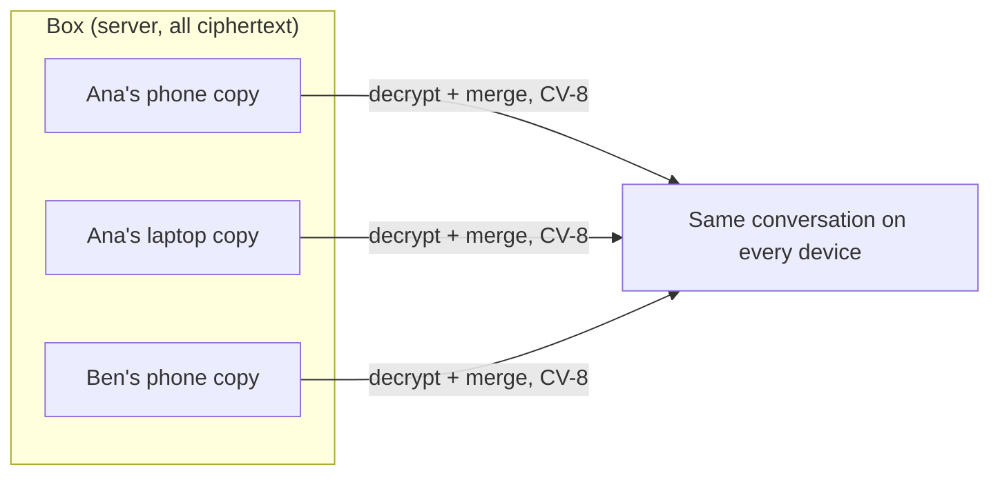

# Live conversations and notifications

**Status:** approved 26 November 2026 with the recommended answer to every decision in §12. Phases 1–2 (boxes, live sharing without notifications) are being built; the wire protocol is in [§7a](#7a-wire-protocol-v1). It builds on [conversations](README.md#7c-conversations) (§7c, PR #87) and [supporter sync](sync.md). Rule IDs use the prefix `NT`. Every "Checked by" entry names the check we plan to write.

**In short:** today, people who aren't in the same room take turns by sending the conversation as a link (CV-6). That stays, free for everyone. This adds **live sharing**:
- A supporter can share a conversation *live*.
- Everyone's devices then keep an **encrypted** copy on our server up to date.
- When someone leaves a comment or changes their notes, the others get a **push notification** on their phone or computer.

The server stores and forwards only ciphertext. Notification text is either generic or written on the receiving device, which can decrypt the conversation. Our server never can.

- **Decisions I need from you:** [§12](#12-decisions-needed)
- **Costs:** [§10](#10-costs)
- **Privacy:** [§8](#8-privacy-and-threat-model)

---

## 1. The idea in one page

```mermaid
sequenceDiagram
  participant A as Ana (supporter)
  participant W as Worker + D1
  participant P as Push service (Apple / Google / Mozilla)
  participant B as Ben
  A->>A: "Share live": new box id, box key K, join secret J
  A->>W: create box (signed by Ana's sync account) + Ana's encrypted copy
  A-->>B: invite link /talk#live=<box id>.<K>.<J> (by message)
  B->>W: join with proof of J, register Ben's device key
  B->>W: read every encrypted copy; decrypt and merge locally (CV-8)
  B->>W: "Notify me": push subscription for this box
  A->>A: Ana comments on "Kids"
  A->>W: PUT Ana's copy (ciphertext) + Notify: comment
  W->>P: encrypted push to Ben's devices: {box, kind: comment} (no content)
  P->>B: wakes Ben's service worker
  B->>W: (only if detailed text is on) fetch copies, decrypt
  B->>B: shows "New comment in your conversation" or "Ana commented on Kids"
```

**What changes for people:**

| | Link swapping (today, free) | Live sharing (this spec) |
| --- | --- | --- |
| Who can use it | Everyone | Started by a supporter; anyone they invite can join without paying |
| How updates travel | You send a link after each turn | Automatically, whenever anyone's device is open |
| Telling the others | Your message is the notification | A push notification on each device that asked for one |
| Where it lives | Each person's browser | Each browser, plus an encrypted copy on our server |
| Server sees | Nothing | Ciphertext, sizes, timing, number of devices, push addresses |

---

## 2. Boxes: an encrypted, shared copy of one conversation

A **box** holds one conversation shared live. The server stores one encrypted **copy** of the whole conversation per member device. Each device writes only its own copy, so the server never merges anything and there are no write conflicts between people. A reader fetches every copy, decrypts them and merges them with the existing conversation merge, which is commutative, associative and idempotent (CV-8). The merge order and timing don't matter.



| ID | Rule | Checked by |
| --- | --- | --- |
| NT-1 | A box has a random 128-bit id, a random 256-bit **box key K** (AES-256-GCM) and a random 256-bit **join secret J**. Both are made on the sharing device. K is never sent to the server. J is sent once by each device that joins (NT-12); the server stores only SHA-256(J), and J lets a device join, never read. | Test (client: ids and keys from `crypto.getRandomValues`; server: stores only the hash) |
| NT-2 | Each copy is the whole conversation (the same JSON as a conversation link, CV-6), compressed, padded to a multiple of 4 KiB and encrypted with K. Every write uses a fresh 96-bit nonce. The additional data is `"menu-box/v1" ‖ boxId ‖ memberId ‖ version`, so the server can't move a copy to another member or box, or present an old version as new, without decryption failing. | Test (tamper: every byte flip, wrong member, wrong version → rejected) |
| NT-3 | Each member device writes only its own copy, conditional on its version (`If-Match`), like menus in sync (SY-42). Two tabs on one device that race get 412, re-read, merge and retry. | Test (server + client) |
| NT-4 | Reading a box returns every copy. The device decrypts each one, cleans it as untrusted input (CV-9), merges them all into its local conversation, and writes its own copy if that changed anything. A copy that fails to decrypt is skipped and counted, never applied. | Property (any order of reads and writes converges; a corrupt copy changes nothing) |
| NT-5 | Limits: at most 16 member devices per box, each copy at most 256 KiB, and at most 50 boxes hosted per supporter account. (Boxes don't use the menus quota.) | Test (server) |
| NT-6 | The conversation's merge rules apply unchanged (CV-8): notes and outcomes go to the latest change, and every comment is kept. A device that has left still sees its last merged copy locally. | Property (reuses `conversation.props`) |

---

## 3. Joining, members and leaving

| ID | Rule | Checked by |
| --- | --- | --- |
| NT-10 | **Share live** is offered to supporters (an active, past-due or lifetime sync account) on a conversation. It creates the box with a request signed by their sync account (SY-6), which becomes the box's **host**. | Test |
| NT-11 | The **invite link** is `/talk#live=<boxId>.<K>.<J>`. Everything is in the #fragment, so it never reaches a server (as SY-11). The app removes it from the address bar before anything else runs. The page says plainly: *"Anyone with this link can read and add to this conversation, now and later. Send it only to the people in it."* | Test (fragment removed before the first effect and `page_view`) |
| NT-12 | **Joining** needs no account. The device makes its own Ed25519 key pair (kept in IndexedDB, non-extractable), and sends the public key with J. The server checks SHA-256(J) and keeps the public key. J only admits members; the server could already add or drop members, so learning J gives it nothing new, and it still can't read anything without K. The member id is the first 128 bits of SHA-256(public key). Every later box request is signed like sync requests (SY-6, label `menu-box/v1`), and the server stores no credential. | Test (server: bad proof, reused proof, wrong key) |
| NT-13 | An invite works for 7 days. The host can make a new one, which replaces J, and that ends the old link for new joins. People who already joined stay. | Test |
| NT-14 | **Leave** (any member) deletes that device's copy, member entry and push subscriptions from the server. The conversation stays on the device, as an ordinary saved conversation. | Test |
| NT-15 | **Stop sharing** (host only) deletes the box: every copy, member and subscription. Each device keeps its own merged conversation. To remove one person, the host stops sharing and shares again with a new link to the others: a new K, so the removed person can't read anything written after that. | Test |
| NT-16 | Boxes follow the host's supporter status (SY lapsing rules): if the host lapses, the box is read-only, so members can read but not write, and nobody is notified. It is purged with the host's account. Members are told *"Live sharing has paused; you can keep talking by sending links."* | Test (server + client) |
| NT-17 | The box key K and the device's box key pair live in IndexedDB (`wants-live`), never in localStorage, a conversation link or analytics. The device's private key is a non-extractable `CryptoKey`. K is kept as bytes, so the host can show the invite link again. | Test (`src/live/live.test.ts`; e2e: no key material in requests) |

---

## 4. Notifications

**What can be notified:** another member left a comment, or changed their area notes, topic notes or an outcome. The server can't tell what changed, because it only sees ciphertext, so the **writing device** says how to notify with each write: `Notify: comment`, `Notify: notes` or `Notify: none`. That's one word, with no content.

| ID | Rule | Checked by |
| --- | --- | --- |
| NT-20 | **Asking.** "Notify me about this conversation" is per conversation and per device. The permission prompt is only ever shown from that button, never on load. That's also required on iPhone and in most browsers. | Test (no `Notification.requestPermission` / `pushManager.subscribe` outside a click handler) |
| NT-21 | **Channels:** Web Push (RFC 8030) with VAPID (RFC 8292) and encrypted payloads (RFC 8291). This covers desktop Chrome, Edge, Firefox and Safari, Android browsers, and iPhone and iPad from iOS 16.4 when the site is added to the Home Screen. The store apps use native push (§6). There's no email and no SMS, so we never hold contact details. | Test (server: RFC 8291 test vectors; client: subscribe flow) |
| NT-22 | **iPhone and iPad in Safari** can't get web push unless the site is on the Home Screen. Pressing the button there explains that, with the existing "Add to Home Screen" steps (SV-12), instead of failing silently. | Test |
| NT-23 | **Who's told:** every subscribed device of every member *except* the device that wrote. Nothing is sent for `Notify: none` (e.g. renaming a part). Writes by the host after the box went read-only notify nobody. | Test (server) + Proof (`Notify.tla`) |
| NT-24 | **Not too often:** at most one notification per box per device every 15 minutes, and at most 20 per box per device per day. Changes in between are coalesced into the next one, which says how many ("3 new comments"). A cron every 5 minutes sends anything held back. | Test (server, fake clock) + Proof (`Notify.tla`: never more than one per window; nothing held back forever) |
| NT-25 | **What the push carries:** `{box, kind, count}`, encrypted to the device's subscription (RFC 8291). No names, no topic text, no ids of menus or people. | Test (server: payload has exactly those fields) |
| NT-26 | **What it says**, decided per device: **Private** (default): *"Wants & Won'ts: something new in a conversation."* **Detailed** (opt-in): the service worker reads the box, decrypts it with K, and writes *"Ana commented on Kids"* or *"Ben added notes on Affection & intimacy"* on the device. Detailed text is never built on the server. | Test (service worker, with a fake box) |
| NT-27 | Tapping a notification opens `/talk?id=<conversation>` and pulls the box first, so the new comment is there, marked new (CV-11). | Test (e2e) |
| NT-28 | **Mute and off:** "Notify me" can be turned off per conversation, or for every conversation on this device. Turning it off deletes the subscription on the server. If the push service says a subscription is gone (404/410), the server deletes it. | Test |
| NT-29 | Quiet hours are left to the operating system's own Do Not Disturb or Focus, so we never store anyone's time zone or schedule. Safari doesn't allow silent pushes, so the app can't hide one after it arrives. | Review |

---

## 5. Keeping devices up to date

| ID | Rule | Checked by |
| --- | --- | --- |
| NT-30 | While a live conversation is open and visible: pull on open, on focus, after a push arrives, and every 2 minutes. Push this device's copy 3 seconds after the last edit, and when the page is hidden. | Test (fake timers) |
| NT-31 | Offline edits are kept locally (they're in the conversation already) and pushed when back online. Nothing is lost if the box is unreachable: the conversation still works as an ordinary local conversation, and link swapping still works. | Test |
| NT-32 | A live conversation can still be sent as a link (CV-6). The link doesn't include the box key, so it doesn't give live access. | Test |

---

## 6. The store apps

The iOS and Android apps (Capacitor, private repository) use native push, because web push isn't available in an app's WebView.

| ID | Rule | Checked by |
| --- | --- | --- |
| NT-40 | The apps use `@capacitor/push-notifications`. Both platforms go through **Firebase Cloud Messaging (FCM) HTTP v1**: Android directly, iOS through FCM's APNs connection. The Worker signs FCM's OAuth token with a service-account key (RS256 in WebCrypto), stored as a Worker secret. | Test (server: token signing with a test key; request shape) |
| NT-41 | Native pushes carry the same `{box, kind, count}` as NT-25, with notification text "Something new in a conversation". Detailed text on iOS needs a Notification Service Extension to decrypt on the device. That's a later step, not version 1. | Review |
| NT-42 | The app asks for notification permission only from the "Notify me" button, and the App Store privacy label adds "Device ID (push token), not linked to identity, app functionality". | Review |

**Why FCM for iOS too:** sending to APNs directly needs HTTP/2 with header compression and long-lived connections, which a Worker's `fetch` doesn't let us control. Community libraries claim it works on Workers, but that's unverified. FCM's HTTP v1 API is plain HTTPS. The cost is that Google sees iOS push tokens and timing as well (§8). If you'd rather avoid that, a direct APNs sender can be tried in phase 5 and the Worker can switch per platform.

---

## 7. Server API and data

New routes on the same Worker (same origin, no CORS, SY-41):

| Method and path | Auth | What it does |
| --- | --- | --- |
| `POST /v1/boxes` | signed by a supporter's sync account | Create: `{boxId, joinHash, hostMemberKey}` → `201` |
| `POST /v1/boxes/:id/invite` | host member | Replace the join secret: `{joinHash}` |
| `POST /v1/boxes/:id/members` | join proof (NT-12) | `{publicKey, proof}` → `{memberId}` |
| `GET /v1/boxes/:id/copies` | member | Every copy: `[{memberId, version, ciphertext}]` |
| `PUT /v1/boxes/:id/copies/:memberId` | that member | Ciphertext, `If-Match` / `If-None-Match: *`, `Notify: comment\|notes\|none` → `{version}` · `412` · `402` box read-only · `413` |
| `DELETE /v1/boxes/:id/members/me` | member | Leave (NT-14) |
| `DELETE /v1/boxes/:id` | host member | Stop sharing (NT-15) |
| `POST /v1/boxes/:id/subscriptions` | member | `{kind: "webpush", endpoint, p256dh, auth}` or `{kind: "fcm", token, platform}` → `{subId}` |
| `DELETE /v1/boxes/:id/subscriptions/:subId` | member | Turn notifications off (NT-28) |
| `GET /v1/push/key` | none | The VAPID public key |

```sql
boxes        (box_id TEXT PRIMARY KEY, host_account TEXT, join_hash TEXT, invite_expires_at INTEGER,
              created_at INTEGER, bytes INTEGER)
box_members  (box_id TEXT, member_id TEXT, public_key BLOB, joined_at INTEGER, is_host INTEGER,
              PRIMARY KEY (box_id, member_id))
box_copies   (box_id TEXT, member_id TEXT, version INTEGER, updated_at INTEGER, ciphertext BLOB,
              PRIMARY KEY (box_id, member_id))
push_subs    (sub_id TEXT PRIMARY KEY, box_id TEXT, member_id TEXT, kind TEXT, endpoint TEXT,
              p256dh TEXT, auth TEXT, created_at INTEGER, last_sent_at INTEGER,
              pending_kind TEXT, pending_count INTEGER, sent_today INTEGER, day INTEGER)
```

| ID | Rule | Checked by |
| --- | --- | --- |
| NT-50 | The API is exactly the table above (SY-40). | Test (server) |
| NT-51 | **No content in logs** (SY-44): no bodies, endpoints, tokens, box ids or member ids. One line per error: route pattern, status, code. | Test (server, log spy with marker bytes) |
| NT-52 | **Rate limits:** 60 box requests a minute per member, 10 joins a minute per IP, and 5 box creations a minute per account. | Test (server) |
| NT-53 | The daily cron deletes expired invites (their hash), boxes of purged hosts, subscriptions not delivered for 60 days, and day counters. | Test (server, scheduled handler) |
| NT-54 | Secrets: the `VAPID_PRIVATE_KEY` (P-256) and, for the apps, `FCM_SERVICE_ACCOUNT`, are set with `wrangler secret put`. They're never committed, and VAPID's `sub` is a project contact address, not a person's. | Review |

## 7a. Wire protocol (v1)

Phases 1–2. Subscriptions (phase 3) come later. All ids are 22-character base64url (128 bits), like sync's.

**Member requests** carry

```
Authorization: MenuBox v1 box=<boxId>, key=<base64url Ed25519 public key>, ts=<seconds>, sig=<base64url signature>
```

The signature is Ed25519 over these lines, joined by `\n`: `menu-box/v1`, METHOD, path with query, ts, base64url(SHA-256(body)). `ts` must be within ±5 minutes. The key must be a member of that box. `memberId` = base64url(first 16 bytes of SHA-256(public key)).

| Method and path | Auth | Request | Response |
| --- | --- | --- | --- |
| `POST /v1/boxes` | sync account (`MenuSync`, sensitive limit); the account must be able to write (active, past due, lifetime) | `{boxId, joinHash, hostKey}`: `joinHash` = base64url(SHA-256(J)), `hostKey` = the host device's box public key | `201 {boxId, memberId, inviteExpiresAt}` · `402 not_supporter` / `read_only` · `409 box_exists` · `429 too_many_boxes` (50 per account) |
| `POST /v1/boxes/:id/members` | none (10/min per IP) | `{key, join}`: the device's box public key, and J (base64url) | `201 {memberId}` (also when already a member) · `404 not_found` · `403 bad_join` (wrong J) · `410 invite_expired` · `409 box_full` (16 members) |
| `POST /v1/boxes/:id/invite` | member, host only | `{joinHash}` | `200 {inviteExpiresAt}` (7 days from now) · `403 not_host` |
| `GET /v1/boxes/:id/copies?since=<seq>` | member | — | `200 {copies: [{memberId, version, seq, updatedAt, ciphertext}], seq, readOnly, members}`: the copies changed after `since` (all of them for `0`), the box's current `seq`, whether the host's support has lapsed, and the member count |
| `PUT /v1/boxes/:id/copies/:memberId` | that member only | body: ciphertext (`application/octet-stream`, 28 B to 256 KiB); `If-None-Match: *` for a first copy, else `If-Match: "<version>"`; optional `Notify: comment\|notes\|none` (ignored until phase 3) | `200 {version, seq}` · `412 version_mismatch {current: {version}}` · `428` · `402 read_only` · `403 not_member` / `not_yours` · `413` |
| `DELETE /v1/boxes/:id/members/me` | member, not the host | — | `204` (its copy goes too) · `409 host_must_stop` |
| `DELETE /v1/boxes/:id` | member, host only | — | `204` (everything goes) |

Unknown box → `404`. A member removed by Stop sharing → `404` on its next request; a key that isn't a member → `403 not_member`. Errors are `{error: <code>}` as elsewhere, plus `400 bad_request` for malformed ids or bodies, `401` for signature failures (`clock_skew` when more than 5 minutes off), and `413 too_large {max}`. A 412 before any copy exists says `current: null`. A lapsed host can't make new invites either (`402 read_only`); joining a lapsed box with a valid invite still works, because it's only reading. Joins have their own per-IP limit (10 a minute), and member requests are limited to 60 a minute per member. The app's signatures are checked against the server's own `authenticateMember` in `src/live/server-auth.test.ts`.

**Copies, on the device:** the plaintext is the conversation's JSON (CV-6), deflated, with a 4-byte big-endian length in front, zero-padded to a multiple of 4 KiB. It's encrypted with AES-256-GCM under K, with a fresh 12-byte nonce in front of the ciphertext. The additional data is UTF-8 `menu-box/v1\n<boxId>\n<memberId>\n<version>`, where `version` is the version being written (1 for the first copy).

**Invite link:** `/talk#live=<boxId>.<base64url K>.<base64url J>`.

```sql
-- server/migrations/0003_boxes.sql
boxes        (box_id TEXT PRIMARY KEY, host_account TEXT NOT NULL, join_hash TEXT,
              invite_expires_at INTEGER, seq INTEGER NOT NULL, created_at INTEGER NOT NULL)
box_members  (box_id TEXT, member_id TEXT, public_key BLOB, is_host INTEGER, joined_at INTEGER,
              PRIMARY KEY (box_id, member_id))
box_copies   (box_id TEXT, member_id TEXT, version INTEGER, seq INTEGER, updated_at INTEGER,
              size INTEGER, ciphertext BLOB, PRIMARY KEY (box_id, member_id))   -- index (box_id, seq)
```

Account deletion and purge delete the account's boxes. Rotation (SY-8) moves `host_account` to the new account. The daily cron clears expired join hashes.

---

## 8. Privacy and threat model

| Who | Can learn | Can't |
| --- | --- | --- |
| **Our server** (or anyone who steals the database) | That a box exists and which supporter account hosts it. How many member devices it has, sizes rounded to 4 KiB, and when each device wrote and read. Each device's push endpoint, which tells it the push service and so roughly the browser or platform. Whether a write was a comment or notes (`Notify`), and when notifications were sent. | Read the conversation, names, menus, notes or comments. Forge a copy or replay an old one (NT-2). Join a box without J (NT-12). Act as a member (it holds no credential). |
| **Push services** (Apple, Google, Mozilla) | That a notification was sent to a device, when, and how big it was. | Read the payload (web push is end-to-end encrypted to the device, NT-25). For FCM, the payload isn't end-to-end encrypted, but it contains only `{box, kind, count}`. |
| **Anyone with the invite link** while it's valid | Everything in the conversation, and anything written later. | Anything after the host stops sharing or shares again without them (NT-15). |
| **Someone looking at a locked phone** | With **Private** text (default): that something happened in "a conversation". With **Detailed** text: the person's name and the topic. | More than the device shows. That's why detailed is opt-in per device (NT-26). |
| **Google Analytics** | Counts only: `live_shared`, `live_joined`, `notifications_enabled` (channel), `notification_opened`. | Ids, names, endpoints, or anything written. |

| ID | Rule | Checked by |
| --- | --- | --- |
| NT-60 | No request to our server carries conversation text, names or menus in the clear: only ciphertext and ids. | Test (e2e: intercept every request, check no marker text appears; as SY-80) |
| NT-61 | The privacy policy gets a "Live conversations and notifications" section listing the table above, and the store privacy labels are updated before the feature ships. | Review |
| NT-62 | **Safety:** live sharing and notifications must never become a way to pressure someone. There's no "seen" or "read" indicator. Nobody can see whether or when someone else opened the conversation. There's no "nudge" or "remind them" button. Anyone can leave at any time without the others being told why. The "Not therapy" and support note (CO-11) stays on every view. | Review + Test (no read receipts in the data model) |

---

## 9. Verification

- **Property tests:**
  - Copies read and merged in any order, with duplicates and stale versions, converge to the same conversation (NT-4, NT-6, reusing CV-8's generators).
  - A corrupt or forged copy never changes anything (NT-2, NT-4).
- **TLA+ (`Notify.tla`):**
  - Model members, devices, writes and the 15-minute window with an abstract clock and the 5-minute cron.
  - Safety: a device is never notified of its own write, gets at most one notification per window, and gets nothing after leaving or after the box goes read-only.
  - Liveness, assuming the cron runs fairly: every other member's write with `Notify ≠ none` is eventually covered by a notification to every subscribed device.
  - A property test ties the real server's scheduling function to the model, as the autosave model is tied today.
- **Server tests:**
  - RFC 8291 and RFC 8292 test vectors through our Web Push code.
  - The API table, auth, limits, cron and the log spy.
- **End to end:**
  - Two browser contexts join one box and exchange a comment.
  - A mocked push service records exactly one encrypted push for the other device, and none for the writer.

---

## 10. Costs

Assumptions: 1,000 live conversations active in a month, 2 people with 2 devices each, about 20 writes a day per conversation while active, and notifications capped by NT-24.

| | 100 live conversations | 1,000 | 10,000 |
| --- | --- | --- | --- |
| Box requests (pulls + writes) | ~0.2 M/month | ~2 M/month | ~20 M/month |
| Push sends (capped, NT-24) | ~10k/month | ~0.1 M/month | ~1 M/month |
| D1 storage (copies ~8–32 KiB each) | < 20 MB | < 200 MB | < 2 GB |
| Workers + D1 | $0 (Free) | $0–5 | ~$5–10 (Paid plan) |
| Web Push, FCM, APNs | $0 | $0 | $0 |
| Cron every 5 min | $0 | $0 | $0 |

Push services are free. The Apple Developer Program ($99/year) is needed only for the iPhone app, which is already planned. Live sharing roughly doubles a supporter's request count, so the move to the Workers Paid plan ([sync.md §14](sync.md#14-costs)) comes at about 750 supporters instead of 1,500.

---

## 11. Phases

| Phase | What | Size |
| --- | --- | --- |
| 1 | Server: boxes, members, copies, join proof, limits, cron, tests. No push yet. | ~1 PR, 2–3 days |
| 2 | App: Share live, invite link, join, pull and push copies, Leave and Stop sharing, e2e with two browsers. Useful without notifications: live updates while open. | ~1 PR, 3 days |
| 3 | Web Push: VAPID keys, subscriptions, service worker, Private text, the 15-minute window and cron, `Notify.tla`. | ~1 PR, 3–4 days |
| 4 | Detailed text (service worker decrypts), the iPhone Home Screen path, Declarative Web Push where available. | ~1 PR, 2 days |
| 5 | Store apps: FCM for Android and iOS (private repo, plus the server's FCM sender). Needs a Firebase project and the APNs key in Firebase. | ~1 PR each, 2–3 days |

---

## 12. Decisions needed

1. **Who pays?** *Recommended:* the person who starts live sharing must be a supporter, and anyone they invite joins free. That keeps it a supporter thank-you without making both people pay.
2. **Lock-screen text.** *Recommended:* "Private" by default ("something new in a conversation"), with names and topics opt-in per device.
3. **How often.** *Recommended:* at most one notification per 15 minutes per conversation, and at most 20 a day.
4. **Email notifications?** *Recommended:* no. It would mean storing addresses, and push covers phones and computers.
5. **Native push route.** *Recommended:* FCM for both Android and iOS in the apps, because it works from a Worker today. Google then sees iOS push tokens and timing. The alternative is direct APNs for iOS, if it proves reliable from a Worker.
6. **Web push on iPhone needs "Add to Home Screen".** Fine as a documented step? *Recommended:* yes. The store app removes that step for people who install it.

Sources for platform facts: [WebKit: Web Push for Web Apps on iOS and iPadOS](https://webkit.org/blog/13878/web-push-for-web-apps-on-ios-and-ipados/), [Apple: sending web push notifications](https://developer.apple.com/documentation/usernotifications/sending-web-push-notifications-in-web-apps-and-browsers), [WebKit: Meet Declarative Web Push](https://webkit.org/blog/16535/meet-declarative-web-push/), [RFC 8291](https://datatracker.ietf.org/doc/html/rfc8291), [RFC 8292](https://datatracker.ietf.org/doc/html/rfc8292), [Apple: establishing a connection to APNs](https://developer.apple.com/documentation/usernotifications/establishing-a-connection-to-apns).
