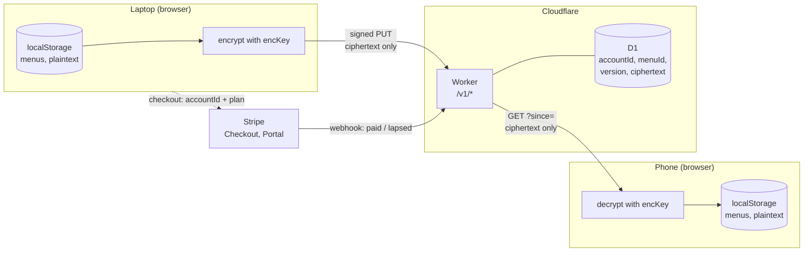
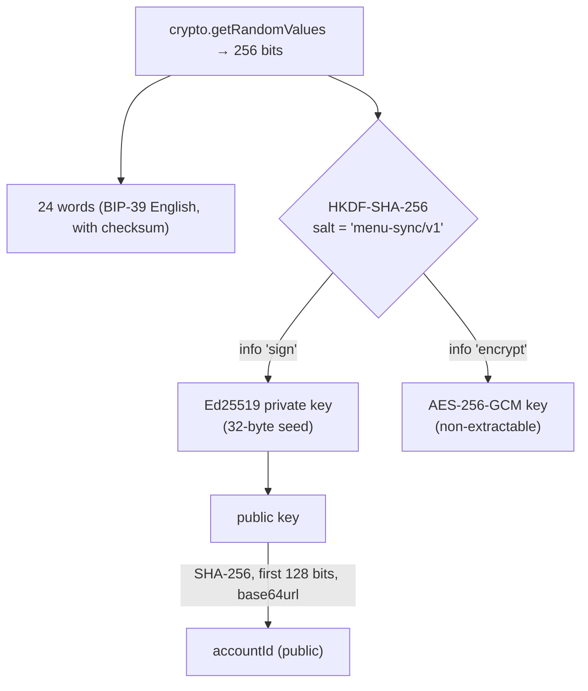
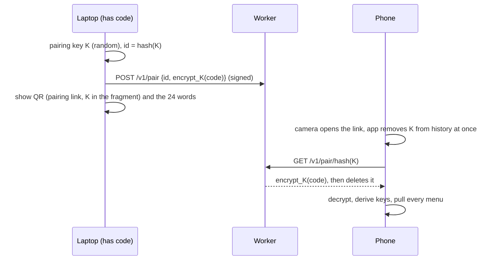
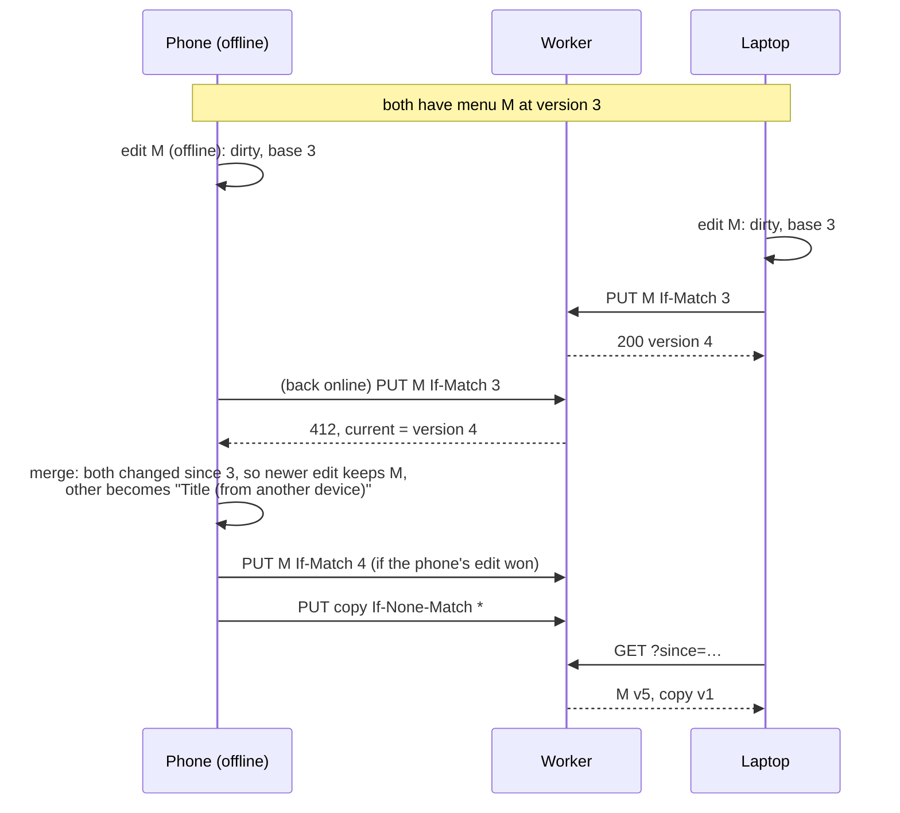
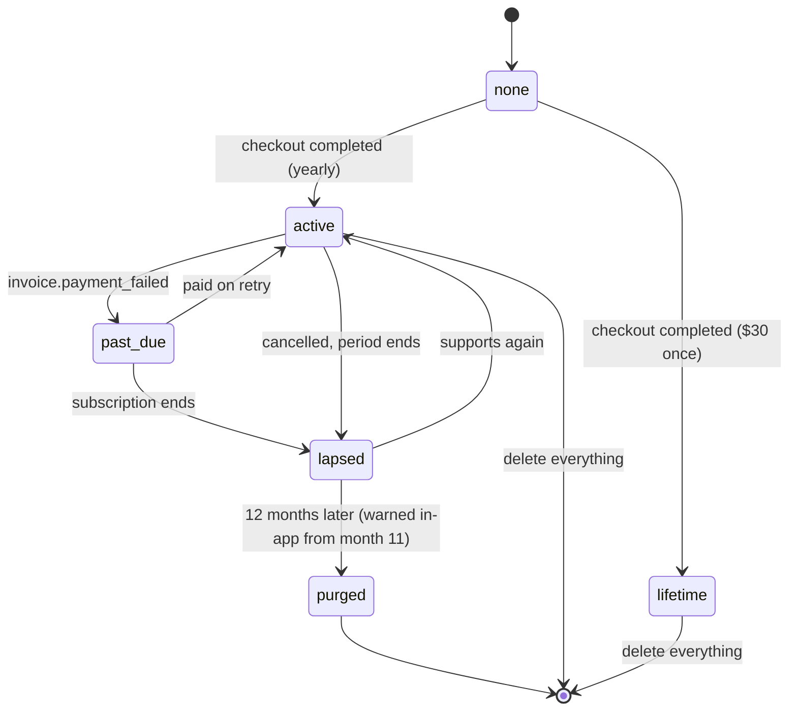
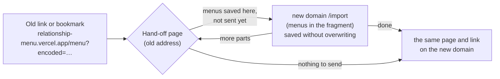

# Supporter sync: specification and plan

**Status: approved 25 November 2026, with the recommended answers to every decision in §18. Nothing is built yet.** Every "Checked by" entry below names the check we plan to write.

This covers the paid "Supporter" tier: encrypted sync across devices, encrypted backup and restore, and a small supporter heart. It follows the style of the [main spec](README.md). Every rule has an ID (`SY-…` for sync and payments, `HO-…` for hosting), and tests will name the rule they check. [§13](#13-changes-to-existing-rules) lists the existing rules this changes.

- **In one page:** [§1](#1-the-idea-in-one-page)
- **What I changed from the brief, and why:** [§0](#0-changes-from-the-brief)
- **Threat model:** [§10](#10-privacy-and-threat-model)
- **Hosting, domain and a new name:** [§12](#12-hosting-domain-and-name)
- **Costs:** [§14](#14-costs)
- **Sales tax and VAT:** [§15](#15-sales-tax-and-vat)
- **Decisions I need from you:** [§18](#18-decisions-needed)

---

## 0. Changes from the brief

The design is the one in the brief, with these changes. Each one either protects people better or fixes a gap the brief left open.

| # | Brief said | Proposal | Why |
| --- | --- | --- | --- |
| 1 | `authKey` signs requests with **HMAC** | Sign with an **Ed25519** key derived from the code. The account id is a hash of its public key. | To check an HMAC, the server has to store the HMAC key. A leaked database or backup would then let someone act as every supporter. With Ed25519 the server stores no credential at all. It checks that the public key hashes to the account id, then checks the signature. WebCrypto supports Ed25519 in Chrome 137+, Safari 17+ and Firefox 129+, and so do Workers. |
| 2 | HMAC with **replay protection** (usually a nonce table) | A 5-minute timestamp window, plus **conditional writes** | Every write carries the version it replaces (`If-Match`), so a replayed write always fails the version check. A replayed read only returns ciphertext. So the server needs no nonce table and no extra database writes. |
| 3 | The **QR code** holds the sync code | The QR code holds a **one-time pairing link**. It expires after 10 minutes or its first use. | A phone camera opens a QR code as a link. If the link held the sync code, the code would stay in the browser's history, which Chrome or iCloud may sync, and which anyone holding the phone can scroll through. For this app, "someone else holding your phone" is a real threat. A one-time link is useless after it has been used. The 24 words are still the permanent code. |
| 4 | (not covered) | **Replace sync code** (SY-8) | The threat model includes an ex-partner who once saw the code, and a stolen phone. Without a way to rotate the code, either one could read every future edit. |
| 5 | Six endpoints | Five more: `POST /v1/portal`, `POST /v1/pair`, `GET /v1/pair/:id`, `POST /v1/account/rotate`, `DELETE /v1/account`, plus `GET /v1/health` | Opening the Customer Portal needs a server-created session. Pairing needs the one-time link. Rotation needs a way to move the subscription. Deleting everything needs an endpoint so the privacy policy can say how. The health check is for a free uptime monitor. |
| 6 | Row: `account_id, menu_id, version, updated_at, deleted, ciphertext` | Adds `seq`, a per-account change counter that drives `since=` | Timestamps can repeat within a millisecond, so a pull could miss a write made in the same millisecond. A counter can't. |
| 7 | Quota "about 500 menus × 64 KB" (32 MB) | 500 menus, 64 KiB each, **4 MiB in total** per account | Browsers give the app about 5 MB of localStorage for everything, so a device can't hold more than that anyway. The cap also keeps the worst case well inside D1's 10 GB per-database limit. A typical menu is 1–3 KB. |
| 8 | Deletions are tombstones | Tombstones are **encrypted** like menus | If the server or an attacker could just set `deleted = 1`, they could wipe menus from every device. The server can't forge an encrypted tombstone. |
| 9 | Remove IPFS **after** sync works | Remove IPFS **before** the sync client PR, in its own PR | IPFS never synced anything between devices: menus already travel in links. Removing it first means the menu-id change only has to touch one storage backend. It also includes a migration that older IPFS menus need (SY-91). |
| 10 | Workers paid plan ($5/month) | Start on the **Workers Free plan** and switch to Paid at about 1,500 supporters | The free tier fits 100 and 1,000 supporters ([§14](#14-costs)), so this saves $60 a year until it no longer does. |
| 11 | App on Vercel; API on its own `workers.dev` address | **One Cloudflare Worker serves the app and the API on our own domain**, under a new name ([§12](#12-hosting-domain-and-name)) | Vercel Hobby doesn't allow commercial use, and Pro costs $20/month. Static files on Workers are free and unlimited, and commercial use is allowed. Serving the API from the same address removes CORS and its preflight requests. A domain we own means changing hosts never strands people's menus again. |
| 12 | (not covered) | Crypto labels and header names are **brand-neutral** (`menu-sync/v1`) and frozen | Changing a derivation label would lock everyone out of their synced menus. So the labels mustn't depend on the product's name, which is about to change. |

Three things turned out costlier or harder than the brief assumed. Per your ground rules, I'm flagging them rather than working around them:

1. **Vercel Hobby is for personal or non-commercial use only** ([Vercel terms, §4](https://vercel.com/legal/terms)). Selling a supporter plan from the site is very likely commercial use, and Pro costs $20/month. Moving hosts has its own cost: localStorage belongs to one origin, so everyone's saved menus would stay behind on `relationship-menu.vercel.app`. **Proposed fix:** move to Cloudflare on our own domain, with a one-time hand-off page left on the old address ([§12](#12-hosting-domain-and-name)).
2. **"Small-seller thresholds" don't help outside the US.** The EU and UK charge VAT on digital services sold by non-resident sellers from the **first sale**. So doing tax yourself means either US-only sales or eight VAT returns a year. See [§15](#15-sales-tax-and-vat).
3. **Some older menus exist only in IPFS's IndexedDB.** From July 2024 to March 2026, the IPFS backend stored only a date in localStorage. The menu itself was kept only in Helia's IndexedDB block store. Removing IPFS without migrating those menus would lose them. SY-91 covers this with plain IndexedDB reads, so it doesn't make IPFS removal much harder. I'm mentioning it because the brief assumed the `menu:*` entries hold everything.

---

## 1. The idea in one page

**In short:** the app stays local-first. A supporter's device encrypts each menu before it leaves the browser. A small Cloudflare Worker stores the encrypted blobs and tells devices what changed. A **sync code** (24 words) is the only key: it identifies the account, signs requests, and decrypts the menus. The server never has it.



What each party holds:

| | Sync code | Keys | Menu text | Ciphertext | Email, card |
| --- | --- | --- | --- | --- | --- |
| Your devices | ✔ | ✔ | ✔ | ✔ | |
| Worker + D1 | | public key only, not stored | | ✔ | |
| Stripe | | | | | ✔ |

### Glossary

| Term | Meaning |
| --- | --- |
| Sync code | 256 random bits, shown as 24 words. The only secret. |
| Account id | A public, random-looking name for the account (22 characters), derived from the code. It's the database key. |
| Supporter | An account with an active subscription or a lifetime payment. |
| Menu id | A random id that every menu now gets. It replaces the title as the storage key. |
| Version | The server's counter for one menu. It goes up by one on each accepted write. |
| Tombstone | An encrypted "this menu was deleted" record. |
| Dirty | A menu changed on this device since its last successful push. |

---

## 2. Sync code and keys

**In short:** one random secret, three derived values, nothing stored on the server that would let anyone act as you.



| ID | Rule | Checked by |
| --- | --- | --- |
| SY-1 | Turning on sync on a first device creates a sync code: 256 bits from `crypto.getRandomValues`, shown as 24 words from the BIP-39 English list. The last word carries a checksum. The word list loads only on the sync screens, so it adds nothing to the main download. | Test (crypto KAT) |
| SY-2 | Keys come from the code through HKDF-SHA-256, with a fixed salt and one `info` label per key: an Ed25519 signing key and an AES-256-GCM key. `accountId` is the first 128 bits of SHA-256 over the public key, in base64url. The code, the private key and the encryption key never leave the device. | Test (KAT with fixed vectors; a changed derivation would lock people out, so the vectors are frozen) |
| SY-3 | "Show my sync code" in sync settings shows the words again. They're hidden until asked for, and hidden again on leaving the page. | Test |
| SY-4 | Before the code is first shown, and again in settings, the app says plainly: *"These 24 words are the only key to your synced menus. We can't see them and can't recover them. If you lose every device and these words, your synced menus are gone. Keep them in a password manager or on paper."* | Test |
| SY-5 | Typing the code ignores case and extra spaces and autocompletes from the first four letters. A code with a bad checksum gets "One of the words is wrong," without saying which. | Property (round trip, typo detection) |
| SY-6 | **Signed requests.** Every API call, except the webhook, health and pairing reads, carries `Authorization: MenuSync v1 account=…, key=…, ts=…, sig=…`. The signature is Ed25519 over `"menu-sync/v1", method, path with query, ts, base64url(SHA-256(body))`, one per line. The server accepts `ts` within ±5 minutes of its clock, requires SHA-256(key) to match the account id, and stores no credential. | Test (server: bad signature, wrong key for account, clock skew, body swapped) |
| SY-7 | **Replay.** Every write is conditional on the current version (SY-42), so replaying a write fails with 412. Replaying a read only returns ciphertext. There is no nonce table. | Test (server: replayed PUT and DELETE) |
| SY-8 | **Replace sync code.** This device makes a new code, uploads every menu under the new account, and calls `/v1/account/rotate`, signed by the old key, with a proof signed by the new key. The server then moves the supporter status (and the Stripe subscription's `account_id` metadata) to the new account and deletes the old account's data. Other devices then show "Your sync code was replaced on another device. Enter the new code to keep syncing." Their local menus are untouched. | Test (server + e2e) |
| SY-9 | **Turn off sync on this device** removes the code and sync state from this device only. Its menus stay on the device and on the server. | Test |

---

## 3. Adding a device and restoring



| ID | Rule | Checked by |
| --- | --- | --- |
| SY-10 | "Add a device" shows a QR code and the 24 words. The QR code is a link to `/pair#<key>`. The first device uploads the sync code encrypted with that random key, which exists only in the QR code. The server deletes the blob on its first read, or after 10 minutes. | Test (server + e2e) |
| SY-11 | Opening a pairing link removes the key from the address bar before anything else runs (history replace). The key is in the `#fragment`, so it is never sent to any server, and analytics only see the path (PR-2). | Test (e2e) |
| SY-12 | A used or expired pairing link says so and offers to type the words instead. A link that was "already used" adds: *"If that wasn't you, replace your sync code."* | Test |
| SY-13 | **Restore / add by words.** Entering the code on a device pulls every menu. Menus already on that device are kept and uploaded, so turning on sync never drops a local menu. | Test (e2e: fresh device restore) |
| SY-14 | A browser without WebCrypto Ed25519 or AES-GCM can't turn on sync, and the Support page says so **before** checkout. Everything else works. | Test |

---

## 4. Encryption

| ID | Rule | Checked by |
| --- | --- | --- |
| SY-15 | Each record is encrypted with AES-256-GCM. Every write gets a fresh random 96-bit nonce, stored in front of the ciphertext. The additional data is `"menu-sync/v1" ‖ accountId ‖ menuId ‖ version ‖ deleted`. So the server can't move a record to another menu, present an old record as a newer version, or flip the deleted flag without decryption failing. | Test (tamper: every byte flip, wrong menuId, wrong version, wrong flag → rejected) |
| SY-16 | The plaintext is the whole menu document (title, encoded menu, person, created and updated times), plus the menu id, an edit id and a format version. It's padded to a multiple of 1 KiB, so the size doesn't give away how many items a menu has. | Test (ciphertext contains no plaintext, in raw or base64 form; sizes are multiples of 1 KiB plus overhead) |
| SY-17 | A record that fails to decrypt is skipped and counted, and sync settings show "Some synced data couldn't be read." It never replaces or deletes a local menu. | Property |
| SY-18 | A device never accepts a lower version of a menu than one it has already seen (rollback protection). | Property |
| SY-19 | A deletion only counts if it is an encrypted tombstone (SY-15 with `deleted = 1`). A bare "deleted" flag from the server never removes a local menu. | Property |

---

## 5. Menu ids and stored data

**In short:** menus are keyed by a random id, not by their title. That's what lets two devices rename the same menu without creating two menus or overwriting a third.

| ID | Rule | Checked by |
| --- | --- | --- |
| SY-20 | Every menu has a random 128-bit id. It is assigned on the menu's first save, or the first time this version of the app loads an older menu. Ids never appear in links, like item ids (DM-3). | Property (links never contain ids) |
| SY-21 | Browser storage keeps one entry per menu id. Renaming keeps the id: it's an ordinary save. Nothing is deleted on rename (replaces the second half of SV-5). | Test |
| SY-22 | **Server row:** `account_id, menu_id, version, seq, updated_at, deleted, ciphertext`. The nonce is the ciphertext's first 12 bytes, and the ciphertext is at most 64 KiB. Titles exist only inside the ciphertext. `seq` is the account's change counter at the time of the write. | Test (server schema) |
| SY-23 | **Quotas per account:** 500 live menus, 64 KiB per menu, 4 MiB in total. Tombstones don't count toward these, and the server forgets them after 180 days. Over quota gets HTTP 507, and the app says "Sync storage is full. Your menus are still saved on this device." | Test (server) |
| SY-24 | Each menu in browser storage has a **local revision** that goes up on every change, local or synced. A save says which revision it started from. A save that started from an older revision than the stored one is a conflict (SY-35), never an overwrite. | Property |

Local sync state, per device, in localStorage:

```
sync:code         the 24 words' bits (needed for "show my sync code")
sync:device       random device id (for tie-breaks)
sync:cursor       highest seq pulled
sync:menu:<id>    { baseVersion, seenVersion, dirty, editId, revision }
sync:status       last known supporter status (so the heart doesn't flicker)
```

---

## 6. Syncing and conflicts

**In short:** saving is unchanged and always local first. A background queue pushes changes, and pulls bring other devices' changes. When two devices changed the same menu, both versions are kept.



### The merge, case by case

When a pull brings a remote record newer than what this device has seen:

| This device has | Remote record | Result |
| --- | --- | --- |
| nothing | live | add it, clean |
| nothing | tombstone | nothing; remember the version |
| clean copy | live | take the remote (fast-forward) |
| clean copy | tombstone | delete locally |
| dirty, same edit id as remote | live | our own write whose reply was lost: mark clean |
| dirty | live, different edit | **conflict:** the newer edit time keeps the menu id; the other becomes a new menu "Title (from another device)". Both are pushed. |
| dirty | tombstone | **edit beats delete:** keep the local menu and push it over the tombstone |
| deleted here (not yet pushed) | live, changed elsewhere | **edit beats delete:** take the remote |
| deleted here | tombstone | done |

| ID | Rule | Checked by |
| --- | --- | --- |
| SY-30 | **Local first.** A save writes to browser storage first (SV-10, unchanged). Sync never blocks, slows or fails a save. | Test (unit + e2e offline) |
| SY-31 | **Push.** Changed menus are sent about 2 s after the last save, one request at a time, and retried with backoff (1 s up to 5 min) while offline. When the page is hidden, the queue is flushed with `fetch(…, {keepalive: true})`. Its 64 KB limit is why one menu is capped at 64 KiB. | Property (queue) + Test |
| SY-32 | **Pull.** Pulls happen on load, when the tab becomes visible, every 5 minutes while it's visible, and after a rejected push. Each pull asks only for changes since the last one (`since=<seq>`), 100 rows per page. | Test |
| SY-33 | A synced change to a menu open in the editor with no unsaved edits replaces it in place, with a quiet "Updated on another device." If the editor has unsaved edits, SY-35 applies when they're saved. | Test (e2e) |
| SY-34 | **Fast-forward.** A menu that hasn't changed here since its last sync takes the newer synced version. | Property |
| SY-35 | **Conflict.** If a menu changed on this device and on another since they last synced, the newer edit (by its edit time, then device id) keeps the menu. The other is kept as a new menu titled "Title (from another device)", or "… (2)" and so on if that title is taken, using the copy logic already in `App.tsx`. Nothing is overwritten unseen. | Proof (TLC) + Property |
| SY-36 | **Edit beats delete.** If one device deleted a menu that another changed without seeing the deletion, the change is kept and the menu comes back. A deletion only applies to the version the deleting device had. | Proof (TLC) + Property |
| SY-37 | A write the server accepted, but whose reply was lost, is recognised by its edit id and isn't turned into a conflict copy. | Proof (TLC) + Property |
| SY-38 | **Convergence.** Once edits stop and every device is online and has pulled, every device holds the same menus as the server. | Proof (TLC) + Property (2-device simulation) |
| SY-39 | **No silent loss.** Every edit ends up in some menu on every device, unless a later edit or a deletion was made by a device that had already seen it. | Proof (TLC) + Property (2-device simulation) |

---

## 7. Server API

**In short:** one Worker, one D1 database per environment (`test`, `production`), plain TypeScript, no framework, and no Stripe SDK. It needs only four Stripe API calls, made with `fetch`.

| Method and path | Auth | What it does |
| --- | --- | --- |
| `GET /v1/account` | signed | `{ status, plan, renewsAt?, readOnly, purgeAt?, limits, usage }` |
| `GET /v1/menus?since=<seq>` | signed | Changed rows since `seq`, 100 per page, `{ menus, next, more }` |
| `PUT /v1/menus/:id` | signed | Body: the ciphertext (`application/octet-stream`). `If-Match: "<version>"`, or `If-None-Match: *` for a new menu. → `200 { version, seq }` · `412 { current }` · `402` not a supporter or read-only · `413` too big · `507` over quota |
| `DELETE /v1/menus/:id` | signed | Body: the encrypted tombstone. `If-Match` required. |
| `POST /v1/checkout` | signed | `{ plan }` → `{ url }` of a Stripe Checkout Session |
| `POST /v1/portal` | signed | → `{ url }` of a Stripe Customer Portal session *(added)* |
| `POST /v1/stripe/webhook` | Stripe signature | The four events in SY-62 |
| `POST /v1/pair` | signed | Stores a pairing blob for 10 min *(added)* |
| `GET /v1/pair/:id` | none (rate-limited) | Returns the blob once, then deletes it *(added)* |
| `POST /v1/account/rotate` | signed by old key + proof from new key | SY-8 *(added)* |
| `DELETE /v1/account` | signed | SY-68 *(added)* |
| `GET /v1/health` | none | `ok`, for the uptime check *(added)* |

D1 tables:

```sql
accounts (account_id TEXT PRIMARY KEY, status TEXT, plan TEXT,
          stripe_customer_id TEXT, stripe_subscription_id TEXT,
          paid_through INTEGER, lapsed_at INTEGER, created_at INTEGER,
          seq INTEGER, menu_count INTEGER, bytes_used INTEGER)
menus    (account_id TEXT, menu_id TEXT, version INTEGER, seq INTEGER,
          updated_at INTEGER, deleted INTEGER, ciphertext BLOB,
          PRIMARY KEY (account_id, menu_id))      -- index on (account_id, seq)
stripe_events (event_id TEXT PRIMARY KEY, received_at INTEGER)
pairings (id TEXT PRIMARY KEY, blob BLOB, expires_at INTEGER)
```

| ID | Rule | Checked by |
| --- | --- | --- |
| SY-40 | The API is exactly the table above. Unknown paths get 404, and wrong methods get 405. | Test (server) |
| SY-41 | **Same origin, no CORS.** The API is served from the app's own address (HO-2) and sends no `Access-Control-Allow-*` headers. A page on another site can't read its responses, and can't forge a request (SY-6). No preflight requests are needed. | Test (server) |
| SY-42 | **Conditional writes.** A PUT or DELETE without `If-Match`, or `If-None-Match: *` for new menus, gets 428. A version mismatch gets 412 with the current row. The version check, counters and `seq` are updated in one D1 batch (one transaction). | Test (server) |
| SY-43 | **Rate limits** (Workers Rate Limiting binding, per location, approximate; its docs don't say whether the Free plan has it, so I'll confirm in Phase 2): 60 requests/min per account; checkout, portal and pairing writes 5/min per account; pairing reads 10/min per IP. Over the limit gets 429 with `Retry-After`, and the client backs off. | Test (server) |
| SY-44 | **No content in logs.** Never log request or response bodies, headers, IP addresses or account ids. Invocation logs are off, and the only log line is one per error: route pattern, status, error code. | Test (server: a test captures `console` and checks that marker bytes and ids never appear) + Review |
| SY-45 | Pairing blobs are at most 1 KiB, deleted on first read, and expire after 10 minutes. A daily cron deletes expired pairings, tombstones older than 180 days, webhook event ids older than 30 days, and purged accounts (SY-67). | Test (server, scheduled handler) |
| SY-46 | `GET /v1/health` returns `ok` without touching D1. A GitHub Actions schedule pings it every 30 min, and a failure emails the repo owner. That's a free uptime check with no new vendor. | Review |

---

## 8. Supporter status, payments, lapsing and deletion



| ID | Rule | Checked by |
| --- | --- | --- |
| SY-60 | **Plans:** $6, $12 or $24 a year, as three Stripe subscription prices, and $30 once (lifetime), as a one-time price. Prices are found by lookup key (`supporter_6_yearly`, …, `supporter_30_lifetime`), so test and live price ids are never hard-coded. | Test (server) |
| SY-61 | **Checkout.** The Support page asks the Worker for a Checkout Session for the chosen plan, and the browser goes to Stripe's page. `client_reference_id` and the session and subscription metadata carry only `account_id` and the plan id. Returning lands on `/support?checkout=done` or `=cancelled`. | Test (server) + e2e (Stripe test card) |
| SY-62 | **Status comes only from verified webhooks:** `checkout.session.completed`, `customer.subscription.updated`, `customer.subscription.deleted` and `invoice.payment_failed`. The `Stripe-Signature` header is checked (HMAC-SHA-256, 5-minute tolerance, constant-time compare). Each event id is handled once (`INSERT OR IGNORE`). Handlers re-read the subscription from Stripe and set the status from it, so events arriving out of order or twice can't leave the wrong state. | Test (server: Stripe fixture events, bad signature, duplicate, out of order) |
| SY-63 | The server stores only `account_id ↔ stripe_customer_id`, the subscription id, plan, status and dates. Stripe keeps the email, name and card. | Review + Test (schema) |
| SY-64 | **Manage subscription** opens the Stripe Customer Portal (cancel, change card, invoices). | Test (e2e, test mode) |
| SY-65 | **Payment failed** → `past_due`. Sync keeps working while Stripe retries. | Test (server) |
| SY-66 | **Lapsed means read-only.** Devices can still pull (restore), but pushes get 402. The app explains this, shows the purge date, and says that menus on this device aren't affected. | Test (server + e2e) |
| SY-67 | **Purge.** 12 months after lapsing, the daily cron deletes the account's synced menus and its account row. The app warns from 30 days before, in the app only (we have no email address). Lifetime supporters never lapse. | Test (server, fake clock) |
| SY-68 | **Delete everything.** "Delete my synced data" deletes every synced menu and the account immediately, cancels any subscription so there are no more charges, and turns off sync on this device. Local menus stay. | Test (server + e2e) |
| SY-69 | **Honest copy.** The Support page says what is live. It only says "Thank you, you're a supporter" once the server reports the status. Before that it says "Waiting for Stripe to confirm…". It never implies a feature was locked before. | Test |
| SY-70 | **Never gate.** Every existing feature stays free and works without an account. Sync, backup and the heart are the only supporter features. | Test (e2e: the whole existing suite runs with no account) |
| SY-71 | The supporter heart shows in the navbar on devices whose account is `active`, `past_due` or `lifetime`. | Test |

---

## 9. Analytics

New events follow [`src/analytics.ts`](../../src/analytics.ts): typed, with fixed values only.

| Event | When | Parameters |
| --- | --- | --- |
| `checkout_started` | Leaving for Stripe Checkout | `amount_usd` (6, 12, 24, 30), `plan` |
| `checkout_completed` | Back from Checkout and the server confirms the status | `amount_usd`, `plan` |
| `checkout_cancelled` | Back from Checkout via cancel | `amount_usd`, `plan` |
| `sync_enabled` | Sync turned on | `how`: `new` or `restored` |
| `device_paired` | A device joined through pairing | `method`: `qr` or `words` |

| ID | Rule | Checked by |
| --- | --- | --- |
| SY-75 | Sync and payment events never carry account ids, codes, words, menu ids, Stripe ids or URLs. `e2e/analytics.spec.ts` extends its marker check to cover a checkout (test mode), pairing and sync. | Test (e2e) + types |

---

## 10. Privacy and threat model

| ID | Rule | Checked by |
| --- | --- | --- |
| SY-80 | The server only ever receives ciphertext, ids, versions and sizes. It never receives titles, item or group text, answers, notes or names. | Test (e2e: intercept every request to the Worker and check no marker text appears) |
| SY-81 | The sync code never leaves the device, except encrypted under a pairing key the server never sees (SY-10). | Test |
| SY-82 | Stripe receives only `account_id` and the plan as metadata. The product is named "Wants & Won'ts supporter", and the card-statement descriptor is neutral (see [decision 5](#18-decisions-needed)). | Review |
| SY-83 | No third-party error reporting is added. Errors stay in the browser console and in the Worker's own error lines (SY-44). | Review |

### Who can learn what

| Who | Can learn | Can do | Can't |
| --- | --- | --- | --- |
| **Our server** (Worker + D1), or anyone who steals the database | That an account exists, whether it's a supporter, its Stripe customer id, how many menus it has, their sizes (rounded to 1 KiB), and when each was written and read | Delete or withhold the server copies; refuse service; give a fresh device an older version | Read any title, item, answer, note or name. Change a menu, forge a deletion or move a record undetected (SY-15, SY-19). Sign requests as you (it holds no credential, SY-6). Delete menus on your devices. |
| **Cloudflare** (runs the Worker and serves the app) | Everything above, plus IP addresses and rough location of devices when they sync, and request timing | As above. It could also serve modified app code: a compromised account or build could ship JavaScript that reads keys. That's true of every web app that encrypts in the browser. | As above |
| **Stripe** | Your email, name, card, billing country and postcode, the plan and amount, your IP at checkout, and the opaque account id | Bill, refund or cancel | See anything about menus, not even whether you have any |
| **Stripe + our database together** | That *this named person* has *N* encrypted menus of these sizes, written at these times | | Read them |
| **Google Analytics** | The events in [§9](#9-analytics) and [`docs/analytics.md`](../analytics.md): plan and amount, never ids | | Link analytics to an account |
| **Vercel** (the old address) | Visits to old links, as today | Serve a modified hand-off page. That page only ever handles menus already on that device. | See anything synced |
| **Someone with your unlocked device** | Everything on it. Menus are already stored unencrypted in browser storage, and sync doesn't change that. They can also open "show my sync code". | Read your synced menus and future edits from your other devices, **until you replace the code** (SY-8) from another device | |
| **Someone who saw your 24 words** | Everything synced, until you replace the code (SY-8) | Same | |
| **Someone who sees a used or expired pairing QR code** | Nothing (SY-10) | | |
| **Someone on the network** | That you use the sync service, and the timing and sizes of requests | | Read or replay writes (TLS, SY-6, SY-7) |
| **Anyone, if you lose every device and the words** | | | Recover your synced menus. Not us either. That's by design (SY-4). |

---

## 11. Moving off IPFS

| ID | Rule | Checked by |
| --- | --- | --- |
| SY-90 | Old `menu:<title>`, `menu:<CID>` and `menu:pending:<title>` entries keep being read (SV-9), and get an id on first load. The id-keyed entry is written **before** the old entry is removed. | Test |
| SY-91 | Menus saved by the IPFS backend between July 2024 and March 2026 may exist only in its IndexedDB store: localStorage held just a date under `menu:<CID>`. Before IPFS code is removed, the app reads the `helia-blocks` IndexedDB store directly (plain IndexedDB, JSON blocks, no IPFS libraries) and copies any menu it finds into browser storage. | Test (unit, with a fake IndexedDB holding real blocks written by today's Helia) |
| SY-92 | The old IPFS IndexedDB data is left in place, not deleted, until you decide otherwise. | Review |
| SY-93 | The `Storage` interface stays. The IPFS backend, `NetworkStatus` and the P2P e2e tests go, which removes about two thirds of the download. | Test (bundle-size check in CI) |

---

## 12. Hosting, domain and name

**In short:** one Cloudflare Worker serves the app and the sync API on a domain we own, `wantsandwonts.com`. The old `relationship-menu.vercel.app` address stays up as a small hand-off page. It brings each browser's saved menus over once, and sends every old link to the same place on the new domain. The name changes first, because the domain follows from it.



| ID | Rule | Checked by |
| --- | --- | --- |
| HO-1 | One Worker serves both the built app (static files) and `/v1/*` (the API). Static requests are free, unlimited, and don't count toward the Worker's request limit. Only `/v1/*` runs Worker code. Unknown paths serve the app (NV-1). | Test (e2e) |
| HO-2 | The app calls the API on its own address. The API sends no CORS headers: other sites can't read its responses, and can't forge requests because every one is signed (SY-6). Locally, the dev server proxies `/v1` to a local Worker. | Test (server) |
| HO-3 | **Every old link keeps working.** `relationship-menu.vercel.app/<path>?<query>#<fragment>` goes to the same path, query and fragment on the new domain. | Test (e2e, two origins) |
| HO-4 | **Hand-off.** Opening the old address in a browser that has menus saved there, including legacy and IPFS-only ones (SY-90, SY-91), sends any not yet sent to the new domain's `/import`. They travel in the URL fragment, in parts of at most 32 KB, and the browser then continues to the page it asked for. The fragment never reaches a server. | Test (e2e, two origins) |
| HO-5 | **Import never overwrites.** A menu identical to one already on the new domain is skipped. One whose title belongs to a different menu is added as a copy ("Title (2)", as in LK-6). The importer clears the fragment from the address bar before doing anything else. | Property + Test |
| HO-6 | The hand-off deletes nothing on the old address. It remembers a fingerprint of what it sent, and sends again only if something changed there, since an old tab left open can still save. | Test |
| HO-7 | Until something has been saved or imported on the new domain, its Library says: *"Used this app before at relationship-menu.vercel.app? Open that address once in this browser to bring your menus here."* | Test |
| HO-8 | The old address serves only the hand-off page: no app, no payments, no analytics. Its canonical link points to the new domain. | Review |
| HO-9 | Canonical and `og:url` tags, the sitemap, `robots.txt`, `llms.txt` and share links all use the new domain. The link reader accepts links on either address (LK-4). | Property (LK-4) + Review |
| HO-10 | GitHub Actions tests and builds every push, and deploys `main` to production. Each PR gets a Workers preview URL, using the test database and Stripe test mode. These replace Vercel's previews. | Review |

For about a second, the `/import` address holds the moved menus in browser history, until the importer clears it. Menu links already do this for each menu (LK-8). The hand-off doesn't add new information to history, but it gathers it into one entry.

### A new name

**Decided (25 November 2026): Wants & Won'ts**, at `wantsandwonts.com`, with the tagline "a relationship menu". `wantsandwonts.app` redirects to it. Below is how we got there.

**Why rename.** "Relationship menu" is the name of the genre. On 25 November 2026, at least four other products used it for the same thing:
- `relationshipmenu.org`: "Relationship Menu – Reflect on and Define Your Relationships";
- `relationship-menu.com`: "Relationship Menu", registered in September 2026;
- `relationshipmenu.com`: an app called Noescalator;
- an iPhone app called "Relationship Menu" ([App Store](https://apps.apple.com/app/id6746169721)).

A descriptive name can't be protected as a trademark, people searching for it land on the others, and a supporter paying "Relationship Menu" could think they paid someone else. We keep "a relationship menu" as the tagline, so searches still find us.

**What a good name needs:**
- It works for any relationship (partners, metamours, friends, family), so nothing couples-only.
- It's discreet on a card statement or a phone's home screen.
- It's short and easy to spell aloud.
- It says something true about the app: answering privately, then finding where you agree.
- A matching domain is free to register.

**Options.** The name is yours. Domains were checked on 25 November 2026 against the registries (RDAP). I searched for existing products with each name, not trademarks. Yearly prices: `.com` $11.17 and `.app` $14.20 at Cloudflare. Cloudflare doesn't sell `.menu`: it's about $27 at Porkbun, and short words may be priced as premium.

| Name | Why it fits | Free domains | Already used? |
| --- | --- | --- | --- |
| **Musts & Maybes** | Built from the app's own answer scale ("Must have" … "Maybe"). Warm, alliterative, and about possibility rather than rules. | `mustsandmaybes.com`, `.app` | Nothing found |
| **Our Menu** | The plainest possible name. "Our" fits any number of people. | None: the `.menu` registry has reserved `our.menu`, so it can't be bought, and `.com` and `.app` are taken | Generic phrase; many restaurant pages use it |
| **Same Page** | What comparing gives you: "getting on the same page." | `samepage.menu`, `samepagemenu.com` | A defunct "Samepage" collaboration tool; a "SameWave" couples app |
| **Say When** | When someone serves you, you "say when". It's boundaries and consent, in the menu's food language. | `saywhen.menu`, `saywhenmenu.com` | A Canadian alcohol-moderation app, "Saying When" |
| **Wants & Won'ts** | Says exactly what the lists hold. | `wantsandwonts.com`, `.app` | Sex educators use "want / will / won't" lists, so some people will read it as a sex app |
| **Unscripted** | Relationships without the default script, the core of relationship anarchy. | `unscripted.menu`, `unscriptedmenu.com` | A common word for media companies |
| **Made to Order** | A relationship built to your own order, like a menu. | `madetoorder.app`, `madetoorder.menu` | A common phrase in shops |
| Keep "Relationship Menu" | No change for current users. | `relationshipmenu.app` | Four other products (above) |

**US trademark search** (USPTO wordmark search, 25 November 2026; not legal clearance):
- **Wants & Won'ts:** no mark contains "won'ts". Marks with "wants" are unrelated: clothing, tea, videos.
- **Musts & Maybes:** nothing close. The nearest are "No Maybes" (T-shirts), "Musts of Trust" (education) and "The Someday Maybes" (a band).
- **Our Menu:** no "Our Menu" mark among the top results. The nearest, "…always on our menu", is a dead restaurant mark.

Registering a trademark is optional (USPTO fees start at about $350 per class), and a lawyer is worth it only if you do. A `.menu` domain would be registered at Porkbun or similar, with its DNS on Cloudflare's free plan so the Worker can use it.

**What the name touches**, all in the hosting PR:
- page titles and copy, `index.html` meta tags, `manifest.json`, the social image, `llms.txt` and the README;
- the Stripe product name, Checkout branding and statement descriptor;
- the privacy policy and terms.

The GitHub repository and package names are optional, and change only with your OK (GitHub redirects the old repository address). Storage keys and crypto labels never change (§0, row 12).

**Order:** name → domain → move → payments. The backend (PR 1) doesn't wait, because it doesn't contain the name.

---

## 13. Changes to existing rules

| Rule | Today | After |
| --- | --- | --- |
| DM-5 | The library holds at most one menu per title. | Menus are keyed by id (SY-20). Titles stay unique when *you* name a menu (SV-7 unchanged), but two menus created offline on two devices can share a title. The library shows both. |
| SV-5 | Rename: save under the new title, then remove the old one. | Rename is an ordinary save of the same id (SY-21). `Autosave.tla` drops its delete step. SV-1…SV-3 are re-checked. |
| SV-6 | One entry per title; most recent wins. | One entry per id. Legacy entries without an id still collapse by title, most recent wins (unchanged). |
| SV-9 | Menus saved before the IPFS node started are listed. | Plus SY-90 and SY-91. |
| SV-10 | Written to browser storage before the slower IPFS copy. | Written to browser storage before the sync push (SY-30). |
| PR-1 | No menu content leaves the browser except inside links the user copies. No server-side storage. | …except inside links the user copies, and, for supporters who turn on sync, **encrypted so only their own devices can read it** (SY-80). |
| NV-4 | Until checkout exists, choosing an amount says nothing was charged. | Choosing an amount goes to Stripe Checkout (SY-61). Copy follows SY-69. |
| NV-1 | The host (Vercel) falls back to the app for unknown paths. | The same, on the Worker (HO-1). |
| LK-4 | Accepted input includes a full link. | Links on the old and new addresses are both accepted (HO-9). |
| [README §12](README.md#12-architecture-notes) | IPFS is ~70% of the download. | IPFS is removed (SY-93). |

---

## 14. Costs

**Assumptions**, generous on purpose:
- Each supporter has 2 devices and makes about 1,000 API requests a month (~33 a day). Most are pulls: on open, on focus, and every 5 min while visible. The rest are pushes after edits.
- Each supporter writes about 900 D1 rows a month, stores about 50 KB (15 menus), and uses about 1.5 ms of CPU per request.
- The average payment is $12 a year, and 30% of cards are from outside the US.

Prices are from [Workers pricing](https://developers.cloudflare.com/workers/platform/pricing/), [Workers limits](https://developers.cloudflare.com/workers/platform/limits/), [D1 pricing](https://developers.cloudflare.com/d1/platform/pricing/) and [Stripe pricing](https://stripe.com/pricing) (November 2026).

### Infrastructure, per month

| | 100 supporters | 1,000 supporters | 10,000 supporters |
| --- | --- | --- | --- |
| Requests | 0.1 M (3.3k/day) | 1 M (33k/day) | 10 M (330k/day) |
| Workers plan | **$0**: Free plan, 100k requests/day | **$0**: Free plan, about a third of the daily limit | **$5**: Paid plan, includes 10 M requests and 30 M CPU-ms |
| Requests over the included amount ($0.30/M) | — | — | $0 (up to ~$6 if usage is 3× the estimate) |
| D1 rows written (Free: 100k/day; Paid: 50 M/month) | 0.09 M | 0.9 M | 9 M → $0 |
| D1 rows read (Free: 5 M/day; Paid: 25 B/month) | ~0.5 M | ~5 M | ~50 M → $0 |
| D1 storage (Free: 5 GB total, 500 MB per database; Paid: 5 GB included, then $0.75/GB) | 5 MB | 50 MB | 500 MB → $0 |
| Logs and analytics (built in) | $0 | $0 | $0 |
| Cron (daily purge) and the uptime check (GitHub Actions) | $0 | $0 | $0 |
| Hosting the app (static files on the Worker; commercial use allowed) | $0 | $0 | $0 |
| Domain ($11.17/year for `.com` or $14.20 for `.app` at Cloudflare; about $27 for `.menu` elsewhere) | ~$1–2 | ~$1–2 | ~$1–2 |
| **Total infrastructure** | **~$1** | **~$1** | **~$6 (up to ~$12)** |

Staying on Vercel would add $20/month for Pro.

- **Worst case for storage**, if everyone fills the 4 MiB quota: 0.4 GB, 4 GB and 40 GB. At 10,000 supporters that passes D1's 10 GB per-database cap, and we'd split accounts across two or more databases, at about $26/month in storage. Real menus are about 1% of the quota.
- **When to move to Paid:** when the Workers dashboard shows more than about 50k requests a day, or about 1,500 supporters. Once the Free plan's 100k daily limit is hit, only `/v1/*` returns errors. The app still loads (static files don't count) and saving still works, but sync pauses until midnight UTC.
- **Workers Logs** pricing moves to "Cloudflare Observability" pricing on 1 December 2026. We keep invocation logs off and write one line per error, so volume stays tiny.

### Payment fees, per month (dominant cost; a share of revenue)

At $12/year, monthly-equivalent revenue is $100, $1,000 and $10,000.

| Per $12 yearly payment | Fee |
| --- | --- |
| Card: 2.9% + 30¢ | $0.65 |
| Non-US cards (+1.5% × 30%) | $0.05 |
| Stripe Billing (0.7% of subscriptions; includes the Customer Portal) | $0.08 |
| **Standard total** | **$0.79 (6.6%)** |
| + Managed Payments (merchant of record), 3.5% | + $0.42 → $1.21 (10.1%) |
| + Stripe Tax Basic instead, 0.5%, only where you're registered | + $0.06 |

| | 100 | 1,000 | 10,000 |
| --- | --- | --- | --- |
| Stripe standard fees | $6.55 | $65.50 | $655 |
| + Managed Payments | + $3.50 | + $35 | + $350 |
| *or* + Stripe Tax Basic, where registered | ≤ $0.50 | ≤ $5 | ≤ $50 |

The $30 lifetime payment has no Billing fee: 2.9% + 30¢ = $1.17, plus $1.05 with Managed Payments. A $6 plan is hit hardest by the fixed 30¢: $0.52 (8.7%) standard, $0.73 (12.2%) with Managed Payments.

---

## 15. Sales tax and VAT

**What applies to us** (research, not tax advice; sources in the PR description):

- **US states.** At up to ~$150k a year, no state's dollar threshold is reached. A few states also count transactions (usually 200). With 10,000 mostly-US supporters, Ohio, New Jersey, Michigan and Virginia could pass 200, but none of them taxes SaaS sold to consumers. Connecticut does, but needs $100k **and** 200. **Your home state applies from the first sale**, and Washington, Pennsylvania, New York, Texas, Utah and Connecticut tax consumer SaaS. California and Colorado start taxing it in January 2027, but their thresholds are far away.
- **EU.** A non-EU seller of digital services owes VAT from the **first** EU sale; the €10,000 threshold is only for EU businesses. The fix is the non-Union OSS: one registration, one quarterly return for all 27 countries, nil returns required, 10 years of records, and two pieces of location evidence per customer.
- **UK.** Zero threshold for non-UK sellers: a full VAT registration with quarterly returns.
- **Elsewhere.** South Korea, India, Turkey and Saudi Arabia have no threshold. Norway (NOK 50k), Canada (C$30k), Australia (A$75k) and New Zealand (NZ$60k) are far away. Switzerland counts **worldwide** turnover (CHF 100k), so it could apply near 10,000 supporters.
- **"Pay what you want" doesn't change this.** Paying unlocks sync, so it's a sale of a service, at whatever amount the buyer picks.

### The three options

| | Stripe Managed Payments (merchant of record) | Stripe Tax + register yourself | Do it yourself, US only |
| --- | --- | --- | --- |
| Extra cost | 3.5% per payment ($3.50 / $35 / $350 a month at 100 / 1k / 10k) | 0.5% where registered. Tax Complete, which files for you, starts at $90/month. | $0 |
| Who registers, files, remits | Stripe, in 80+ countries | You: EU OSS + UK from day one (8 returns a year, including nil ones), your home state, more as thresholds pass | You: your home state only, if it taxes SaaS |
| Who can buy | Everyone except sanctioned countries | Everyone | US cards and addresses only |
| Disputes, fraud | Stripe handles | You | You |
| What buyers see | Receipts from Link; statement `LINK.COM* <descriptor>` | Your name | Your name |
| Integration change | One flag on the Checkout Session (`managed_payments[enabled]`) and a tax code per product. Checkout, the Portal and webhooks are the same. | `automatic_tax` on Checkout | Restrict countries in Checkout |
| Catches | Eligibility review; Stripe may refund within 60 days on its own; receipts aren't branded as us | Real paperwork, from the first foreign sale | Turns away every supporter outside the US |

**Recommendation: Stripe Managed Payments**, if your account passes its eligibility review. It's for US businesses selling software and electronically supplied services, which fits. Reasons:
- **The audience is international.** Relationship anarchy and polyamory communities are large in Europe. If even 10% of would-be supporters are outside the US, turning them away (US-only) loses more than the 3.5% costs.
- **You're one person.** At 100–1,000 supporters, the 3.5% is $3.50–$35 a month. Eight EU/UK returns a year would cost more than that in an accountant's time or your own, and you'd carry the liability.
- **It's reversible.** The integration is the same Stripe Checkout with one flag. If you pass ~5,000 supporters ($175+/month in fees), switching to Stripe Tax with your own registrations (or Tax Complete at $90/month) becomes cheaper, and nothing in the app changes.

Things to confirm in test mode during Phase 1, before relying on it:
- that `customer.subscription.*` and `invoice.payment_failed` webhooks still reach our endpoint;
- that the Customer Portal works for these subscriptions (Stripe's docs say it does, alongside Link's own management);
- what the statement descriptor looks like.

**Fallback:** if you're not eligible or don't want Link on receipts, sell US-only and register in your home state only if it taxes SaaS. Tell me your home state and I'll check.

---

## 16. Verification plan

| What | Rules | Where |
| --- | --- | --- |
| **TLA+ model `Sync.tla`** (new, beside `Autosave.tla`). Two devices, one server. Local edits and deletes; pushes that succeed, are rejected (412) or have their reply lost; pulls; offline periods. Each edit's content is the set of edit ids it has seen, so "lost" can be stated exactly. | SY-35…SY-39 | `docs/spec/formal/tla/Sync.tla`, run in `formal.yml` |
| Invariant `NoSilentLoss`: every edit made is in some live menu (on a device or the server), or in the history of a deletion or edit made by a device that had seen it. | SY-39 | ″ |
| Liveness `Converges`: `<>[]` all devices' live menus equal the server's and nothing is dirty, under fairness on network and pull, with bounded edits. | SY-38 | ″ |
| `Autosave.tla` updated: the save callback no longer deletes the old title. | SV-1…SV-3 | existing configs |
| **fast-check** `src/__props__/sync.props.test.ts` | | |
| merge is idempotent (the same pull twice = once); fast-forward; dirty content always survives (as the menu or a copy); tombstones and rollbacks without valid ciphertext are ignored | SY-17…SY-19, SY-34…SY-37 | real `sync-merge.ts` |
| two simulated devices + an in-memory server, random interleavings (like `autosave.props`): converge, nothing lost | SY-38, SY-39 | real merge + push queue |
| Crypto unit tests: HKDF RFC 5869 vectors through our wrapper; frozen derivation vectors; AES-GCM tamper and AAD tests; "ciphertext contains no plaintext" | SY-1, SY-2, SY-15, SY-16 | `src/sync-crypto.test.ts` |
| Server: Vitest + `@cloudflare/vitest-pool-workers` (Miniflare, real D1): auth, If-Match, quotas, no CORS headers, rate limits, webhooks with Stripe fixture payloads, cron, no-content logging | SY-6…SY-8, SY-40…SY-46, SY-60…SY-68 | `server/test/` |
| Playwright: two contexts pair, edit, see, offline conflict → copy; Stripe test checkout (test card 4242…); lapsed → read-only; restore on a fresh context; analytics no-leak | SY-10…SY-13, SY-33, SY-35, SY-61, SY-66, SY-75, SY-80 | `e2e/sync.spec.ts`, `e2e/analytics.spec.ts` |
| Playwright with two origins (`localhost` and `127.0.0.1` are different origins): old links redirect, saved menus move, nothing is overwritten, a second visit sends only changes | HO-3…HO-7 | `e2e/handoff.spec.ts` |

---

## 17. Phases and pull requests

| Phase | What | PR |
| --- | --- | --- |
| 0 | This document | goes in with PR 1 |
| 1 | You pick the name and buy the domain in Cloudflare Registrar. You also create, while I guide you in the browser: two D1 databases (`menu-sync-test`, `menu-sync-prod`) and a Workers + D1 API token for GitHub Actions; in Stripe test mode, the product, 4 prices with lookup keys, the Customer Portal, the webhook endpoint and the Managed Payments eligibility check. Secrets go only into `wrangler secret` or GitHub Actions secrets. | — |
| 2 | `server/` (Worker, migrations, `wrangler.toml`, tests) + a GitHub Actions job that tests it, and deploys it from `main` to a `workers.dev` URL in test mode | **PR 1: backend** |
| 2½ | Menu ids + IPFS removal + SY-90/91 migration + `Autosave.tla` update | **PR 2: IPFS removal** (recommended order; [decision 4](#18-decisions-needed)) |
| 2¾ | The Worker serves the built app; GitHub Actions deploys and PR previews; the hand-off page and importer (HO-1…HO-10); the rename; the new domain everywhere. Attaching the domain is a DNS change, and switching what the Vercel project serves changes what the old address shows, so I'll ask before each. | **PR 3: hosting move and rename** |
| 3 | Crypto, sync code and pairing UI (QR library < 10 KB, lazy-loaded), sync storage, merge, `Sync.tla`, props, settings panel, heart, real Checkout on `/support`, analytics | **PR 4: client** |
| 4 | Playwright sync, checkout, lapse and restore tests, plus the full existing suite | in PR 4 |
| 5 | Privacy policy, terms and FAQ drafts, with the places that need a lawyer or your business details marked | PR 5: docs |
| 6 | Switch Stripe to live with you, then the launch checklist (what to watch, how to rotate keys) | — |

I'll ask before merging anything.

---

## 18. Decisions needed

1. **Approve the design**, including the changes in [§0](#0-changes-from-the-brief).
2. **Tax approach.** Recommended: **Stripe Managed Payments**. The alternatives are Stripe Tax with your own registrations, or US-only.
3. ✅ **Hosting, domain and name: decided 25 November 2026.**
   - Move to one Cloudflare Worker, with the hand-off page on the old address ([§12](#12-hosting-domain-and-name)).
   - The new name is **Wants & Won'ts**, at `wantsandwonts.com`. `wantsandwonts.app` redirects to it.
   - You buy both domains in Cloudflare Registrar: $19.37 the first year, then $25.37 a year.
4. **Order of PRs.** Recommended: backend → IPFS removal → hosting move and rename → sync client.
5. **Statement descriptor**, the text on a card statement that a partner or family member might see (at most 22 characters). The options are `WANTSANDWONTS`, or something more discreet like `WW APP`. Under Managed Payments it shows as `LINK.COM* <descriptor>`.
6. **Workers plan.** Recommended: start on Free and move to Paid ($5) near 1,500 supporters.
7. **Small things, defaults unless you say otherwise:**
   - prices are tax-inclusive ($12 means $12);
   - the conflict copy is called "Title (from another device)" as in the brief (it reads oddly on the device that made the copy; "Title (conflicting copy)" is the alternative);
   - Stripe's own customer emails (receipts, failed-payment notices) are switched on in Phase 1 only with your OK.

---

## 19. Setup log

What exists, and where. IDs here are not secrets: they go into `wrangler.toml`, or they identify dashboard objects. Secrets (API keys, webhook signing secrets, the Cloudflare API token) are never written here.

| When | What | Where |
| --- | --- | --- |
| 25 Nov 2026 | Domains `wantsandwonts.com` and `wantsandwonts.app` | Cloudflare Registrar (bought by you) |
| 25 Nov 2026 | Stripe account **Wants & Won'ts** (US), separate from your other accounts. Its sandbox is where all test-mode work happens. | Stripe |
| 25 Nov 2026 | Managed Payments chosen in setup. Default product category: SaaS, personal use (`txcd_10103000`). | Stripe sandbox → Settings → Tax |
| 25 Nov 2026 | Prices **include tax** ("Include tax in prices: Yes") | Stripe sandbox → Settings → Tax |
| 25 Nov 2026 | Products, each eligible for Managed Payments. **$6/yr** (`supporter_6_yearly`), **$12/yr**, the default (`supporter_12_yearly`), and **$24/yr** (`supporter_24_yearly`) are three separate products, because the Customer Portal can only switch between prices on different products. **$30 once** (`supporter_30_lifetime`) is a one-time price on the $12 product. | Stripe sandbox → Product catalog |
| 25 Nov 2026 | Customer Portal: change card, invoices, cancel at period end (with a reason survey), and switch between the three yearly products. Raising the amount applies now (prorated, invoiced at once); lowering it applies at renewal. | Stripe sandbox → Settings → Billing → Customer portal |
| 25 Nov 2026 | D1 `menu-sync-test`, id `f14f5608-e4a9-4272-b136-8a5c928de807` | Cloudflare → D1 |
| 25 Nov 2026 | D1 `menu-sync-prod`, id `be712c7e-c171-4e5b-b0cd-5a40096c0bed` | Cloudflare → D1 |
| *to do* | Cloudflare API token (Workers + D1 edit) → GitHub secret `CLOUDFLARE_API_TOKEN`, plus `CLOUDFLARE_ACCOUNT_ID` | You, when PR 1 is ready to deploy |
| *to do* | Stripe restricted key and webhook signing secret → `wrangler secret put` (test environment) | You, once the test Worker has a URL (end of Phase 2) |
| *to do* | Card-statement text (decision 5) | You, before going live |
